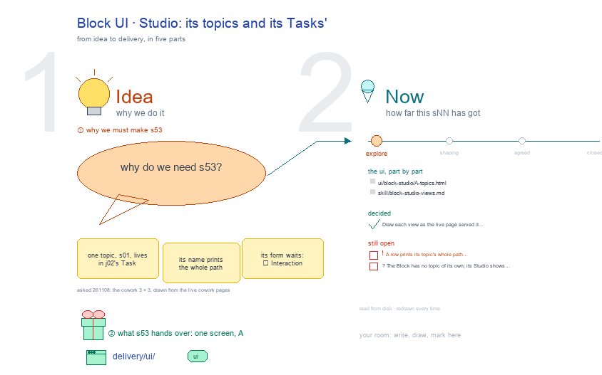

# s53 · Block UI: Studio <!-- root #7ac600 -->

**Tags:** `Block UI`
**Stage:** explore

- For <!-- @for #f78806 -->
  - a deck, and the Studio screen of … <!-- @for/0 #505997 -->
    a deck, and the Studio screen of the cowork Block (one topic coordinated with people) on the focus page (`delivery/ui/block-studio`), for the people who build the workbench
- Delivery type <!-- @delivery-type #58a44f -->
  - ui <!-- @delivery-type/0 #636117 -->
- Covers <!-- @covers #a6c44a -->
  - one view, Topics: the Block's own topics … <!-- @covers/0 #a7de96 -->
    one view, Topics: the Block's own topics and its Jobs' and Tasks', a flat row each (address, name, stage, kind, its line, its verbs, its picture).
- Excluded <!-- @excluded #980495 -->
  - the other eight cells of the 3 … <!-- @excluded/0 #d04f67 -->
    the other eight cells of the 3 × 3 (s51, s52, s54, s55, s56, s57, s58, s59); today's Block-level CoWork Spaces (s02); every Theme's shared frame (b10).
- Topic <!-- @topic #7e13bd -->
  - One cell of the cowork 3 × … <!-- @topic/0 #91661f -->
    One cell of the cowork 3 × 3, the cowork Block (one topic coordinated with people) × Studio (think), copied from the paper (b16 j01), work (b17 j03), labeling (b15 j01) and insight (b11 j01) themes' (asked 261108: the cowork Block's UI drawings, drawn from the live cowork pages).
  - Its drawing is haipipe-studio's five parts, drawn … <!-- @topic/1 #5a491e -->
    Its drawing is haipipe-studio's five parts, drawn by `build_s53_block_ui_studio.py` through j01's `cowork_ui_cells.py`; its Design is every view as the same full screen, lettered, settled one round each.
  - The example is the theme's own public … <!-- @topic/2 #af7a93 -->
    The example is the theme's own public example, `cowork/b01_example_data_request` (every role, date and number made up), as the live page served it on 261108.
- Feeds <!-- @feeds #ffe8e9 -->
  - `reports/` q01_cowork_ladder <!-- @feeds/0 #60eca9 -->
- Files <!-- @files #6ce6c5 -->
  - [py] [build_s53_block_ui_studio.py](build_s53_block_ui_studio.py) <!-- @files/0 #2aedf7 -->
  - delivery/ <!-- @files/1 #404761 -->
  - [excalidraw] [s53-block-ui-studio.excalidraw](s53-block-ui-studio.excalidraw) <!-- @files/2 #5c2eb0 -->
  - [md] [s53-block-ui-studio.md](s53-block-ui-studio.md) <!-- @files/3 #234b6e -->
  - [png] [s53-block-ui-studio.png](s53-block-ui-studio.png) <!-- @files/4 #8fc5bd -->
    
- Decided <!-- @decided #55615a -->
  - s53-D01 · Draw each view as the … <!-- @decided/0 #9226c2 -->
    s53-D01 · Draw each view as the live page served it on 261108: every section closed with its state word, a waiting line under a bar that waits on you, 🙋 Interaction last with the view's own forms; a step the page plainly lacks drawn red, a proposal (asked 261108).
- Open <!-- @open #cf9b77 -->
  - ❗ A row prints its topic's whole … <!-- @open/0 #1c496d -->
    ❗ A row prints its topic's whole path (`b01.j02.t01-s01:…data_use_plan @`). Proposal (red): the short form `b01-s01:example_data_request @ data_use_plan_rounds`, as b17 j03 asked of the base frame.
  - ? <!-- @open/1 #194c00 -->
    ? The Block has no topic of its own; its Studio shows only the Task's s01.
