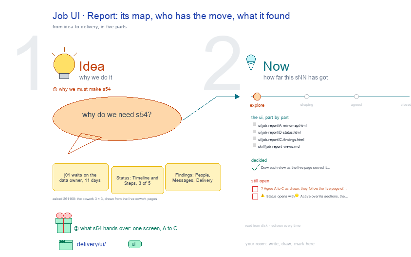

# s54 · Job UI: Report <!-- root #b2743c -->

**Tags:** `Job UI`
**Stage:** explore

- For <!-- @for #f78806 -->
  - a deck, and the Report screen of … <!-- @for/0 #23593a -->
    a deck, and the Report screen of a cowork Job (one line of work) on the focus page (`delivery/ui/job-report`), for the people who build the workbench
- Delivery type <!-- @delivery-type #58a44f -->
  - ui <!-- @delivery-type/0 #636117 -->
- Covers <!-- @covers #a6c44a -->
  - a line of work's map, then who … <!-- @covers/0 #2492e6 -->
    a line of work's map, then who has the move with its Timeline and Steps, then its People, Messages and Delivery: A MindMap · B Status · C Findings (j01 waits on them).
- Excluded <!-- @excluded #980495 -->
  - the other eight cells of the 3 … <!-- @excluded/0 #74b675 -->
    the other eight cells of the 3 × 3 (s51, s52, s53, s55, s56, s57, s58, s59); today's Block-level CoWork Spaces (s02); every Theme's shared frame (b10).
- Topic <!-- @topic #7e13bd -->
  - One cell of the cowork 3 × … <!-- @topic/0 #436d4c -->
    One cell of the cowork 3 × 3, a cowork Job (one line of work) × Report (check), copied from the paper (b16 j01), work (b17 j03), labeling (b15 j01) and insight (b11 j01) themes' (asked 261108: the cowork Block's UI drawings, drawn from the live cowork pages).
  - Its drawing is haipipe-studio's five parts, drawn … <!-- @topic/1 #4613d6 -->
    Its drawing is haipipe-studio's five parts, drawn by `build_s54_job_ui_report.py` through j01's `cowork_ui_cells.py`; its Design is every view as the same full screen, lettered, settled one round each.
  - The example is the theme's own public … <!-- @topic/2 #af7a93 -->
    The example is the theme's own public example, `cowork/b01_example_data_request` (every role, date and number made up), as the live page served it on 261108.
- Feeds <!-- @feeds #ffe8e9 -->
  - `reports/` q01_cowork_ladder <!-- @feeds/0 #60eca9 -->
- Files <!-- @files #6ce6c5 -->
  - [py] [build_s54_job_ui_report.py](build_s54_job_ui_report.py) <!-- @files/0 #672ece -->
  - delivery/ <!-- @files/1 #404761 -->
  - [excalidraw] [s54-job-ui-report.excalidraw](s54-job-ui-report.excalidraw) <!-- @files/2 #e7ffe5 -->
  - [md] [s54-job-ui-report.md](s54-job-ui-report.md) <!-- @files/3 #a04945 -->
  - [png] [s54-job-ui-report.png](s54-job-ui-report.png) <!-- @files/4 #7d58ae -->
    
- Decided <!-- @decided #55615a -->
  - s54-D01 · Draw each view as the … <!-- @decided/0 #62fe5a -->
    s54-D01 · Draw each view as the live page served it on 261108: every section closed with its state word, a waiting line under a bar that waits on you, 🙋 Interaction last with the view's own forms; a step the page plainly lacks drawn red, a proposal (asked 261108).
- Open <!-- @open #cf9b77 -->
  - ? <!-- @open/0 #f1e5e6 -->
    ? Agree A to C as drawn: they follow the live page of 261108.
  - ⚠️ Status opens with 🟡 Active over … <!-- @open/1 #d376fc -->
    ⚠️ Status opens with 🟡 Active over its sections, the only state line on a cowork view.
