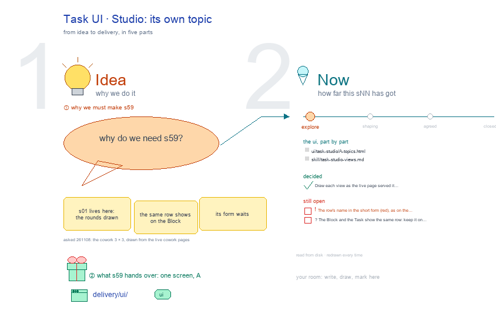

# s59 · Task UI: Studio <!-- root #9c8388 -->

**Tags:** `Task UI`
**Stage:** explore

- For <!-- @for #f78806 -->
  - a deck, and the Studio screen of … <!-- @for/0 #8824ad -->
    a deck, and the Studio screen of a cowork Task (one document written in rounds) on the focus page (`delivery/ui/task-studio`), for the people who build the workbench
- Delivery type <!-- @delivery-type #58a44f -->
  - ui <!-- @delivery-type/0 #636117 -->
- Covers <!-- @covers #a6c44a -->
  - one view, Topics: the Task's own topic, … <!-- @covers/0 #ce5932 -->
    one view, Topics: the Task's own topic, s01 (the rounds drawn), the same row the Block's Studio shows.
- Excluded <!-- @excluded #980495 -->
  - the other eight cells of the 3 … <!-- @excluded/0 #b708b2 -->
    the other eight cells of the 3 × 3 (s51, s52, s53, s54, s55, s56, s57, s58); today's Block-level CoWork Spaces (s02); every Theme's shared frame (b10).
- Topic <!-- @topic #7e13bd -->
  - One cell of the cowork 3 × … <!-- @topic/0 #b66fe6 -->
    One cell of the cowork 3 × 3, a cowork Task (one document written in rounds) × Studio (think), copied from the paper (b16 j01), work (b17 j03), labeling (b15 j01) and insight (b11 j01) themes' (asked 261108: the cowork Block's UI drawings, drawn from the live cowork pages).
  - Its drawing is haipipe-studio's five parts, drawn … <!-- @topic/1 #e5e2a2 -->
    Its drawing is haipipe-studio's five parts, drawn by `build_s59_task_ui_studio.py` through j01's `cowork_ui_cells.py`; its Design is every view as the same full screen, lettered, settled one round each.
  - The example is the theme's own public … <!-- @topic/2 #af7a93 -->
    The example is the theme's own public example, `cowork/b01_example_data_request` (every role, date and number made up), as the live page served it on 261108.
- Feeds <!-- @feeds #ffe8e9 -->
  - `reports/` q01_cowork_ladder <!-- @feeds/0 #60eca9 -->
- Files <!-- @files #6ce6c5 -->
  - [py] [build_s59_task_ui_studio.py](build_s59_task_ui_studio.py) <!-- @files/0 #4aa8b9 -->
  - delivery/ <!-- @files/1 #404761 -->
  - [excalidraw] [s59-task-ui-studio.excalidraw](s59-task-ui-studio.excalidraw) <!-- @files/2 #732586 -->
  - [md] [s59-task-ui-studio.md](s59-task-ui-studio.md) <!-- @files/3 #9797f7 -->
  - [png] [s59-task-ui-studio.png](s59-task-ui-studio.png) <!-- @files/4 #9176b9 -->
    
- Decided <!-- @decided #55615a -->
  - s59-D01 · Draw each view as the … <!-- @decided/0 #c2a77a -->
    s59-D01 · Draw each view as the live page served it on 261108: every section closed with its state word, a waiting line under a bar that waits on you, 🙋 Interaction last with the view's own forms; a step the page plainly lacks drawn red, a proposal (asked 261108).
- Open <!-- @open #cf9b77 -->
  - ❗ The row's name in the short … <!-- @open/0 #cd5332 -->
    ❗ The row's name in the short form (red), as on the Block's Studio (s53).
  - ? <!-- @open/1 #fa8042 -->
    ? The Block and the Task show the same row: keep it on both.
