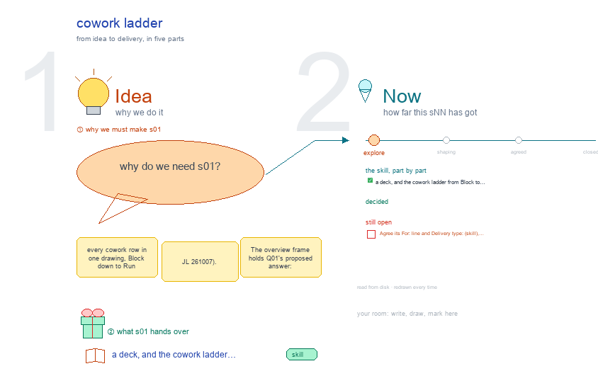

# s01 · cowork ladder <!-- root #efd753 -->

**Stage:** explore

- For <!-- @for #f78806 -->
  - a deck, and the cowork ladder from … <!-- @for/0 #299c44 -->
    a deck, and the cowork ladder from Block to Run, each level with its Spaces, for the people who write the toolkit skills
- Delivery type <!-- @delivery-type #58a44f -->
  - skill <!-- @delivery-type/0 #34b33e -->
- Topic <!-- @topic #7e13bd -->
  - every cowork row in one drawing, Block … <!-- @topic/0 #ff9df8 -->
    every cowork row in one drawing, Block down to Run (JL 261007).
  - The overview frame holds Q01's proposed answer: … <!-- @topic/1 #38edb3 -->
    The overview frame holds Q01's proposed answer: the ladder, why an email or a meeting is a row and not a Task, each level's six Spaces, where today's Check Views go, and the open points in red.
  - Below it are the Block and Job … <!-- @topic/2 #af066b -->
    Below it are the Block and Job rows.
  - Each row shows its folder, what it … <!-- @topic/3 #7df0e8 -->
    Each row shows its folder, what it holds, its skills and its screens, with the proposal (teal, solid) above today's workbench (gray, dashed).
  - There is no cowork Task row <!-- @topic/4 #30fe90 -->
- Source <!-- @source #6da13a -->
  - the rows are defined once in `../../b10_project_workbench/s01-overall-tree-structure/` … <!-- @source/0 #063396 -->
    the rows are defined once in `../../b10_project_workbench/s01-overall-tree-structure/` (`build_ladder_v4.py`, `level_views.py`).
  - This topic's own builder draws them under … <!-- @source/1 #39f8ba -->
    This topic's own builder draws them under its overview frame, as b12's s01-design does.
  - Edit the cowork rows there and this … <!-- @source/2 #b4b7ce -->
    Edit the cowork rows there and this drawing follows on its next build.
- Feeds <!-- @feeds #ffe8e9 -->
  - `../reports/` q01 (the ladder question) <!-- @feeds/0 #723053 -->
- Files <!-- @files #6ce6c5 -->
  - [py] [build_s01_cowork_ladder.py](build_s01_cowork_ladder.py) <!-- @files/0 #58207a -->
  - delivery/ <!-- @files/1 #404761 -->
  - [excalidraw] [s01-cowork-ladder.excalidraw](s01-cowork-ladder.excalidraw) <!-- @files/2 #d50094 -->
  - [md] [s01-cowork-ladder.md](s01-cowork-ladder.md) <!-- @files/3 #ebe5d6 -->
  - [png] [s01-cowork-ladder.png](s01-cowork-ladder.png) <!-- @files/4 #73a97e -->
    
- Decided so far <!-- @decided-so-far #f1f0e3 -->
  - (proposed 261007, waiting for JL <!-- @decided-so-far/0 #3f1ae1 -->
    (proposed 261007, waiting for JL; Q01)
  - A cowork topic climbs Block → Job … <!-- @decided-so-far/1 #8b4d76 -->
    A cowork topic climbs Block → Job → Run. An email, a meeting or a checklist step is a row of its
  - Job (Work Details › Timeline · Checklist … <!-- @decided-so-far/2 #75fff8 -->
    Job (Work Details › Timeline · Checklist · Emails · Meetings), not a Task.
  - A Task appears only when a Job … <!-- @decided-so-far/3 #455d2b -->
    A Task appears only when a Job writes a document with others over several rounds. It is then a
  - Page Task (`tNN_<doc>/`), shown on the shared … <!-- @decided-so-far/4 #40d514 -->
    Page Task (`tNN_<doc>/`), shown on the shared Task tab.
  - The Job tab gets the Block's six … <!-- @decided-so-far/5 #3b9b45 -->
    The Job tab gets the Block's six Spaces: Description (the job page; Job · Files) · Idea Studio
  - (optional) · Audience Report (optional: the Block's … <!-- @decided-so-far/6 #d6ce78 -->
    (optional) · Audience Report (optional: the Block's Questions that cite this Job) | Work Details | Runs (soft: email · notes · update · check) · Delivery (optional).
  - Cowork has no hard Runs <!-- @decided-so-far/7 #23c48d -->
    Cowork has no hard Runs. Work that runs code is a work Task in another Block, cited.
- Open <!-- @open #cf9b77 -->
  - Agree its **For:** line and **Delivery type:** … <!-- @open/0 #09a2ba -->
    Agree its **For:** line and **Delivery type:** (skill), proposed by the agent 261030?
  - `j00_people/` → `people.md` at the Block? <!-- @open/1 #23c1e6 -->
    `j00_people/` → `people.md` at the Block? (changes real Blocks: JL)
  - A Job's `design/`: drawings → `studio/`, notes … <!-- @open/2 #8cb65e -->
    A Job's `design/`: drawings → `studio/`, notes → `materials/`? (changes real Jobs: JL)
  - Task ▾ greyed unless the open Job … <!-- @open/3 #cda624 -->
    Task ▾ greyed unless the open Job has a `tNN_<doc>/`?
  - `board.md` → `bNN_<topic>.md`, with every Theme <!-- @open/4 #077799 -->
  - Q02: waiting-on, drafts, stale <!-- @open/5 #feee11 -->
    Q02: waiting-on, drafts, stale. Q03: Delivery.
