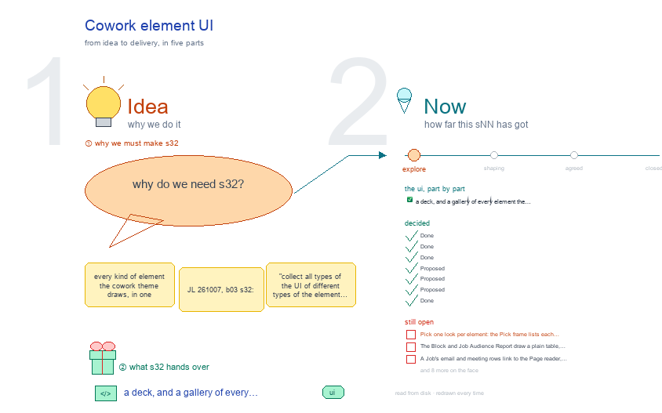

# s32 · Cowork element UI <!-- root #3111db -->

**Stage:** explore

- For <!-- @for #f78806 -->
  - a deck, and a gallery of every … <!-- @for/0 #a2eec5 -->
    a deck, and a gallery of every element the cowork theme draws, so the UI can be unified, for the people who build the workbench
- Delivery type <!-- @delivery-type #58a44f -->
  - ui <!-- @delivery-type/0 #636117 -->
- Topic <!-- @topic #7e13bd -->
  - every kind of element the cowork theme … <!-- @topic/0 #93a933 -->
    every kind of element the cowork theme draws, in one gallery, so the UI can be unified (JL 261007, b03 s32: "collect all types of the UI of different types of the element ... so we can unify them").
  - Each element is shown three ways: as … <!-- @topic/1 #a58354 -->
    Each element is shown three ways: as the cowork theme draws it today on the frame (`/_board/workbench` at its Block, Job and Task levels, every Space and view), as its old CoWork page draws it (`/_board/cowork-board`, flagged OLD in a red dashed box), and as b03's s11 (Block) and s12 (Job) cowork rows plan it.
  - Beside each element, a "· proposed" frame: … <!-- @topic/2 #888931 -->
    Beside each element, a "· proposed" frame: one look, b03's picks kept, with why, a green line for what changed and a red line for what is open.
  - It is b03's `s32-element-ui` cut to one … <!-- @topic/3 #bd5ee0 -->
    It is b03's `s32-element-ui` cut to one theme, and it adds the four elements only cowork has.
- Feeds <!-- @feeds #ffe8e9 -->
  - `../reports/` q01_cowork_ladder · q02_waiting_and_drafts · q03_cowork_delivery · … <!-- @feeds/0 #1b2dff -->
    `../reports/` q01_cowork_ladder · q02_waiting_and_drafts · q03_cowork_delivery · and b03's s32 (its Theme elements list, read from the heading below).
- Files <!-- @files #6ce6c5 -->
  - [py] [build_s32_cowork_element_ui.py](build_s32_cowork_element_ui.py) <!-- @files/0 #6c55cf -->
  - [py] [cowork_fixture.py](cowork_fixture.py) <!-- @files/1 #a44855 -->
  - delivery/ <!-- @files/2 #404761 -->
  - [excalidraw] [s32-cowork-element-ui.excalidraw](s32-cowork-element-ui.excalidraw) <!-- @files/3 #6ca44a -->
  - [md] [s32-cowork-element-ui.md](s32-cowork-element-ui.md) <!-- @files/4 #eabdd1 -->
  - [png] [s32-cowork-element-ui.png](s32-cowork-element-ui.png) <!-- @files/5 #819dd0 -->
    
  - shots/ <!-- @files/6 #4d5052 -->
- What the gallery holds <!-- @what-the-gallery-holds #69fd53 -->
  - The OLD page is the CoWork board … <!-- @what-the-gallery-holds/0 #244796 -->
    The OLD page is the CoWork board page (`/_board/cowork-board`: Scope · Work · Check · Delivery, its file and report pop-outs, its every-Project list). The cowork theme draws on the frame now (`servers/workbench-cowork/cowork_theme.py`), so it retires. There is no b13 s11 · s12 · s13 yet, so the planned screens are b03's s11-block-variants and s12-job-variants cowork rows; cowork has no s13 row (a Task is the shared Page Task, b13 Q01).
- Theme elements <!-- @theme-elements #bfa59f -->
  - element · level · Space › view … <!-- @theme-elements/0 #910858 -->
    element · level · Space › view · base or its own and why · drawn today, or GAP: …
  - top tabs · every level · the … <!-- @theme-elements/1 #f922a1 -->
    top tabs · every level · the level row and the six Spaces · base · drawn
  - Task ▾ greyed · Block, Job · … <!-- @theme-elements/2 #25eadc -->
    Task ▾ greyed · Block, Job · the level row · base (no tNN_<doc>/ in the Job) · drawn
  - view row · every level · every … <!-- @theme-elements/3 #16b749 -->
    view row · every level · every Space's views · base · drawn · GAP: casing (open · waiting · done)
  - Question rows · Block · Audience Report … <!-- @theme-elements/4 #bcd365 -->
    Question rows · Block · Audience Report · base (Insight's row) · GAP: a plain table, no question_cell()
  - Question rows · Job · Audience Report … <!-- @theme-elements/5 #0e1b60 -->
    Question rows · Job · Audience Report (Block Questions citing it) · base · GAP: a plain table
  - Space body · every level · every … <!-- @theme-elements/6 #7ccfcd -->
    Space body · every level · every Space · base · drawn
  - table · Block, Job · Scope, Resources, … <!-- @theme-elements/7 #ad1f54 -->
    table · Block, Job · Scope, Resources, Jobs, Runs, Done jobs; Job, Files, Checklist · base · drawn
  - rows · every level · Idea Studio … <!-- @theme-elements/8 #e380b6 -->
    rows · every level · Idea Studio · base (b03 s32-D06) · drawn
  - Disk · Runs panel · every level … <!-- @theme-elements/9 #b433a9 -->
    Disk · Runs panel · every level · every Space · base · drawn (the server's Run names, b03 261008)
  - tags · none · — · none … <!-- @theme-elements/10 #3c6824 -->
    tags · none · — · none (b03 s32-D09) · drawn: the frame has none
  - header · every level · the top … <!-- @theme-elements/11 #717db8 -->
    header · every level · the top line · base · drawn
  - one item · Job · Work Details … <!-- @theme-elements/12 #18aa32 -->
    one item · Job · Work Details › Emails · Meetings · Timeline · base pop-out · GAP: link leaves, 404
  - Job state · Block, Job · Work … <!-- @theme-elements/13 #baa0e0 -->
    Job state · Block, Job · Work Details › All · open · waiting · done; Description › Job · own: the header is cowork's only state · drawn
  - Timeline · Job · Work Details › … <!-- @theme-elements/14 #a08614 -->
    Timeline · Job · Work Details › Timeline · own: every dated thing, newest first · drawn
  - Checklist · Emails · Meetings · Job … <!-- @theme-elements/15 #d87a15 -->
    Checklist · Emails · Meetings · Job · Work Details · base table, cowork's words · drawn
  - People · Block · Description › People … <!-- @theme-elements/16 #ff917b -->
    People · Block · Description › People · own: who to ask, role, who we wait on · GAP: a <pre>, not rows
  - Resources · Related · Files · Block, … <!-- @theme-elements/17 #62dc8a -->
    Resources · Related · Files · Block, Job · Description · base table · drawn
  - Done jobs · Block · Delivery › … <!-- @theme-elements/18 #3708f7 -->
    Done jobs · Block · Delivery › Done jobs · base table · drawn
  - Job Delivery · Job · Delivery · … <!-- @theme-elements/19 #34f4e4 -->
    Job Delivery · Job · Delivery · base · GAP: vanilla, nothing cowork (Q03)
  - Page Task · Task · every Space … <!-- @theme-elements/20 #64e72c -->
    Page Task · Task · every Space · base Page Task views · GAP: the vanilla Task is drawn
  - old CoWork page · old · /_board/cowork-board … <!-- @theme-elements/21 #ff9de5 -->
    old CoWork page · old · /_board/cowork-board · retires · old page
- Buttons with no Run name <!-- @buttons-with-no-run-name #84dd2d -->
  - Every button the frame draws for cowork … <!-- @buttons-with-no-run-name/0 #545e65 -->
    Every button the frame draws for cowork carries a Run name (`cowork_theme.RUN_NAMES` and the base's own). These have none yet:
  - The old page's 14 run types (Update … <!-- @buttons-with-no-run-name/1 #4c78df -->
    The old page's 14 run types (Update the Block status, Add a person, Add a resource, Draw, Open a job, Update a job, Ask a Question, Review the questions, Write the report, Draft an email, Write meeting notes, Draft a follow-up, Review a draft, Check a report) show bare words; each but Draft a follow-up already has a name on the frame, which is its proposal (the drawing lists them).
  - Named differently by the server and b03's … <!-- @buttons-with-no-run-name/2 #a55a32 -->
    Named differently by the server and b03's s12; decided (b03, 261008): the server's names win, and b03's s12 cowork Runs rows now read them (s12 rebuilt):
- Decided <!-- @decided #55615a -->
  - s32-D01 · Done (261008): b03's picks hold … <!-- @decided/0 #6a7555 -->
    s32-D01 · Done (261008): b03's picks hold for the cowork theme: top tabs in the D · E look, the view row in the E look, the Question cell as the Insight row, Disk inside the Runs panel, no tags (b03 s32-D01, D02, D05, D08, D09). The cowork theme gives the words and the rows of its own elements only.
  - s32-D02 · Done (261008): the ladder levels … <!-- @decided/1 #9e7895 -->
    s32-D02 · Done (261008): the ladder levels and the old page are shot live from a placeholder Block on a second host (`cowork_fixture.py`), until a Project holds a cowork Block; the old page is flagged OLD, read off the code (`old_reason`: `cowork_theme.py` exists).
  - s32-D03 · Done (261008): each element also … <!-- @decided/2 #d7de34 -->
    s32-D03 · Done (261008): each element also shows its planned screen, drawn by b03's shared cowork rows (s11 Block, s12 Job), so the gallery follows them on every rebuild.
  - s32-D04 · Proposed (261008): four elements are … <!-- @decided/3 #bb510e -->
    s32-D04 · Proposed (261008): four elements are cowork's own (11 – 14): the Job's state fields, the Timeline, People, and today's Check split into Work Details › waiting, open run-email Runs and Delivery › Done jobs (b13 Q01). Each is built on the base's table and row; only People needs rows.
  - s32-D05 · Proposed (261008): an email, a … <!-- @decided/4 #bffd6e -->
    s32-D05 · Proposed (261008): an email, a meeting or a step opens in the frame's pop-out from its row (`pop()`, not `link()`); a document written in rounds opens as the Page Task.
  - s32-D06 · Proposed (261008): the Block and … <!-- @decided/5 #77d3e9 -->
    s32-D06 · Proposed (261008): the Block and Job Audience Report take the base's Question row and `question_cell()` (b03 s32-D05), as the frame draws it on b13 itself (frame 3 · proposed).
  - s32-D07 · Done (261008, b03's ruling): where … <!-- @decided/6 #b6c4dc -->
    s32-D07 · Done (261008, b03's ruling): where the server's Run names and b03's s12 plan differ, the server's win (run-email-<slug>, run-meeting-<slug>, run-face-<jNN>, run-review-email-<slug>); b03's s12 cowork Runs rows now read them. Draft a follow-up takes run-email-<slug>.
- Open <!-- @open #cf9b77 -->
  - Pick one look per element: the Pick … <!-- @open/0 #5de0c6 -->
    Pick one look per element: the Pick frame lists each one, b03's picks in green, the rest in red.
  - The Block and Job Audience Report draw … <!-- @open/1 #006f00 -->
    The Block and Job Audience Report draw a plain table, not the base's row and `question_cell()`
  - (`cowork_theme._question_rows`) <!-- @open/2 #aa7c77 -->
  - A Job's email and meeting rows link … <!-- @open/3 #e8073c -->
    A Job's email and meeting rows link to the Page reader, which answers 404 "Not a Page" (an email is
  - not a Page Face) and leaves the … <!-- @open/4 #8c97b3 -->
    not a Page Face) and leaves the frame. The report link works (200) but leaves the frame too.
  - The cowork Task (`t01_protocol/`) draws the vanilla … <!-- @open/5 #166f74 -->
    The cowork Task (`t01_protocol/`) draws the vanilla Task (Face · Folder | Folders · Evidence · Value
  - | run-<type>-<target>), not the base's Page Task … <!-- @open/6 #9b1dcc -->
    | run-<type>-<target>), not the base's Page Task views (`draft_task_spaces`), which Q01 names.
  - Run names: `run-review-questions` has no target, and … <!-- @open/7 #24f8cc -->
    Run names: `run-review-questions` has no target, and Draft a follow-up, the planned Close the Job and
  - the drawing and form buttons have no … <!-- @open/8 #daef8b -->
    the drawing and form buttons have no Run (the table above).
  - People shows `j00_people.md` as written; s11 plans … <!-- @open/9 #bf1899 -->
    People shows `j00_people.md` as written; s11 plans person · role · waiting on · since rows. Whether
  - `j00_people/` becomes `people.md` is JL's call (Q01 … <!-- @open/10 #127890 -->
    `j00_people/` becomes `people.md` is JL's call (Q01 Next 1).
  - One casing in the view row (open … <!-- @open/11 #c71799 -->
    One casing in the view row (open · waiting · done, delivery/).
  - Job › Delivery is the vanilla one … <!-- @open/12 #2f1397 -->
    Job › Delivery is the vanilla one (Q03); no stale state on a Job row (Q02).
  - One icon: the old page is 📨, … <!-- @open/13 #44beb7 -->
    One icon: the old page is 📨, the frame 🤝. The Job and Task selects read folder names.
  - s11 plans "waiting on <person> · 3 … <!-- @open/14 #cf0fe6 -->
    s11 plans "waiting on <person> · 3 days" as one line; the frame has waiting-on and since as two
  - fields, and Timeline rows carry no state … <!-- @open/15 #537c4c -->
    fields, and Timeline rows carry no state except draft ✎ (s12 plans one per row).
  - Agree its **For:** line and **Delivery type:** … <!-- @open/16 #7b11a4 -->
    Agree its **For:** line and **Delivery type:** (ui), proposed by the agent 261030?
  - None of these is changed here. b03 … <!-- @open/17 #bc24fe -->
    None of these is changed here. b03 placed 2, 3, 4, 5 and 6 in `servers/workbench-cowork/cowork_theme.py` (question_cell() rows, pop() for email and meeting rows, draft_task_spaces for the Task, the unnamed buttons, People as rows); they wait for JL (b03, 261008).
