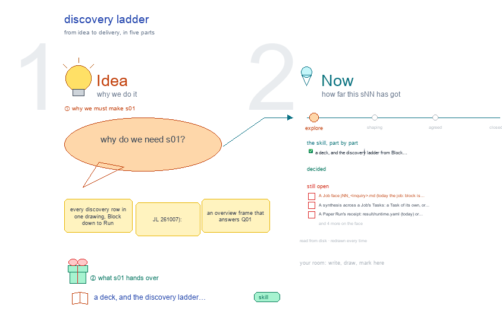

# s01 · discovery ladder <!-- root #73e333 -->

**Stage:** explore

- For <!-- @for #f78806 -->
  - a deck, and the discovery ladder from … <!-- @for/0 #fcefdd -->
    a deck, and the discovery ladder from Block to Run, each level with its folder and screens, for the people who write the toolkit skills
- Delivery type <!-- @delivery-type #58a44f -->
  - skill <!-- @delivery-type/0 #34b33e -->
- Topic <!-- @topic #7e13bd -->
  - every discovery row in one drawing, Block … <!-- @topic/0 #da0e2f -->
    every discovery row in one drawing, Block down to Run (JL 261007): an overview frame that answers Q01 (the ladder one line per level, where each of today's Discovery Views goes, what discovery has that no other Theme has, the open points in red), then the Board, Job and Task levels, each row with its folder, what it holds, its skills and its screens, the proposal (teal, solid) above today's workbench (gray, dashed), and a Run-level frame: a Paper Run opened from Task › Runs.
- Source <!-- @source #6da13a -->
  - the Board, Job and Task rows are … <!-- @source/0 #d9db14 -->
    the Board, Job and Task rows are defined once in `../../b10_project_workbench/s01-overall-tree-structure/` (`build_ladder_v4.py`, `level_views.py`; the discovery entries are this Block's, marked `b14 Q01`); edit them there and this drawing and b03's s06, s07, s08 follow on their next build.
  - The overview and the Run frame are … <!-- @source/1 #fe08c3 -->
    The overview and the Run frame are drawn by this topic's builder.
- Feeds <!-- @feeds #ffe8e9 -->
  - `../reports/` q01 (the ladder question); q02 and … <!-- @feeds/0 #3c94c5 -->
    `../reports/` q01 (the ladder question); q02 and q03 pick up its open points.
- Files <!-- @files #6ce6c5 -->
  - [py] [build_s01_discovery_ladder.py](build_s01_discovery_ladder.py) <!-- @files/0 #474179 -->
  - delivery/ <!-- @files/1 #404761 -->
  - [excalidraw] [s01-discovery-ladder.excalidraw](s01-discovery-ladder.excalidraw) <!-- @files/2 #43abb5 -->
  - [md] [s01-discovery-ladder.md](s01-discovery-ladder.md) <!-- @files/3 #d0b537 -->
  - [png] [s01-discovery-ladder.png](s01-discovery-ladder.png) <!-- @files/4 #b21c40 -->
    
- Proposed (261007, for JL) <!-- @proposed-261007-for-jl #8d9dcd -->
  - **Block** `discovery/bNN_<topic>/`: the folder of a work … <!-- @proposed-261007-for-jl/0 #3d9105 -->
    **Block** `discovery/bNN_<topic>/`: the folder of a work Block (s01-D19). Description = Scope ·
  - Resources (where it searches) · Related <!-- @proposed-261007-for-jl/1 #68e18c -->
    Resources (where it searches) · Related; Idea Studio = `studio/`; Audience Report = `reports/`, one Question │ Work │ Report row each; Work Details = its Jobs, each open to its Tasks; Runs = its soft Runs (draw, report, check, delivery-bib); Delivery (optional) = `<block>.bib` and built reports.
  - **Job** `jNN_<inquiry>/`: one inquiry, with the Block's … <!-- @proposed-261007-for-jl/2 #94f4e6 -->
    **Job** `jNN_<inquiry>/`: one inquiry, with the Block's six Spaces (as the DIKW level and the design
  - method) <!-- @proposed-261007-for-jl/3 #6e651c -->
    method). Description = its face `jNN_<inquiry>.md`; Audience Report = its Tasks' answers, a view with no `reports/`; Work Details = its sub-question Tasks, each open to its papers, third row by specialist (Search · Review · Synthesize); Runs = soft only (plan-tasks, delivery-bib) plus its Tasks' Runs from below; Delivery (optional) = `jNN_<inquiry>.bib`, merged.
  - **Task** `tNN_<task>/`: one sub-question, one `discovery_type` <!-- @proposed-261007-for-jl/4 #1225a4 -->
    **Task** `tNN_<task>/`: one sub-question, one `discovery_type`. A Page that makes facts: hard Paper
  - Runs, and its Page's soft Runs (structure, … <!-- @proposed-261007-for-jl/5 #299660 -->
    Runs, and its Page's soft Runs (structure, section, citation, check). Description = Scope · Admission · Records; Audience Report = Table (Question │ Work │ Report, as b03's s08 decided) · Reading; Work Details = Papers (the Result Cards) · Intake (screened candidates) · Draft (the plan); Runs grouped read · write · check · delivery; Delivery = the built article and the Evidence Bib, as cards.
  - **Run** `runs/rNN_<author><year>_<subject>/`: hard, one Subject; the Paper … <!-- @proposed-261007-for-jl/6 #5e2001 -->
    **Run** `runs/rNN_<author><year>_<subject>/`: hard, one Subject; the Paper Run contract kept (Result
  - Card, facts, runtime receipt, one Bib entry); … <!-- @proposed-261007-for-jl/7 #49ee57 -->
    Card, facts, runtime receipt, one Bib entry); opens as a pop-out from Task › Runs or a paper row.
  - Today's Views, all on the Block, each … <!-- @proposed-261007-for-jl/8 #06e530 -->
    Today's Views, all on the Block, each have a place: see the overview frame's table.
- Open <!-- @open #cf9b77 -->
  - A Job face `jNN_<inquiry>.md` (today the `job:` … <!-- @open/0 #fc2579 -->
    A Job face `jNN_<inquiry>.md` (today the `job:` block is copied into each Task's discovery.yaml).
  - A synthesis across a Job's Tasks: a … <!-- @open/1 #6eaa13 -->
    A synthesis across a Job's Tasks: a Task of its own, or the Block's report?
  - A Paper Run's receipt: `result/runtime.yaml` (today) or … <!-- @open/2 #a2f27e -->
    A Paper Run's receipt: `result/runtime.yaml` (today) or `passes/pNN-<MMDD>/runtime.yaml` (s01-D15)?
  - Screened candidates: `draft/records/search/` (today `results/search/`, which merges … <!-- @open/3 #1f85ec -->
    Screened candidates: `draft/records/search/` (today `results/search/`, which merges into `runs/`)?
  - The Evidence Bib: `draft/evidence/bibex/tNN_<task>.bib` (today) or `tNN_<task>.bib`, … <!-- @open/4 #4e6475 -->
    The Evidence Bib: `draft/evidence/bibex/tNN_<task>.bib` (today) or `tNN_<task>.bib`, as a Page Task's?
  - Papers grouped by role, and the citation … <!-- @open/5 #6d0eca -->
    Papers grouped by role, and the citation chip: Q02.
  - Agree its **For:** line and **Delivery type:** … <!-- @open/6 #09a2ba -->
    Agree its **For:** line and **Delivery type:** (skill), proposed by the agent 261030?
