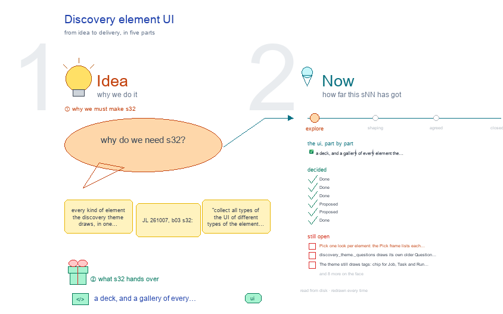

# s32 · Discovery element UI <!-- root #2abf41 -->

**Stage:** explore

- For <!-- @for #f78806 -->
  - a deck, and a gallery of every … <!-- @for/0 #98ee0c -->
    a deck, and a gallery of every element the discovery theme draws, so the UI can be unified, for the people who build the workbench
- Delivery type <!-- @delivery-type #58a44f -->
  - ui <!-- @delivery-type/0 #636117 -->
- Topic <!-- @topic #7e13bd -->
  - every kind of element the discovery theme … <!-- @topic/0 #b293d5 -->
    every kind of element the discovery theme draws, in one gallery, so the UI can be unified (JL 261007, b03 s32: "collect all types of the UI of different types of the element ... so we can unify them").
  - Each element is shown three ways: as … <!-- @topic/1 #dbc449 -->
    Each element is shown three ways: as the discovery theme draws it today on the frame (`/_board/workbench` at its Block, Job and Task levels, every Space and view), as its old pages draw it (flagged OLD), and as b03's s11 · s12 · s13 discovery rows plan it.
  - Beside each element, a "· proposed" frame: … <!-- @topic/2 #888931 -->
    Beside each element, a "· proposed" frame: one look, b03's picks kept, with why, a green line for what changed and a red line for what is open.
  - It is b03's `s32-element-ui` cut to one … <!-- @topic/3 #52a43b -->
    It is b03's `s32-element-ui` cut to one theme, and it adds the elements only discovery has, and every discovery button with the Run name it needs.
- Feeds <!-- @feeds #ffe8e9 -->
  - `../reports/` q01_discovery_ladder · q02_papers_citations_bib · and b03's … <!-- @feeds/0 #9113aa -->
    `../reports/` q01_discovery_ladder · q02_papers_citations_bib · and b03's s32, which reads the list under the heading below.
- Files <!-- @files #6ce6c5 -->
  - [py] [build_s32_discovery_element_ui.py](build_s32_discovery_element_ui.py) <!-- @files/0 #3db514 -->
  - delivery/ <!-- @files/1 #404761 -->
  - [excalidraw] [s32-discovery-element-ui.excalidraw](s32-discovery-element-ui.excalidraw) <!-- @files/2 #ab0a0f -->
  - [md] [s32-discovery-element-ui.md](s32-discovery-element-ui.md) <!-- @files/3 #a27b65 -->
  - [png] [s32-discovery-element-ui.png](s32-discovery-element-ui.png) <!-- @files/4 #9a0e86 -->
    
  - shots/ <!-- @files/5 #4d5052 -->
- What the gallery holds <!-- @what-the-gallery-holds #69fd53 -->
- Theme elements <!-- @theme-elements #bfa59f -->
  - element · level · Space › view … <!-- @theme-elements/0 #bbee5c -->
    element · level · Space › view · from the base, or the theme's own and why · drawn today (GAP = open)
  - top tabs · every level · the … <!-- @theme-elements/1 #9ee4a3 -->
    top tabs · every level · the level row and the six Spaces · the base · drawn · GAP: the Job and
  - Task selects read folder names (`j01_smsr_literature_inquiry`) <!-- @theme-elements/2 #3886da -->
  - view row · Block, Task · every … <!-- @theme-elements/3 #658e0c -->
    view row · Block, Task · every Space with views · the base · drawn · GAP: the Job draws no third
  - row; s12 plans Description: Inquiry · Resources, … <!-- @theme-elements/4 #2f2aa7 -->
    row; s12 plans Description: Inquiry · Resources, Work Details: All · Search · Review · Synthesize, Runs: All · plan · delivery · from below
  - Question rows · Block, Job · Audience … <!-- @theme-elements/5 #1863cf -->
    Question rows · Block, Job · Audience Report › Questions; Job › Audience Report · the base
  - (Insight's row) · GAP: `_questions` draws its … <!-- @theme-elements/6 #cf048a -->
    (Insight's row) · GAP: `_questions` draws its own older cell (a Q01 tag, the whole question, the hypothesis); no Block on disk registers a Question
  - Question rows (divisions) · Task · Audience … <!-- @theme-elements/7 #14b002 -->
    Question rows (divisions) · Task · Audience Report › Table · the base row: division │ papers read │
  - state (s13) · GAP: not drawn; today … <!-- @theme-elements/8 #f03209 -->
    state (s13) · GAP: not drawn; today Synthesis · Draft
  - Reports folds · Block · Audience Report … <!-- @theme-elements/9 #a6b7b8 -->
    Reports folds · Block · Audience Report › Reports · the base folding row · drawn
  - Space body and Disk · Runs · … <!-- @theme-elements/10 #5706eb -->
    Space body and Disk · Runs · every level · every Space · the base · drawn
  - table · every level · Block facts, … <!-- @theme-elements/11 #e88ce8 -->
    table · every level · Block facts, Papers, Tasks, Citations, Runs, Task Face · the base · drawn
  - folding row · Block, Task · Resources, … <!-- @theme-elements/12 #d19a87 -->
    folding row · Block, Task · Resources, Reports, Synthesis, Notes · the base row · GAP: an open
  - fold shows raw markdown in a pre, … <!-- @theme-elements/13 #dd73d7 -->
    fold shows raw markdown in a pre, not the Page reader
  - Runs panel · every level · every … <!-- @theme-elements/14 #c040c6 -->
    Runs panel · every level · every Space · the base; run types from the Workbench Table, named by
  - `RUN_NAMES` · drawn <!-- @theme-elements/15 #a128e2 -->
  - tags · every level · Job, Task … <!-- @theme-elements/16 #fb568c -->
    tags · every level · Job, Task and Run ids, a Question id, a state · none (b03 s32-D09) · GAP: chip,
  - kind, st-ok, st-warn and rp-tags drawn <!-- @theme-elements/17 #611f04 -->
  - header · every level · the top … <!-- @theme-elements/18 #a5179b -->
    header · every level · the top line · the base · drawn
  - paper row · Block, Task · Work … <!-- @theme-elements/19 #11ec7f -->
    paper row · Block, Task · Work Details › Papers, Citations · its own: a Paper Run is read by depth,
  - claim and citation, which no other theme … <!-- @theme-elements/20 #987daa -->
    claim and citation, which no other theme has · GAP: s13's paper · depth · claim · cite and papers grouped by role (Q02) not drawn; today 7 columns with a readout under each title
  - Result Card · Task (pop-out) · a … <!-- @theme-elements/21 #a8ee13 -->
    Result Card · Task (pop-out) · a paper row's link · its own: one Paper Run's card, facts and Bib
  - entry · GAP: it opens through the … <!-- @theme-elements/22 #216d8b -->
    entry · GAP: it opens through the old board page's file route, not the base reader
  - sub-question row · Block, Job · Work … <!-- @theme-elements/23 #042f33 -->
    sub-question row · Block, Job · Work Details › Tasks; Job › Work Details · the base table with
  - discovery's columns (type · Runs · to … <!-- @theme-elements/24 #64938c -->
    discovery's columns (type · Runs · to verify · synthesis) · GAP: s12's fold-open to the papers and its row by specialist
  - synthesis · Task · Audience Report › … <!-- @theme-elements/25 #0a4f60 -->
    synthesis · Task · Audience Report › Synthesis · its own: the typed record (summary · verdict ·
  - landscape) · GAP: s13's Table · Reading … <!-- @theme-elements/26 #795872 -->
    landscape) · GAP: s13's Table · Reading not drawn
  - BibTeX · Block (Task, Job planned) · … <!-- @theme-elements/27 #d774d0 -->
    BibTeX · Block (Task, Job planned) · Delivery › BibTeX · its own: the merged Evidence Bib · GAP:
  - the Task's and the Job's Delivery show … <!-- @theme-elements/28 #ce2199 -->
    the Task's and the Job's Delivery show no Bib
  - Scope · Admission · Records · Task … <!-- @theme-elements/29 #872e6b -->
    Scope · Admission · Records · Task · Description · its own: discovery.yaml's question, type and
  - rule · GAP: today the base's Face … <!-- @theme-elements/30 #e07699 -->
    rule · GAP: today the base's Face · Folder
  - Inquiry face · Job · Description › … <!-- @theme-elements/31 #c6124a -->
    Inquiry face · Job · Description › Inquiry · its own: `jNN_<inquiry>.md` (s12) · GAP: empty, no
  - face on disk <!-- @theme-elements/32 #933f27 -->
  - Intake · Task · Work Details › … <!-- @theme-elements/33 #e35fdc -->
    Intake · Task · Work Details › Intake · the base table of screened candidates (s13) · GAP: not
  - drawn at any level <!-- @theme-elements/34 #9add67 -->
  - Idea Studio · every level · Idea … <!-- @theme-elements/35 #71c052 -->
    Idea Studio · every level · Idea Studio · the base (b03 s32-D06) · drawn (this Block has no studio/)
  - the Discovery board page · old · … <!-- @theme-elements/36 #4269dd -->
    the Discovery board page · old · `/_board/discovery-board` · retires: the frame draws every level ·
  - old page <!-- @theme-elements/37 #545a6c -->
  - the Page workbench page · old · … <!-- @theme-elements/38 #8d96a4 -->
    the Page workbench page · old · `/_board/draft`, from a Task link · retires: a Task is the Task tab
  - · old page <!-- @theme-elements/39 #ead099 -->
- Run names <!-- @run-names #1d67c7 -->
  - Every frame button already carries a Run … <!-- @run-names/0 #e0ca5c -->
    Every frame button already carries a Run name: `discovery_theme.RUN_NAMES` names the theme's (run-ask, run-review-questions, run-report, run-check, run-find-papers, rNN_ for Read a paper, run-synthesize, run-verify-citation, run-review, run-add-resource) and the base names run-draw, run-face and run-delivery. The buttons with no Run name yet, with the name proposed:
  - On the frame, `<tNN>` and the like … <!-- @run-names/1 #db17d1 -->
    On the frame, `<tNN>` and the like take the folder's own number (run-plan-t03).
  - `+ New Run` has no name of … <!-- @run-names/2 #e0f454 -->
    `+ New Run` has no name of its own: it asks for a run type and takes that type's name. The Page workbench's own buttons (where a Task opens today) are the Page theme's, not listed here.
- Decided <!-- @decided #55615a -->
  - s32-D01 · Done (261008): b03's picks hold … <!-- @decided/0 #e96e5a -->
    s32-D01 · Done (261008): b03's picks hold for the discovery theme too: top tabs in the D · E look, the view row in the E look, the Question cell as the Insight row, Disk inside the Runs panel, no tags (b03 s32-D01, D02, D05, D08, D09). The discovery theme gives the words, and the columns of its own elements only.
  - s32-D02 · Done (261008): the ladder is … <!-- @decided/1 #26db6c -->
    s32-D02 · Done (261008): the ladder is shot live from the discovery Block with the most on disk (SMSEngagement), at one Job and one Task; the Question rows from a placeholder Block until a discovery Block registers a Question. The old pages are flagged OLD (`old_reason`).
  - s32-D03 · Done (261008): each element also … <!-- @decided/2 #6bcc32 -->
    s32-D03 · Done (261008): each element also shows its planned screen, drawn from b03's s11 · s12 · s13 discovery rows by b03's own wireframe(), so the gallery follows the level designs on every rebuild.
  - s32-D04 · Proposed (261008): six elements are … <!-- @decided/3 #8eceae -->
    s32-D04 · Proposed (261008): six elements are the discovery theme's own (11 – 16): paper rows, sub-question rows, synthesis, BibTeX, scope and resources, intake. Each is a base table, row or fold with discovery's columns; none needs a look of its own.
  - s32-D05 · Proposed (261008): a paper opens … <!-- @decided/4 #023c70 -->
    s32-D05 · Proposed (261008): a paper opens in the frame's pop-out (its Result Card, read by the base reader), and a Task opens as its own Task tab; the Discovery board page, the file route and the Page workbench page stop being destinations.
  - s32-D06 · Done (261008, b03's ruling): where … <!-- @decided/5 #d472a3 -->
    s32-D06 · Done (261008, b03's ruling): where the base already names a button, discovery reuses that name, so one button has one name in every theme (run-add, run-plan, run-check, run-face, run-structure, run-section, run-delivery, run-draw). Only discovery's own buttons get new names: run-add-paper-<key>, run-freeze-admission-<tNN>, run-admit-<candidate>. On the frame a name takes the folder's own number (run-plan-t03). See the Run names list above.
- Open <!-- @open #cf9b77 -->
  - Pick one look per element: the Pick … <!-- @open/0 #a84ba2 -->
    Pick one look per element: the Pick frame lists each one, b03's picks in green, the rest red.
  - `discovery_theme._questions` draws its own older Question cell; … <!-- @open/1 #696a21 -->
    `discovery_theme._questions` draws its own older Question cell; it should call the base's
  - `question_cell()` (b03 s32-D05) <!-- @open/2 #7cefaf -->
  - The theme still draws tags: `chip` for … <!-- @open/3 #3d9dbe -->
    The theme still draws tags: `chip` for Job, Task and Run ids, `kind` for a Question id, `st-ok` /
  - `st-warn` for a state, `rp-tags` (b03 s32-D09 … <!-- @open/4 #1e04af -->
    `st-warn` for a state, `rp-tags` (b03 s32-D09 says none).
  - The Job level has no third row … <!-- @open/5 #696f66 -->
    The Job level has no third row and an empty Description: s12's Inquiry · Resources and its
  - specialist row (Search · Review · Synthesize) … <!-- @open/6 #d44e96 -->
    specialist row (Search · Review · Synthesize) are not drawn, and no Job has a `jNN_<inquiry>.md` face (s01 Open 1).
  - The Task's Description is the base's Face … <!-- @open/7 #8dbf09 -->
    The Task's Description is the base's Face · Folder, not s13's Scope · Admission · Records; its
  - Audience Report is Synthesis · Draft, not … <!-- @open/8 #254ccd -->
    Audience Report is Synthesis · Draft, not s13's Table · Reading; its Work Details has no Intake.
  - A Result Card opens through the old … <!-- @open/9 #3bacc5 -->
    A Result Card opens through the old board page's file route (`/_board/discovery-board?show=…`);
  - the base reader (`/_board/page`) instead <!-- @open/10 #2e170f -->
  - The Bib shows only at Block › … <!-- @open/11 #3a52ce -->
    The Bib shows only at Block › Delivery › BibTeX; the Task's and the Job's Delivery show none.
  - An open synthesis or note is raw … <!-- @open/12 #ad5676 -->
    An open synthesis or note is raw markdown in a pre, not the Page reader.
  - The Job and Task selects read folder … <!-- @open/13 #826d5c -->
    The Job and Task selects read folder names; a short label through the base's option() hook.
  - The 16 unnamed buttons (Run names, above) … <!-- @open/14 #7c36fd -->
    The 16 unnamed buttons (Run names, above) need their names in `RUN_NAMES` or the Workbench Table
  - (s32-D06) <!-- @open/15 #af4a83 -->
  - Agree its **For:** line and **Delivery type:** … <!-- @open/16 #7b11a4 -->
    Agree its **For:** line and **Delivery type:** (ui), proposed by the agent 261030?
  - These are the discovery theme's code (`servers/workbench-discovery/discovery_theme.py`), … <!-- @open/17 #658db5 -->
    These are the discovery theme's code (`servers/workbench-discovery/discovery_theme.py`), not the base. They wait for JL (b03, 261008); no server code was changed here.
