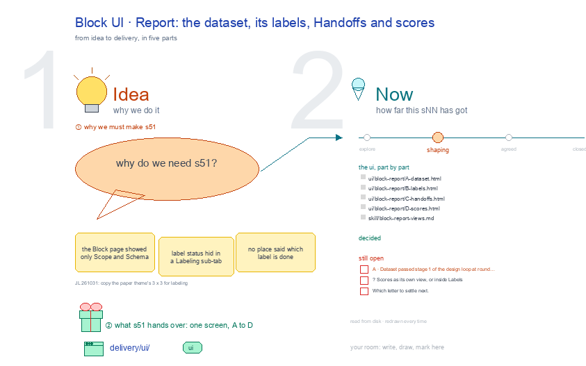

# s51 · Block UI: Report <!-- root #e37039 -->

**Tags:** `Block UI`
**Stage:** shaping

- For <!-- @for #f78806 -->
  - a deck, and the Report screen of … <!-- @for/0 #0b2906 -->
    a deck, and the Report screen of the labeling Block (one dataset) on the focus page (`delivery/ui/block-report`), for the people who build the workbench
- Delivery type <!-- @delivery-type #58a44f -->
  - ui <!-- @delivery-type/0 #636117 -->
- Covers <!-- @covers #a6c44a -->
  - the dataset, its labels, Handoffs and scores; … <!-- @covers/0 #cd20dd -->
    the dataset, its labels, Handoffs and scores; its views, each one full screen: A Dataset · B Labels · C Handoffs · D Scores.
- Excluded <!-- @excluded #980495 -->
  - the other eight cells of the 3 … <!-- @excluded/0 #30e210 -->
    the other eight cells of the 3 × 3 (s52, s53, s54, s55, s56, s57, s58, s59); the engine's own Labeling workbench, where a person labels (s02); every Theme's shared frame (b10).
- Topic <!-- @topic #7e13bd -->
  - The Block's Report: the dataset, its labels, … <!-- @topic/0 #69c955 -->
    The Block's Report: the dataset, its labels, Handoffs and scores; one cell of the labeling 3 × 3, the labeling Block (one dataset) × Report (check), copied from the paper theme's (b16 j01;
  - JL 261031: "please go ahead and update … <!-- @topic/1 #20cd7c -->
    JL 261031: "please go ahead and update them").
  - Its drawing is haipipe-studio's five parts, drawn … <!-- @topic/2 #4eb17d -->
    Its drawing is haipipe-studio's five parts, drawn by `build_s51_block_ui_report.py` through j01's `labeling_ui_cells.py`; its Design is every view as the same full screen, lettered, settled one round each.
  - Names are the public DICES-350 dataset's; no … <!-- @topic/3 #9f447d -->
    Names are the public DICES-350 dataset's; no item text is drawn.
- Feeds <!-- @feeds #ffe8e9 -->
  - `reports/` q01_labeling_ladder <!-- @feeds/0 #70ceeb -->
- Files <!-- @files #6ce6c5 -->
  - [py] [build_s51_block_ui_report.py](build_s51_block_ui_report.py) <!-- @files/0 #544502 -->
  - delivery/ <!-- @files/1 #404761 -->
  - review/ <!-- @files/2 #7928fb -->
  - [excalidraw] [s51-block-ui-report.excalidraw](s51-block-ui-report.excalidraw) <!-- @files/3 #1dffb8 -->
  - [md] [s51-block-ui-report.md](s51-block-ui-report.md) <!-- @files/4 #99f121 -->
  - [png] [s51-block-ui-report.png](s51-block-ui-report.png) <!-- @files/5 #5dd068 -->
    
- Decided <!-- @decided #55615a -->
  - (none yet: a decision is one line, … <!-- @decided/0 #ed3e7f -->
    (none yet: a decision is one line, s51-D01 · <what was decided> (<who> <date>))
- Open <!-- @open #cf9b77 -->
  - A · Dataset passed stage 1 of … <!-- @open/0 #f637b3 -->
    A · Dataset passed stage 1 of the design loop at round 2 (mean 8.7; review/A-s1-r01.md 7.2, review/A-s1-r02.md 8.7); waits for JL to look once before it is built.
  - ? <!-- @open/1 #d96bd0 -->
    ? Scores as its own view, or inside Labels
  - Which letter to settle next <!-- @open/2 #fe10a7 -->
