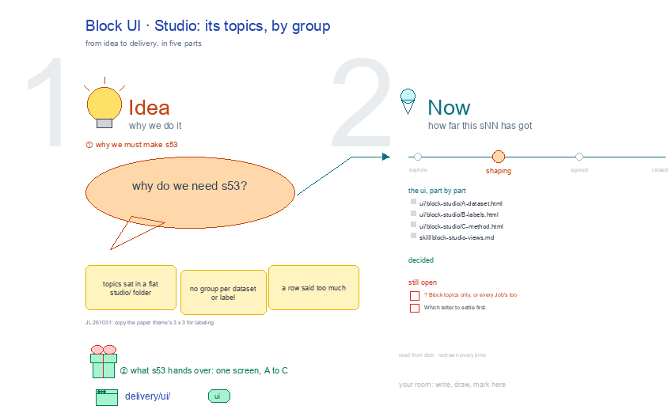

# s53 · Block UI: Studio <!-- root #b67a53 -->

**Tags:** `Block UI`
**Stage:** shaping

- For <!-- @for #f78806 -->
  - a deck, and the Studio screen of … <!-- @for/0 #7bcc13 -->
    a deck, and the Studio screen of the labeling Block (one dataset) on the focus page (`delivery/ui/block-studio`), for the people who build the workbench
- Delivery type <!-- @delivery-type #58a44f -->
  - ui <!-- @delivery-type/0 #636117 -->
- Covers <!-- @covers #a6c44a -->
  - its topics, by group; its views, each … <!-- @covers/0 #ff6fd9 -->
    its topics, by group; its views, each one full screen: A Dataset · B Labels · C Method.
- Excluded <!-- @excluded #980495 -->
  - the other eight cells of the 3 … <!-- @excluded/0 #e89715 -->
    the other eight cells of the 3 × 3 (s51, s52, s54, s55, s56, s57, s58, s59); the engine's own Labeling workbench, where a person labels (s02); every Theme's shared frame (b10).
- Topic <!-- @topic #7e13bd -->
  - The Block's Studio: its topics, by group; … <!-- @topic/0 #166ab3 -->
    The Block's Studio: its topics, by group; one cell of the labeling 3 × 3, the labeling Block (one dataset) × Studio (think), copied from the paper theme's (b16 j01;
  - JL 261031: "please go ahead and update … <!-- @topic/1 #20cd7c -->
    JL 261031: "please go ahead and update them").
  - Its drawing is haipipe-studio's five parts, drawn … <!-- @topic/2 #bb5221 -->
    Its drawing is haipipe-studio's five parts, drawn by `build_s53_block_ui_studio.py` through j01's `labeling_ui_cells.py`; its Design is every view as the same full screen, lettered, settled one round each.
  - Names are the public DICES-350 dataset's; no … <!-- @topic/3 #9f447d -->
    Names are the public DICES-350 dataset's; no item text is drawn.
- Feeds <!-- @feeds #ffe8e9 -->
  - `reports/` q01_labeling_ladder <!-- @feeds/0 #70ceeb -->
- Files <!-- @files #6ce6c5 -->
  - [py] [build_s53_block_ui_studio.py](build_s53_block_ui_studio.py) <!-- @files/0 #2aedf7 -->
  - delivery/ <!-- @files/1 #404761 -->
  - [excalidraw] [s53-block-ui-studio.excalidraw](s53-block-ui-studio.excalidraw) <!-- @files/2 #5c2eb0 -->
  - [md] [s53-block-ui-studio.md](s53-block-ui-studio.md) <!-- @files/3 #234b6e -->
  - [png] [s53-block-ui-studio.png](s53-block-ui-studio.png) <!-- @files/4 #8fc5bd -->
    
- Decided <!-- @decided #55615a -->
  - (none yet: a decision is one line, … <!-- @decided/0 #3f6b0c -->
    (none yet: a decision is one line, s53-D01 · <what was decided> (<who> <date>))
- Open <!-- @open #cf9b77 -->
  - ? <!-- @open/0 #eaa40e -->
    ? Block topics only, or every Job's too
  - Which letter to settle first <!-- @open/1 #075ea7 -->
