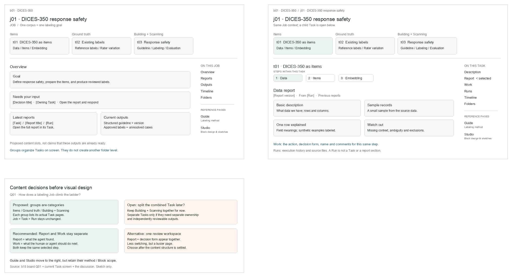
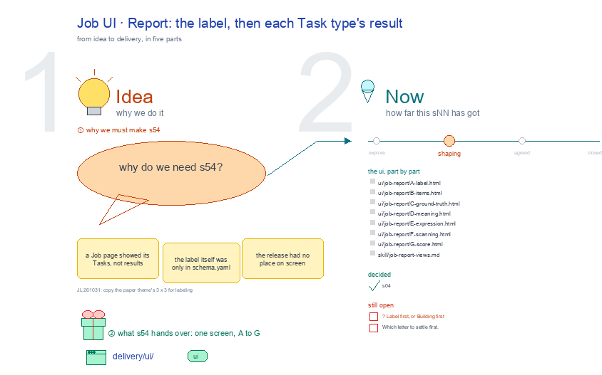

# s54 · Job UI: Report <!-- root #0114a9 -->

**Tags:** `Job UI`
**Stage:** shaping

- For <!-- @for #f78806 -->
  - a deck, and the Report screen of … <!-- @for/0 #398dd1 -->
    a deck, and the Report screen of a labeling Job (one dataset × one label) on the focus page (`delivery/ui/job-report`), for the people who build the workbench
- Delivery type <!-- @delivery-type #58a44f -->
  - ui <!-- @delivery-type/0 #636117 -->
- Covers <!-- @covers #a6c44a -->
  - the label, then each Task type's result; … <!-- @covers/0 #d299a6 -->
    the label, then each Task type's result; its views, each one full screen: A Label · B Items · C Ground truth · D Meaning · E Expression · F Scanning · G Score.
- Excluded <!-- @excluded #980495 -->
  - the other eight cells of the 3 … <!-- @excluded/0 #35fe7e -->
    the other eight cells of the 3 × 3 (s51, s52, s53, s55, s56, s57, s58, s59); the engine's own Labeling workbench, where a person labels (s02); every Theme's shared frame (b10).
- Topic <!-- @topic #7e13bd -->
  - A Job's Report: the label, then each … <!-- @topic/0 #5cdd0a -->
    A Job's Report: the label, then each Task type's result; one cell of the labeling 3 × 3, a labeling Job (one dataset × one label) × Report (check), copied from the paper theme's (b16 j01;
  - JL 261031: "please go ahead and update … <!-- @topic/1 #20cd7c -->
    JL 261031: "please go ahead and update them").
  - Its drawing is haipipe-studio's five parts, drawn … <!-- @topic/2 #351c41 -->
    Its drawing is haipipe-studio's five parts, drawn by `build_s54_job_ui_report.py` through j01's `labeling_ui_cells.py`; its Design is every view as the same full screen, lettered, settled one round each.
  - Names are the public DICES-350 dataset's; no … <!-- @topic/3 #9f447d -->
    Names are the public DICES-350 dataset's; no item text is drawn.
- Feeds <!-- @feeds #ffe8e9 -->
  - `reports/` q01_labeling_ladder <!-- @feeds/0 #70ceeb -->
- Files <!-- @files #6ce6c5 -->
  - [py] [build_s54_job_ui_report.py](build_s54_job_ui_report.py) <!-- @files/0 #672ece -->
  - delivery/ <!-- @files/1 #404761 -->
  - [excalidraw] [s54-job-ui-report.earlier-job-centered-v1.excalidraw](s54-job-ui-report.earlier-job-centered-v1.excalidraw) <!-- @files/2 #54e90f -->
  - [png] [s54-job-ui-report.earlier-job-centered-v1.png](s54-job-ui-report.earlier-job-centered-v1.png) <!-- @files/3 #3092c2 -->
    
  - [excalidraw] [s54-job-ui-report.excalidraw](s54-job-ui-report.excalidraw) <!-- @files/4 #e7ffe5 -->
  - [md] [s54-job-ui-report.md](s54-job-ui-report.md) <!-- @files/5 #a04945 -->
  - [png] [s54-job-ui-report.png](s54-job-ui-report.png) <!-- @files/6 #7d58ae -->
    
- Decided <!-- @decided #55615a -->
  - s54-D01 · s04 (job-centered content v1) folds … <!-- @decided/0 #922eec -->
    s54-D01 · s04 (job-centered content v1) folds into this topic as its earlier sketch, kept beside the drawing (JL 261031).
- Open <!-- @open #cf9b77 -->
  - ? <!-- @open/0 #ecb9fc -->
    ? Label first, or Building first
  - Which letter to settle first <!-- @open/1 #075ea7 -->
