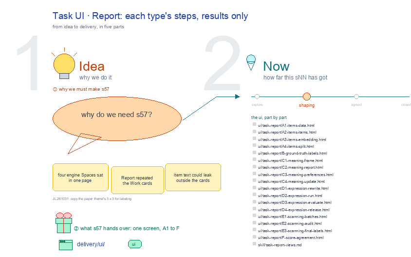

# s57 · Task UI: Report <!-- root #1f6b42 -->

**Tags:** `Task UI`
**Stage:** shaping

- For <!-- @for #f78806 -->
  - a deck, and the Report screen of … <!-- @for/0 #69a51c -->
    a deck, and the Report screen of a labeling Task (one step, of six types) on the focus page (`delivery/ui/task-report`), for the people who build the workbench
- Delivery type <!-- @delivery-type #58a44f -->
  - ui <!-- @delivery-type/0 #636117 -->
- Covers <!-- @covers #a6c44a -->
  - each Task view drawn from its step … <!-- @covers/0 #2872f4 -->
    each Task view drawn from its step slide (the deck's pages 7 to 15: In → who works → Out, your part, next), its close-up screen (pages 16 to 23) drawing the Results, and a coverage table in task_views.py (COVER, check()) that fails when a slide box has no place on the screen (JL 261101: "you should read the steps here, in this slides, and then you think how do design it"); the type sets the view buttons (its steps).
  - Rows: A 📦 items (Data · Items … <!-- @covers/1 #aaba7b -->
    Rows: A 📦 items (Data · Items · Embedding · Split), B 📏 ground truth (Labels), C 🧭 meaning (Frame · Report · Preferences · Update;
  - Loop 1, 2 … making m01, m02 … <!-- @covers/2 #d39856 -->
    Loop 1, 2 … making m01, m02 …; the only Task with an interaction), D 🛠 expression (Rewrite · Run · Evaluate · Release; rounds e01, e02 … under one meaning), E 🔍 scanning (Batches · Audit · Final labels), F 📊 score (Agreement).
  - Report shows 📊 Results only, read only <!-- @covers/3 #7ba30c -->
- Excluded <!-- @excluded #980495 -->
  - the other eight cells of the 3 … <!-- @excluded/0 #320263 -->
    the other eight cells of the 3 × 3 (s51, s52, s53, s54, s55, s56, s58, s59); the engine's own Labeling workbench, where a person labels (s02); every Theme's shared frame (b10).
- Topic <!-- @topic #7e13bd -->
  - A Task's Report: each type's steps, results … <!-- @topic/0 #a36fc1 -->
    A Task's Report: each type's steps, results only; one cell of the labeling 3 × 3, a labeling Task (one step, of six types) × Report (check), copied from the paper theme's (b16 j01;
  - JL 261031: "please go ahead and update … <!-- @topic/1 #20cd7c -->
    JL 261031: "please go ahead and update them").
  - Its drawing is haipipe-studio's five parts, drawn … <!-- @topic/2 #f6b342 -->
    Its drawing is haipipe-studio's five parts, drawn by `build_s57_task_ui_report.py` through j01's `labeling_ui_cells.py`; its Design is every view as the same full screen, lettered, settled one round each.
  - Names are the public DICES-350 dataset's; no … <!-- @topic/3 #9f447d -->
    Names are the public DICES-350 dataset's; no item text is drawn.
- Feeds <!-- @feeds #ffe8e9 -->
  - `reports/` q01_labeling_ladder <!-- @feeds/0 #70ceeb -->
- Files <!-- @files #6ce6c5 -->
  - [py] [build_s57_task_ui_report.py](build_s57_task_ui_report.py) <!-- @files/0 #b00392 -->
  - delivery/ <!-- @files/1 #404761 -->
  - [excalidraw] [s57-task-ui-report.excalidraw](s57-task-ui-report.excalidraw) <!-- @files/2 #7fe90a -->
  - [md] [s57-task-ui-report.md](s57-task-ui-report.md) <!-- @files/3 #64bed6 -->
  - [png] [s57-task-ui-report.png](s57-task-ui-report.png) <!-- @files/4 #91bd67 -->
    
- Decided <!-- @decided #55615a -->
  - s57-D02 · Building becomes two Tasks, one … <!-- @decided/0 #7a8cb4 -->
    s57-D02 · Building becomes two Tasks, one per loop: 🧭 meaning (Frame · Report · Preferences · Update) and 🛠 expression (Rewrite · Run · Evaluate · Release); a turns strip shows each loop (m01, m02 … ; e01, e02 … under one meaning), the round report sends expression back to meaning's next Report, and only meaning's Preferences carries an interaction, one collect Run per turn, whose answers Update records as the meaning history (JL 261101: "we have the meaning-loop and expression-loop"; "we hope that the interaction is only available in the meaning loop task").
  - s57-D01 · No Runs view: the view-button-list … <!-- @decided/1 #cff65c -->
    s57-D01 · No Runs view: the view-button-list holds a Task's steps only; each step shows the Runs that made it in its own Process, and every Run in time order is the right-rail Timeline (JL 261101: "for things here, we don't put Runs as a seperate things view").
- Open <!-- @open #cf9b77 -->
  - Replaced (JL 261031: "It is stupid that … <!-- @open/0 #f4adb3 -->
    Replaced (JL 261031: "It is stupid that every view has the same three boxes"): every view now shows its own step's sections from the previous version; the old one-template design and its reviews are in review/old-template-261031/.
  - Which letter to settle first <!-- @open/1 #075ea7 -->
