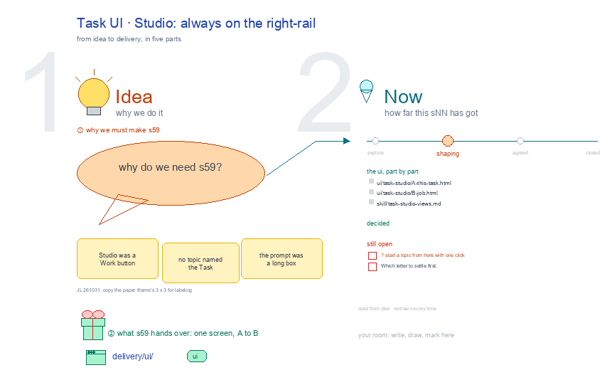

# s59 · Task UI: Studio <!-- root #de0e1a -->

**Tags:** `Task UI`
**Stage:** shaping

- For <!-- @for #f78806 -->
  - a deck, and the Studio screen of … <!-- @for/0 #22bec3 -->
    a deck, and the Studio screen of a labeling Task (one step, of six types) on the focus page (`delivery/ui/task-studio`), for the people who build the workbench
- Delivery type <!-- @delivery-type #58a44f -->
  - ui <!-- @delivery-type/0 #636117 -->
- Covers <!-- @covers #a6c44a -->
  - always on the right-rail; its views, each … <!-- @covers/0 #0f1db2 -->
    always on the right-rail; its views, each one full screen: A This Task · B Job.
- Excluded <!-- @excluded #980495 -->
  - the other eight cells of the 3 … <!-- @excluded/0 #c01894 -->
    the other eight cells of the 3 × 3 (s51, s52, s53, s54, s55, s56, s57, s58); the engine's own Labeling workbench, where a person labels (s02); every Theme's shared frame (b10).
- Topic <!-- @topic #7e13bd -->
  - A Task's Studio: always on the right-rail; … <!-- @topic/0 #b0a76a -->
    A Task's Studio: always on the right-rail; one cell of the labeling 3 × 3, a labeling Task (one step, of six types) × Studio (think), copied from the paper theme's (b16 j01;
  - JL 261031: "please go ahead and update … <!-- @topic/1 #20cd7c -->
    JL 261031: "please go ahead and update them").
  - Its drawing is haipipe-studio's five parts, drawn … <!-- @topic/2 #c22378 -->
    Its drawing is haipipe-studio's five parts, drawn by `build_s59_task_ui_studio.py` through j01's `labeling_ui_cells.py`; its Design is every view as the same full screen, lettered, settled one round each.
  - Names are the public DICES-350 dataset's; no … <!-- @topic/3 #9f447d -->
    Names are the public DICES-350 dataset's; no item text is drawn.
- Feeds <!-- @feeds #ffe8e9 -->
  - `reports/` q01_labeling_ladder <!-- @feeds/0 #70ceeb -->
- Files <!-- @files #6ce6c5 -->
  - [py] [build_s59_task_ui_studio.py](build_s59_task_ui_studio.py) <!-- @files/0 #4aa8b9 -->
  - delivery/ <!-- @files/1 #404761 -->
  - [excalidraw] [s59-task-ui-studio.excalidraw](s59-task-ui-studio.excalidraw) <!-- @files/2 #732586 -->
  - [md] [s59-task-ui-studio.md](s59-task-ui-studio.md) <!-- @files/3 #9797f7 -->
  - [png] [s59-task-ui-studio.png](s59-task-ui-studio.png) <!-- @files/4 #9176b9 -->
    
- Decided <!-- @decided #55615a -->
  - (none yet: a decision is one line, … <!-- @decided/0 #9f7e23 -->
    (none yet: a decision is one line, s59-D01 · <what was decided> (<who> <date>))
- Open <!-- @open #cf9b77 -->
  - ? start a topic from here with … <!-- @open/0 #11a273 -->
    ? start a topic from here with one click
  - Which letter to settle first <!-- @open/1 #075ea7 -->
