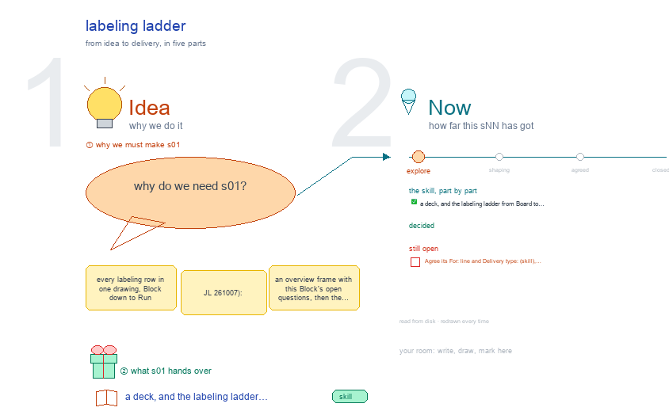

# s01 · labeling ladder <!-- root #2f61fa -->

**Stage:** explore

- For <!-- @for #f78806 -->
  - a deck, and the labeling ladder from … <!-- @for/0 #106c40 -->
    a deck, and the labeling ladder from Board to Task, each level with its folder, skills and screens, for the people who write the toolkit skills
- Delivery type <!-- @delivery-type #58a44f -->
  - skill <!-- @delivery-type/0 #34b33e -->
- Topic <!-- @topic #7e13bd -->
  - every labeling row in one drawing, Block … <!-- @topic/0 #ea0f60 -->
    every labeling row in one drawing, Block down to Run (JL 261007): an overview frame with this Block's open questions, then the Board, Job and Task levels, each row with its folder, what it holds, its skills, and its screens, the proposal (teal, solid) above today's workbench (gray, dashed).
- Source <!-- @source #6da13a -->
  - the rows are defined once in `../../b10_project_workbench/s01-overall-tree-structure/` … <!-- @source/0 #b850dc -->
    the rows are defined once in `../../b10_project_workbench/s01-overall-tree-structure/` (`build_ladder_v4.py`, `level_views.py`) and drawn by `../../b10_project_workbench/studio/_build/theme_ladder.py`; edit the rows there and this drawing follows on its next build.
- Feeds <!-- @feeds #ffe8e9 -->
  - `../reports/` q01 (the ladder question) <!-- @feeds/0 #723053 -->
- Files <!-- @files #6ce6c5 -->
  - [py] [build_s01_labeling_ladder.py](build_s01_labeling_ladder.py) <!-- @files/0 #438962 -->
  - delivery/ <!-- @files/1 #404761 -->
  - [excalidraw] [s01-labeling-ladder.excalidraw](s01-labeling-ladder.excalidraw) <!-- @files/2 #bc6c35 -->
  - [md] [s01-labeling-ladder.md](s01-labeling-ladder.md) <!-- @files/3 #e46ece -->
  - [png] [s01-labeling-ladder.png](s01-labeling-ladder.png) <!-- @files/4 #27f028 -->
    
- Proposed so far <!-- @proposed-so-far #04bce1 -->
  - (261007, for Q01) The engine's one labeling … <!-- @proposed-so-far/0 #1625fa -->
    (261007, for Q01) The engine's one labeling job is a Task, `tNN_<dataset>_labeling/` with
  - `labeling/`; today's page-level workbench becomes its Task … <!-- @proposed-so-far/1 #803cbf -->
    `labeling/`; today's page-level workbench becomes its Task tab, in the six Spaces. Data and Labeling and Quality views go to Work Details (Building: Embedding · Definition · Rounds · Guideline | Scanning: Test · Evaluation · Scan · Audit); Contract to Description; REPORT.md to Audience Report; Handoff and Final labels stay in Delivery.
  - (261007, for Q01) The Job is one … <!-- @proposed-so-far/2 #8b4293 -->
    (261007, for Q01) The Job is one dataset × one label with four step Tasks, prepare · keys ·
  - label · score (t01-t04) <!-- @proposed-so-far/3 #fa2eb9 -->
    label · score (t01-t04). Its tab is new: Audience Report = our labels vs the dataset's keys (was Quality › External gold), Work Details = the four steps (was Data › Preparation's Task list). A scan-only Job reads another Job's handoff. Since 261014 these steps are five Task types, named by the face's `task-type:` line: items · keys · building · scanning · score (`../s13-labeling-task/`); the workbench shows them.
  - (261007, for Q01) A Run is one … <!-- @proposed-so-far/4 #b116e9 -->
    (261007, for Q01) A Run is one operation: `runs/rNN_<operation>_<target>/` (was
  - `runs/run-labeling-<op>-<MMDD>-<target>.yaml` + `results/<same>/`); a resumed human session … <!-- @proposed-so-far/5 #cb785b -->
    `runs/run-labeling-<op>-<MMDD>-<target>.yaml` + `results/<same>/`); a resumed human session is a pass.
- Open <!-- @open #cf9b77 -->
  - Agree its **For:** line and **Delivery type:** … <!-- @open/0 #09a2ba -->
    Agree its **For:** line and **Delivery type:** (skill), proposed by the agent 261030?
  - The real labeling Blocks (`tasks/`, schema at … <!-- @open/1 #87b692 -->
    The real labeling Blocks (`tasks/`, schema at the Block, Jobs by side) move only when JL says.
  - schema.yaml at the Block or the Job … <!-- @open/2 #1cc2ec -->
    schema.yaml at the Block or the Job (Q03).
  - A labeling Run: hard with `result.yaml` pointing … <!-- @open/3 #35e77d -->
    A labeling Run: hard with `result.yaml` pointing into `labeling/`, or soft?
  - Building | Scanning as the third row, … <!-- @open/4 #2a9f46 -->
    Building | Scanning as the third row, and the gates (Q02).
  - The Theme becomes `labeling/` (s01-D29), so `labeling/` … <!-- @open/5 #fc5b06 -->
    The Theme becomes `labeling/` (s01-D29), so `labeling/` appears twice in a job's path; proposed:
  - keep the Task's lane name and tell … <!-- @open/6 #402ada -->
    keep the Task's lane name and tell the two apart by depth. `labeling.py`'s `_labeling_job` must read both Theme names (via `themes.py`).
