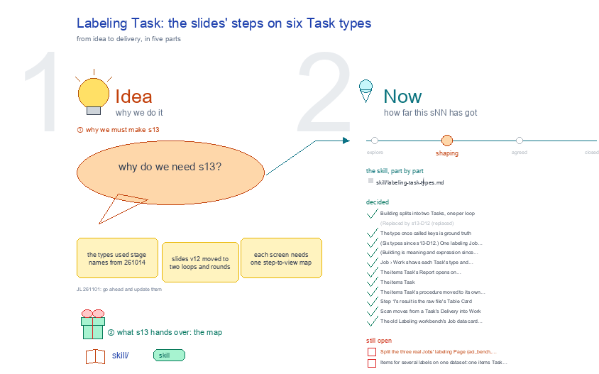

# s13 · Labeling Task: six types in one Job <!-- root #b74de9 -->

**Tags:** `Levels`
**Stage:** shaping

- For <!-- @for #f78806 -->
  - a deck, and the six types of … <!-- @for/0 #8e36c8 -->
    a deck, and the six types of Task inside one labeling Job, for the people who write the toolkit skills
- Delivery type <!-- @delivery-type #58a44f -->
  - skill <!-- @delivery-type/0 #34b33e -->
- Topic <!-- @topic #7e13bd -->
  - the types a labeling Job's Tasks come … <!-- @topic/0 #bd46fa -->
    the types a labeling Job's Tasks come in.
  - A labeling Job is one dataset × … <!-- @topic/1 #bed67f -->
    A labeling Job is one dataset × one label; inside it the Tasks have different jobs, the way a design Job's do (b12 s13: `t00` reason ideas · `tNN_d<NN>` one design · `t99` review whole).
  - Here there are five: items, ground truth, … <!-- @topic/2 #128b92 -->
    Here there are five: items, ground truth, building, scanning, score, each read from the Task face's `task-type:` line, never from its number (ground truth and score are optional, so numbers shift).
  - Building and scanning meet only at the … <!-- @topic/3 #c9d6b3 -->
    Building and scanning meet only at the signed Label Handoff, the engine's one crossing.
  - Asked by JL 261014; the workbench shows … <!-- @topic/4 #310c5a -->
    Asked by JL 261014; the workbench shows the types since the same day (`servers/workbench-labeling/labeling_theme.py`, `TYPES`).
  - On 261101 the slide deck's newer process … <!-- @topic/5 #fc4783 -->
    On 261101 the slide deck's newer process (version 12: Steps 0 to 7, two loops, the round report) was placed on the types: one map from each step to its Task, its views, the files it writes and the person's gate (JL 261101: "go ahead and update them"); the same day building split into its two loops, 🧭 meaning and 🛠 expression, so the types became six (s13-D12).
- Feeds <!-- @feeds #ffe8e9 -->
  - `reports/` q01_labeling_ladder · q02_building_scanning_gates <!-- @feeds/0 #e5c97c -->
- Files <!-- @files #6ce6c5 -->
  - [py] [build_s13_labeling_task.py](build_s13_labeling_task.py) <!-- @files/0 #ea50cf -->
  - delivery/ <!-- @files/1 #404761 -->
  - passes/ <!-- @files/2 #49b302 -->
  - result/ <!-- @files/3 #d4a42c -->
  - [excalidraw] [s13-labeling-task.excalidraw](s13-labeling-task.excalidraw) <!-- @files/4 #8080c2 -->
  - [md] [s13-labeling-task.ideas.md](s13-labeling-task.ideas.md) <!-- @files/5 #963e59 -->
  - [md] [s13-labeling-task.md](s13-labeling-task.md) <!-- @files/6 #ad7445 -->
  - [png] [s13-labeling-task.png](s13-labeling-task.png) <!-- @files/7 #58446a -->
    
  - [html] [s13-labeling-task.slides.html](s13-labeling-task.slides.html) <!-- @files/8 #a0f450 -->
  - [json] [s13-labeling-task.slides.json](s13-labeling-task.slides.json) <!-- @files/9 #c4cae1 -->
  - [pptx] [s13-labeling-task.slides.pptx](s13-labeling-task.slides.pptx) <!-- @files/10 #7c64b3 -->
  - shots/ <!-- @files/11 #4d5052 -->
- The steps on the six types <!-- @the-steps-on-the-six-types #cf4bdd -->
  - Two loops, two Tasks (JL 261101: "we … <!-- @the-steps-on-the-six-types/0 #977a65 -->
    Two loops, two Tasks (JL 261101: "we have the meaning-loop and expression-loop"). 🧭 meaning runs Loop 1, 2 … (Report → Preferences → Update), each making a meaning version m01, m02 …, and is the only place the person is asked: each loop's Report is one interaction report, written by the agent with /haipipe-labeling-interaction as one /haipipe-interaction collect Run, `runs/rNN_collect_report_mNN/`; you answer it in Preferences, and Update records which answer made which rule, so every meaning version points back to the interaction that produced it (the meaning history). The guideline itself is a mind map of rules, one version per loop. 🛠 expression runs rounds e01, e02 … (Rewrite → Run → Evaluate) under one approved meaning and never asks: a wording issue starts the next expression round, a rule or label issue goes back as the round report to the next meaning Report, and when the criteria are met the version goes to Release. Train develops the wording; Test is labeled, scored and audited, and its issues go to meaning, never to the rewriting. Scanning's new meaning issues also go back to meaning.
- The five types, as first drawn (261014) <!-- @the-five-types-as-first-drawn-261014 #9a992e -->
  - A Job needs items, building and scanning … <!-- @the-five-types-as-first-drawn-261014/0 #d39c0f -->
    A Job needs items, building and scanning to close; once it has ground truth, it needs score too. G0 is the gate where the person confirms what each label means; the Label Handoff is the frozen, signed guideline plus the person's gold labels.
- Decided <!-- @decided #55615a -->
  - s13-D12 · Building splits into two Tasks, … <!-- @decided/0 #6d6a89 -->
    s13-D12 · Building splits into two Tasks, one per loop: 🧭 meaning (Steps 1 to 4: Frame · Report · Preferences · Update, turns m01, m02 …) and 🛠 expression (Steps 5 and 6: Rewrite · Run · Evaluate · Release, turns e01, e02 … under one approved meaning); the round report sends expression back to meaning; only meaning carries interactions, one collect Run per turn, and its Update keeps the meaning history. Six Task types. (JL 261101: "we have the meaning-loop and expression-loop"; "we hope that the interaction is only available in the meaning loop task".)
  - s13-D11 · (Replaced by s13-D12: building is … <!-- @decided/1 #71b09b -->
    s13-D11 · (Replaced by s13-D12: building is two Tasks.) The slide deck's Steps 0 to 7 (version 12) map onto the five types: items holds Step 0 (Data · Items · Embedding · Split); building holds Steps 1 to 6 (Frame · Decide · Changes · Staging · Release), since Steps 2 to 5 loop round by round until release; scanning holds Step 7 (Batches · Audit · Final labels); score holds the evaluation (Agreement); ground truth keeps the dataset's own labels (Labels). The signed Label Handoff becomes the Step 6 release. (Proposed by Claude 261101 as a step map; JL 261101: "go ahead and update them".)
  - s13-D10 · The type once called keys … <!-- @decided/2 #aff70b -->
    s13-D10 · The type once called keys is ground truth (📏; JL 261014: "could we do not use the term of key, is this widely used or not?"): papers say ground truth or gold labels, not keys. Its `task-type: raw` line is unchanged.
  - s13-D01 · (Six types since s13-D12.) One … <!-- @decided/3 #98f235 -->
    s13-D01 · (Six types since s13-D12.) One labeling Job = one dataset × one label; its Tasks come in five types, items · ground truth · building · scanning · score, each named by its face's `task-type:` line (data · raw · labeling-building · labeling-scanning · eval), never by its number (JL 261014: "one job is a data+labeling ... in the job, we might have different types of tasks").
  - s13-D02 · (Building is meaning and expression … <!-- @decided/4 #9a6a2f -->
    s13-D02 · (Building is meaning and expression since s13-D12; the Handoff is expression's Release.) Building and scanning split at the signed Label Handoff, the engine's one crossing; today's `task-type: labeling` Page counts as both, so the three real Jobs read as they are (proposed by Claude 261014; the real Jobs keep their folders until JL says).
  - s13-D03 · Job › Work shows each … <!-- @decided/5 #de876f -->
    s13-D03 · Job › Work shows each Task's type and state, then a dashed card for each type the Job still lacks (items, building, scanning; score once it has ground truth), ground truth and score as optional otherwise (JL 261014: "I think the kind things is here, right? To prepare these tasks to be finished"; built 261014).
  - s13-D04 · The items Task's Report opens … <!-- @decided/6 #813531 -->
    s13-D04 · The items Task's Report opens on Itemization · Embedding (JL 261014: "we can call them Itemization, and Embedding"): Itemization reads the face's Data, Method and Result parts and the newest Run's `result/manifest.yaml` and `metrics.json`; Embedding reads the labeling job's embedding state and opens its Embedding view (built 261014). No Draft tab beside them (JL 261014: "we don't need draft").
  - s13-D07 · The items Task: Report shows … <!-- @decided/7 #22fdb1 -->
    s13-D07 · The items Task: Report shows the results only, one tab per step: 1 · Data · 2 · Item · 3 · Item list (ids and sizes, never an item's text) · 4 · Embedding (the map once built, framed from the Labeling workbench); Work has the same four tabs, one step each: read the raw data (hard) · choose what one item is (soft) · make the items (hard) · embed the items (hard), each with its state chip, a "Prompt for this step" row with Copy prompt (open on the step to do now), its result in full and a link to the next step; no Folders, Evidence or Value views (JL 261014: "report will just show the results ... Work will show the steps, and the step's results"; "Result1-Data, Result2-Item, Result3-ItemList, and Result-4-Embedding"; "I want here to show the results 1, 2, 3, 4 ... in the work"; built 261014). Older Itemization links open 1 · Data. Item text stays out: the old item table showed it only after the sealed set was held back, each showing recorded, so the Item list shows ids and sizes.
  - s13-D09 · The items Task's procedure moved … <!-- @decided/8 #183035 -->
    s13-D09 · The items Task's procedure moved to its own topic, s41-task-items-procedure (261014): three steps and tabs 1 · Data · 2 · Items · 3 · Embedding, which replace D07's four; D07 and D08 stay as the record.
  - s13-D08 · Step 1's result is the … <!-- @decided/9 #398aec -->
    s13-D08 · Step 1's result is the raw file's Table Card (haipipe-task-for-description), from a `rNN_raw_read` Run: what one row is and its checks, every column by meaning group, what to watch out for, and a sample made up in the real columns (synth_df), never a real row: a chat's text is a future item and its answers are ground truth (JL 261014: "you should also show what is the sample of the data, so people can view it"). The Step 1 prompt names haipipe-task-for-description; it named haipipe-task-for-raw, which extracts from a database. First Run: dices350 t01 r05_raw_read, 43,050 rows × 41 columns, started by JL pasting the prompt (261014).
  - s13-D05 · Scan moves from a Task's … <!-- @decided/10 #6468b9 -->
    s13-D05 · Scan moves from a Task's Delivery into Work (a scanning step); Delivery keeps Handoff and Final labels (261014).
  - s13-D06 · The old Labeling workbench's Job … <!-- @decided/11 #414bc6 -->
    s13-D06 · The old Labeling workbench's Job data card read Runs from the flat `runs/rNN_*.sh` + `results/<run>/`; it now reads one folder per Run, `runs/<run>/result/` (since 261010), the flat layout still read (fixed 261014, `labeling.py` `_task_runs`).
- Open <!-- @open #cf9b77 -->
  - Split the three real Jobs' labeling Page … <!-- @open/0 #34de24 -->
    Split the three real Jobs' labeling Page (aci_bench, dices350, redsm5) into meaning, expression and scanning
  - Tasks, or keep one Page until the … <!-- @open/1 #4a51ec -->
    Tasks, or keep one Page until the engine can hold their lanes?
  - Items for several labels on one dataset: … <!-- @open/2 #189930 -->
    Items for several labels on one dataset: one items Task at the Block, or one per Job as today?
  - Release (Step 6): inside the expression Task, … <!-- @open/3 #902b80 -->
    Release (Step 6): inside the expression Task, or a Task of its own?
  - A new release (h02): a new pass … <!-- @open/4 #a769d6 -->
    A new release (h02): a new pass of the scanning Run, or a new scanning Task?
  - Embedding sits on the labeling job's lane … <!-- @open/5 #7dc48b -->
    Embedding sits on the labeling job's lane today; should the items Task own it, since it embeds the items?
  - Agree its **For:** line and **Delivery type:** … <!-- @open/6 #09a2ba -->
    Agree its **For:** line and **Delivery type:** (skill), proposed by the agent 261030?
