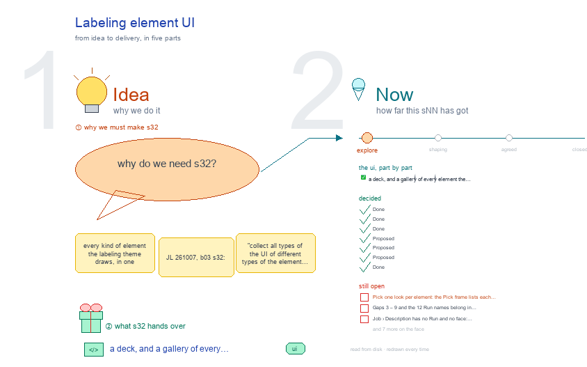

# s32 · Labeling element UI <!-- root #df14cf -->

**Stage:** explore

- For <!-- @for #f78806 -->
  - a deck, and a gallery of every … <!-- @for/0 #2ed7ae -->
    a deck, and a gallery of every element the labeling theme draws, so the UI can be unified, for the people who build the workbench
- Delivery type <!-- @delivery-type #58a44f -->
  - ui <!-- @delivery-type/0 #636117 -->
- Topic <!-- @topic #7e13bd -->
  - every kind of element the labeling theme … <!-- @topic/0 #f5e657 -->
    every kind of element the labeling theme draws, in one gallery, so the UI can be unified (JL 261007, b03 s32: "collect all types of the UI of different types of the element ... so we can unify them").
  - Each element is shown three ways: as … <!-- @topic/1 #e1a233 -->
    Each element is shown three ways: as the labeling theme draws it today on the frame (`/_board/workbench` at its Block, Job and Task levels, every Space and view), as its old board and job pages draw it (flagged OLD, red dashed), and as b03's s11 · s12 · s13 plan it for labeling.
  - Beside each element, a "· proposed" frame: … <!-- @topic/2 #888931 -->
    Beside each element, a "· proposed" frame: one look, b03's picks kept, with why, a green line for what changed and a red line for what is open.
  - It is b03's `s32-element-ui` cut to one … <!-- @topic/3 #e62ea8 -->
    It is b03's `s32-element-ui` cut to one theme, and it adds the six elements only labeling has.
- Feeds <!-- @feeds #ffe8e9 -->
  - `../reports/` q01_labeling_ladder · q02_building_scanning_gates · q03_schema_and_handoff; and … <!-- @feeds/0 #f7b7f1 -->
    `../reports/` q01_labeling_ladder · q02_building_scanning_gates · q03_schema_and_handoff; and b03's s32 (its Theme elements frame reads the list below).
- Files <!-- @files #6ce6c5 -->
  - [py] [build_s32_labeling_element_ui.py](build_s32_labeling_element_ui.py) <!-- @files/0 #1d80ed -->
  - delivery/ <!-- @files/1 #404761 -->
  - [excalidraw] [s32-labeling-element-ui.excalidraw](s32-labeling-element-ui.excalidraw) <!-- @files/2 #cd77b8 -->
  - [md] [s32-labeling-element-ui.md](s32-labeling-element-ui.md) <!-- @files/3 #a4c471 -->
  - [png] [s32-labeling-element-ui.png](s32-labeling-element-ui.png) <!-- @files/4 #401169 -->
    
  - shots/ <!-- @files/5 #4d5052 -->
- What the gallery holds <!-- @what-the-gallery-holds #69fd53 -->
- Theme elements <!-- @theme-elements #bfa59f -->
  - element · level · Space › view … <!-- @theme-elements/0 #fe1a62 -->
    element · level · Space › view · the base's, or its own and why · drawn today, or GAP: …
  - top tabs · every level · the … <!-- @theme-elements/1 #f922a1 -->
    top tabs · every level · the level row and the six Spaces · base · drawn
  - top tabs · Task (old page) · … <!-- @theme-elements/2 #49ed3b -->
    top tabs · Task (old page) · Data · Labeling · Quality · Delivery · retires: they are the Task's views ·
  - GAP: the job page keeps its own … <!-- @theme-elements/3 #85fc9c -->
    GAP: the job page keeps its own four Spaces while it is the write door
  - view row · every level · every … <!-- @theme-elements/4 #d550ba -->
    view row · every level · every Space's views · base · drawn
  - view row · Task · Work Details … <!-- @theme-elements/5 #0ccb7d -->
    view row · Task · Work Details › Preparation · Embedding · Definition · Rounds · Guideline · Test ·
  - Evaluation · Audit, then the base's Evidence … <!-- @theme-elements/6 #242f7c -->
    Evaluation · Audit, then the base's Evidence · Value · base row, the theme's views · GAP: s13 puts Preparation in Description and Scan in Work Details (today in Delivery), with a Building | Scanning divider; Evidence and Value show the Preparation Run
  - Question rows · Block · Audience Report … <!-- @theme-elements/7 #fcf021 -->
    Question rows · Block · Audience Report · base (the Insight row) · drawn
  - Question rows · Job · Audience Report … <!-- @theme-elements/8 #e05959 -->
    Question rows · Job · Audience Report › Scored · Building (ours vs the dataset's ground truth) · base row, the
  - labeling words · GAP: not drawn; the … <!-- @theme-elements/9 #163da3 -->
    labeling words · GAP: not drawn; the Job has no reports/ and no t04 scoring Task yet
  - Question rows · Task · Audience Report … <!-- @theme-elements/10 #096f45 -->
    Question rows · Task · Audience Report › Report (REPORT.md) · base (a work Task's Report) · drawn
  - Space body + Disk · Runs · … <!-- @theme-elements/11 #7d596d -->
    Space body + Disk · Runs · every level · every Space · base · drawn
  - table · Block, Task · Work Details … <!-- @theme-elements/12 #1e87ea -->
    table · Block, Task · Work Details › Labeling; a job's facts · base (wf-table) · drawn
  - table · Task (old page) · Data … <!-- @theme-elements/13 #64fe26 -->
    table · Task (old page) · Data › Preparation steps · base table · GAP: its own steptable
  - rows · every level · Idea Studio <!-- @theme-elements/14 #58b72d -->
    rows · every level · Idea Studio; Work Details › Jobs · base · drawn
  - Runs panel · every level · every … <!-- @theme-elements/15 #5148eb -->
    Runs panel · every level · every Space · base; buttons named run-labeling-<op>-<target> · drawn ·
  - GAP: the old job page's panel names … <!-- @theme-elements/16 #560994 -->
    GAP: the old job page's panel names none (below)
  - tags · Block, Task · the 'open … <!-- @theme-elements/17 #c34ab4 -->
    tags · Block, Task · the 'open ↗' chip, state spans · none (b03 s32-D09) · GAP: still drawn
  - header · every level · the top … <!-- @theme-elements/18 #717db8 -->
    header · every level · the top line · base · drawn
  - job status (no item text) · Block, … <!-- @theme-elements/19 #847815 -->
    job status (no item text) · Block, Task · Block › Work Details › Labeling; each Task view · its own: a
  - labeling job's status, read only · drawn … <!-- @theme-elements/20 #0d7b15 -->
    labeling job's status, read only · drawn · GAP: two lists at the Block (Jobs and Labeling), s11 plans one
  - way out ↗ · Block, Task · … <!-- @theme-elements/21 #05e731 -->
    way out ↗ · Block, Task · every labeling view · its own until the frame hosts the gates · drawn (the
  - link answers 200 since b03's fix, 261008) <!-- @theme-elements/22 #ad8252 -->
  - schema · Block (per Job in s12) … <!-- @theme-elements/23 #19550b -->
    schema · Block (per Job in s12) · Description › Schema · its own: the label, as the file reads · drawn ·
  - GAP: per Job in s12 (b15 Q03) <!-- @theme-elements/24 #83bbde -->
  - label meanings + G0 gate · Task … <!-- @theme-elements/25 #0573f8 -->
    label meanings + G0 gate · Task · Work Details › Definition · its own: the person's gate · GAP: on the old
  - page only; the frame shows status <!-- @theme-elements/26 #8f7e4b -->
  - calibration rounds · Task · Work Details … <!-- @theme-elements/27 #1e28a7 -->
    calibration rounds · Task · Work Details › Rounds · its own: item text shows only here · GAP: on the old
  - page only <!-- @theme-elements/28 #c43541 -->
  - corpus preparation + map · Task (s12: … <!-- @theme-elements/29 #346059 -->
    corpus preparation + map · Task (s12: the Job's t01 items) · Work Details › Preparation · Embedding · base
  - table + its own map · GAP: … <!-- @theme-elements/30 #7cf25c -->
    table + its own map · GAP: on the old page only
  - guideline · Task · Work Details › … <!-- @theme-elements/31 #9d1aa5 -->
    guideline · Task · Work Details › Guideline · its own: the versions G_NN · GAP: on the old page only
  - test · evaluation · audit · Task … <!-- @theme-elements/32 #672eae -->
    test · evaluation · audit · Task · Work Details (Scanning) · base table · GAP: empty; the engine's Scanning
  - Runs are not built yet <!-- @theme-elements/33 #9d8622 -->
  - handoff · scan · final labels · … <!-- @theme-elements/34 #087fbb -->
    handoff · scan · final labels · Task, rolled up to Job and Block · Delivery · base rows, the handoff its own
  - (signed) · drawn as status only · … <!-- @theme-elements/35 #6f096e -->
    (signed) · drawn as status only · GAP: no Job or Block roll-up yet
  - Idea Studio · every level · Idea … <!-- @theme-elements/36 #54b2c3 -->
    Idea Studio · every level · Idea Studio · base (b03 s32-D06) · drawn
  - the labeling board page · old · … <!-- @theme-elements/37 #bb6743 -->
    the labeling board page · old · `/_board/labeling-board` · retires: Block › Work Details · old page
  - the labeling job page · old · … <!-- @theme-elements/38 #15e721 -->
    the labeling job page · old · `/_board/labeling` · retires last: it is the write door · old page
- Buttons with no Run name <!-- @buttons-with-no-run-name #84dd2d -->
  - Read off the live pages (`shots/facts.json` `_buttons`) … <!-- @buttons-with-no-run-name/0 #4e3a2e -->
    Read off the live pages (`shots/facts.json` `_buttons`) and b03's planned screens, named by b03's `run_names`; the frame's Run names frame lists the same. The rule is the theme's own: a view's button is `run-labeling-<view>-<job>`; an engine step inside a view is a pass of that view's Run; a round is its own Run (`run-labeling-round-<NN>`).
  - Clashes, fixed by b03 in `run_names.DRAWN` (261008; … <!-- @buttons-with-no-run-name/1 #579a84 -->
    Clashes, fixed by b03 in `run_names.DRAWN` (261008; the drawing shows them green once they read so):
  - "Set up the job" read `run-add-<jNN>`; now … <!-- @buttons-with-no-run-name/2 #083df9 -->
    "Set up the job" read `run-add-<jNN>`; now `run-labeling-contract-<job>` (Data › Contract).
  - "Build a map" read `run-draw-<sNN>`; now `run-labeling-embedding-<job>` … <!-- @buttons-with-no-run-name/3 #2c7e60 -->
    "Build a map" read `run-draw-<sNN>`; now `run-labeling-embedding-<job>` (Data › Embedding).
  - "Measure" read `run-labeling-evaluation-<job>`; now `run-labeling-round-<NN>` (a pass … <!-- @buttons-with-no-run-name/4 #50036d -->
    "Measure" read `run-labeling-evaluation-<job>`; now `run-labeling-round-<NN>` (a pass of the round).
  - The 17 engine steps not built yet … <!-- @buttons-with-no-run-name/5 #60d3d8 -->
    The 17 engine steps not built yet (test-reserve … dstar-materialize) show no button today; when built, each takes its view's Run by the same rule (`OP_RUN` in the builder).
- Decided <!-- @decided #55615a -->
  - s32-D01 · Done (261008): b03's picks hold … <!-- @decided/0 #3d7a68 -->
    s32-D01 · Done (261008): b03's picks hold for the labeling theme: top tabs in the D · E look, the view row in the E look, the Question cell as the Insight row, Disk inside the Runs panel, no tags (b03 s32-D01, D02, D05, D08, D09). The labeling theme gives the words, and the layout of its own elements only.
  - s32-D02 · Done (261008): the levels are … <!-- @decided/1 #55bf80 -->
    s32-D02 · Done (261008): the levels are shot live from b61 and b62 in Project-Labeling-SafeResponse; the labeling board page and the labeling job page are flagged OLD (`old_reason`, read off the code: the theme has `labeling_theme.py`). The job page is reached with path= starting "/", the only form its route accepts.
  - s32-D03 · Done (261008): each element shows … <!-- @decided/2 #8e51c1 -->
    s32-D03 · Done (261008): each element shows b03's planned labeling screen, sliced out of b03's own row builders, so the gallery follows s11 · s12 · s13 on every rebuild (b15 has no s11 – s13 of its own).
  - s32-D04 · Proposed (261008): six elements are … <!-- @decided/3 #b0e012 -->
    s32-D04 · Proposed (261008): six elements are labeling's own (11 – 16). The job page's views (Definition with its G0 gate, Rounds, Guideline, Preparation and its map) carry over into the frame's Task views in base rows and tables (JL: carry over what exists); the gated actions stay engine-checked through `POST /_board/labeling/act`.
  - s32-D05 · Proposed (261008): the job page … <!-- @decided/4 #2318f5 -->
    s32-D05 · Proposed (261008): the job page retires last, once the frame hosts its gated actions; until then it is the one write door and keeps its own four Spaces.
  - s32-D06 · Proposed (261008): every labeling button … <!-- @decided/5 #56a40f -->
    s32-D06 · Proposed (261008): every labeling button is named `run-labeling-<view>-<job>`, an engine step a pass of its view's Run and a round its own Run (the list above). The 12 names wait for JL (they go into `labeling_theme.py` RUN_NAMES); the three clashes are fixed in b03's `run_names.DRAWN` (261008).
  - s32-D07 · Done (261008, b03): both job … <!-- @decided/6 #3b1fc0 -->
    s32-D07 · Done (261008, b03): both job links answer 200: `generated_page_url` in `labeling.py` accepts path= with or without a leading "/" (test in haipipe-draft/tests/test_labeling.py); reshot, the title frame's link lines are green.
- Open <!-- @open #cf9b77 -->
  - Pick one look per element: the Pick … <!-- @open/0 #61dbcd -->
    Pick one look per element: the Pick frame lists each one, b03's picks in green, the proposal in red.
  - Gaps 3 – 9 and the 12 … <!-- @open/1 #6524c4 -->
    Gaps 3 – 9 and the 12 Run names belong in `labeling_theme.py` (its views and RUN_NAMES); they wait for
  - JL (b03, 261008) <!-- @open/2 #ae6f22 -->
    JL (b03, 261008). Server code is not changed from this topic.
  - Job › Description has no Run and … <!-- @open/3 #1fd9cb -->
    Job › Description has no Run and no face: `j01_building_corpus/` holds no `j01_building_corpus.md`.
  - Job › Audience Report draws no rows; … <!-- @open/4 #d617f8 -->
    Job › Audience Report draws no rows; s12 plans ours vs the dataset's ground truth from t04's scoring Runs.
  - Task › Work Details mixes the labeling … <!-- @open/5 #9db1cb -->
    Task › Work Details mixes the labeling views with the base's Evidence · Value, which show the Preparation
  - Run; s13 plans Preparation in Description and … <!-- @open/6 #53afbd -->
    Run; s13 plans Preparation in Description and Scan in Work Details with a Building | Scanning divider.
  - The Block lists its jobs twice: Work … <!-- @open/7 #0f8f66 -->
    The Block lists its jobs twice: Work Details › Jobs (the jNN_ folders) and › Labeling (the jobs).
  - Tags: the 'open ↗' chip and the … <!-- @open/8 #37c638 -->
    Tags: the 'open ↗' chip and the state spans go (b03 s32-D09); the state becomes a word.
  - The 12 buttons above have no Run … <!-- @open/9 #67501e -->
    The 12 buttons above have no Run name (the three clashes are fixed, 261008).
  - Where the schema lives: the Block today, … <!-- @open/10 #3dfa96 -->
    Where the schema lives: the Block today, per Job in s12 (b15 Q03).
  - Agree its **For:** line and **Delivery type:** … <!-- @open/11 #7b11a4 -->
    Agree its **For:** line and **Delivery type:** (ui), proposed by the agent 261030?
