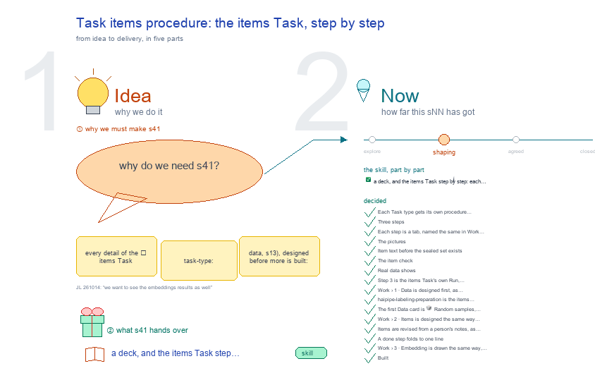

# s41 · Task items procedure: the items Task, step by step <!-- root #4ed14d -->

**Tags:** `Levels`
**Stage:** shaping

- For <!-- @for #f78806 -->
  - a deck, and the items Task step … <!-- @for/0 #1ff03f -->
    a deck, and the items Task step by step: each Run, what it reads and writes, its prompt, for the people who write the toolkit skills
- Delivery type <!-- @delivery-type #58a44f -->
  - skill <!-- @delivery-type/0 #34b33e -->
- Topic <!-- @topic #7e13bd -->
  - every detail of the 📦 items Task … <!-- @topic/0 #22c377 -->
    every detail of the 📦 items Task (`task-type: data`, s13), designed before more is built: its steps, each step's Run, what it reads and writes on disk, what its tabs show in Work and in Report, the prompt that runs it, how its state is read, and the rules that keep item text and ground truth out of sight.
  - The first real one is dices350 `t01_dices350_items` <!-- @topic/1 #3e2d57 -->
  - Asked by JL 261014 ("I think we … <!-- @topic/2 #3d55c5 -->
    Asked by JL 261014 ("I think we should have a b15 s14-TaskItem-Procedure, and design every details").
  - One topic per Task type, named `sNN-task-<type>-procedure` … <!-- @topic/3 #60963d -->
    One topic per Task type, named `sNN-task-<type>-procedure` in the s41-s49 band (JL 261014: "so we will have, Task-xxxx-procedure"; "it should be a new series"): s41 items, then ground truth, building, scanning and score.
  - The screens built so far that day … <!-- @topic/4 #88c4bc -->
    The screens built so far that day are the first draft this topic replaces.
- Feeds <!-- @feeds #ffe8e9 -->
  - `reports/` q01_labeling_ladder · q02_building_scanning_gates <!-- @feeds/0 #e5c97c -->
- Files <!-- @files #6ce6c5 -->
  - [py] [build_s41_task_items_procedure.py](build_s41_task_items_procedure.py) <!-- @files/0 #ae71ea -->
  - delivery/ <!-- @files/1 #404761 -->
  - history/ <!-- @files/2 #9a00ab -->
  - passes/ <!-- @files/3 #49b302 -->
  - [excalidraw] [s41-task-items-procedure.excalidraw](s41-task-items-procedure.excalidraw) <!-- @files/4 #cf8e04 -->
  - [md] [s41-task-items-procedure.md](s41-task-items-procedure.md) <!-- @files/5 #80789f -->
  - [png] [s41-task-items-procedure.png](s41-task-items-procedure.png) <!-- @files/6 #79203e -->
    
  - shots/ <!-- @files/7 #4d5052 -->
- 1 · The steps (proposed: three) <!-- @1-the-steps-proposed-three #49d9ea -->
  - **Step 1 · Read the raw data**: … <!-- @1-the-steps-proposed-three/0 #6c6b39 -->
    **Step 1 · Read the raw data**: one hard Run, `rNN_raw_read` (`haipipe-task-for-description`). It reads the raw
  - files once and writes their Table Card <!-- @1-the-steps-proposed-three/1 #f28277 -->
    files once and writes their Table Card. It makes no items.
  - **Step 2 · Make the items**: one … <!-- @1-the-steps-proposed-three/2 #0bc832 -->
    **Step 2 · Make the items**: one hard Run, `rNN_items` (`haipipe-task-for-data`). It holds the recipe (what one
  - item is) and makes every item from … <!-- @1-the-steps-proposed-three/3 #436f2d -->
    item is) and makes every item from it. The recipe is settings in the Run's config (§ 6), and a person signs it in the Run's card (`signs:`) before the Run starts (s41-D10); the sign is a gate inside the step, not a step of its own (JL 261014: "2 · Item, should this creating items?").
  - **Step 3 · Embed the items**: hard, … <!-- @1-the-steps-proposed-three/4 #513683 -->
    **Step 3 · Embed the items**: hard, one Run per model (`run-labeling-embedding-<job>` today, on the labeling
  - job's lane <!-- @1-the-steps-proposed-three/5 #7ea43d -->
    job's lane; Open 2). It writes the vectors, the map and its groups.
  - **Then**: the 🏗 building Task takes the … <!-- @1-the-steps-proposed-three/6 #8daa3f -->
    **Then**: the 🏗 building Task takes the items, holds back the sealed set (its Contract, P0) and starts its rounds.
  - The 261014 draft had four steps, with … <!-- @1-the-steps-proposed-three/7 #02e67b -->
    The 261014 draft had four steps, with "Choose what one item is" as a separate soft Run. Proposed: fold it into Step 2, because the recipe only proves itself when the items exist, and the config that runs is the recipe.
- 2 · What each step reads and writes <!-- @2-what-each-step-reads-and-writes #2f0933 -->
  - | step | reads | writes (Result) … <!-- @2-what-each-step-reads-and-writes/0 #3b8a27 -->
    | step | reads | writes (Result) | writes (store) | done when | |---|---|---|---|---| | 1 | the raw folder | `description.json` (Table Card), `metrics.json` | nothing | its Run is complete and the card is there | | 2 | the raw folder, the signed recipe | `manifest.yaml`, `metrics.json` | `items-vN/` | its Run is complete with `manifest.yaml` | | 3 | `items-vN/items.jsonl` | the build record | vectors, map, groups | one build is complete |
  - A new recipe makes a new items … <!-- @2-what-each-step-reads-and-writes/1 #b5d6d5 -->
    A new recipe makes a new items version (`items-v4`) by a new Run; a closed Run and its items are never rewritten.
- 3 · What the tabs show <!-- @3-what-the-tabs-show #2e9de4 -->
  - One shape for every step tab (proposed … <!-- @3-what-the-tabs-show/0 #7c5c81 -->
    One shape for every step tab (proposed 261014, after "it is so hard to read"):
  - | tab | ① at a glance … <!-- @3-what-the-tabs-show/1 #e45536 -->
    | tab | ① at a glance | ② the picture | ③ folded | |---|---|---|---| | 1 · Data | rows · columns · units (chats) · raters; "one row is …" | one row as group cards, made-up values | the columns by group · the checks · the file and its Run | | 2 · Items | items · median words judged · median turns before | one made-up item drawn (before → **main** → after), then the item list (id, words, turns) | the recipe as signed · what the Run recorded · files · earlier Runs | | 3 · Embedding | models built · groups | the map | the builds and their settings |
  - The tabs are named for the step, … <!-- @3-what-the-tabs-show/2 #055ecf -->
    The tabs are named for the step, the same in Work and Report, so a switch keeps the step. Older links (Itemization, 1 · Data, 3 · Item list) open the matching new tab.
- 4 · State and prompts <!-- @4-state-and-prompts #3d10ec -->
  - **State, from disk**: done (the step's Run … <!-- @4-state-and-prompts/0 #980642 -->
    **State, from disk**: done (the step's Run is complete with its required files), next (the first not done),
  - not yet (after it) <!-- @4-state-and-prompts/1 #ecab4f -->
    not yet (after it). Nothing is typed by hand.
  - **The prompts**, one per step, copied from … <!-- @4-state-and-prompts/2 #16f56a -->
    **The prompts**, one per step, copied from Work:
- 5 · What shows, and what it costs <!-- @5-what-shows-and-what-it-costs #466d73 -->
  - **Real rows and real items** show when … <!-- @5-what-shows-and-what-it-costs/0 #c0aad5 -->
    **Real rows and real items** show when opened (s41-D07): the raw rows with every column, the items with their
  - text <!-- @5-what-shows-and-what-it-costs/1 #372ea0 -->
  - **What that costs**: the raw rows carry … <!-- @5-what-shows-and-what-it-costs/2 #e841c2 -->
    **What that costs**: the raw rows carry the experts' and raters' answers (the ground truth), and the items include the
  - ones the building Task will later hold … <!-- @5-what-shows-and-what-it-costs/3 #2e88ff -->
    ones the building Task will later hold back as the sealed set; a person who has read them is no longer blind to them.
  - **The Table Card's sample** stays made up … <!-- @5-what-shows-and-what-it-costs/4 #872f06 -->
    **The Table Card's sample** stays made up (`synth_df`), so the card itself is shareable.
- 6 · The recipe, so any dataset can be itemized <!-- @6-the-recipe-so-any-dataset-can-be-itemized #f76f31 -->
  - The recipe is settings in the items … <!-- @6-the-recipe-so-any-dataset-can-be-itemized/0 #85b7c0 -->
    The recipe is settings in the items Run's config, not code, so one worker itemizes any raw dataset. Step 1's Table Card proposes its first draft; a person signs it in the Run's card before the Run starts (s41-D10).
  - | field | what it says | … <!-- @6-the-recipe-so-any-dataset-can-be-itemized/1 #f658fa -->
    | field | what it says | DICES-350 | |---|---|---| | `unit_key` | the column(s) whose rows make one item | the chat's id | | `item_id` | how an item's id is written | `<dataset>-<n>` | | `main` | the text being judged | the AI's last reply | | `context_before` | the text before it, and how it is cut into turns | earlier turns, by speaker tag | | `context_after` | the text after it | none | | `keep_out` | the answer columns, written to their own files and never into an item | the experts' key, the raters' answers | | `check` | the item check, Step 2's gate | unique ids · one item per unit · main not empty · no `keep_out` value inside an item |
  - A dataset with no `context_before` or `main` … <!-- @6-the-recipe-so-any-dataset-can-be-itemized/2 #8f0877 -->
    A dataset with no `context_before` or `main` (Open 3) keeps the same fields and leaves those empty; its item drawing is then the `main` text alone.
- Decided <!-- @decided #55615a -->
  - s41-D01 · Each Task type gets its … <!-- @decided/0 #261753 -->
    s41-D01 · Each Task type gets its own procedure topic, `sNN-task-<type>-procedure`, in a new band, s41-s49 (JL 261014: "it should be a new series"; s50s were asked, but s51-s59 is the server band, so the free 40s were taken). This one was made as s14-items-task-procedure, then s14-task-items-procedure, the same day.
  - s41-D02 · Three steps: 1 Read the … <!-- @decided/1 #b029df -->
    s41-D02 · Three steps: 1 Read the raw data (hard `rNN_raw_read`) · 2 Make the items (hard `rNN_items`, its recipe signed in the face's Method part and typed in its config) · 3 Embed the items; Open 1, taken as proposed (JL 261014: "go ahead and do it").
  - s41-D03 · Each step is a tab, … <!-- @decided/2 #e9db97 -->
    s41-D03 · Each step is a tab, named the same in Work and Report: 1 · Data · 2 · Items · 3 · Embedding. Work: the step's title, state chip and Copy prompt, then ① at a glance (big numbers, one sentence), ② the picture, ③ the details folded. Report: ① and ② only. Older links (Itemization, 2 · Item, 3 · Item list, 4 · Embedding) open the matching tab. The scoreboard and the cards are shared base looks, `.stat-row` and `.card-row` in `servers/workbench/frame.py` WORK_CSS, so a theme still carries no stylesheet (built 261014).
  - s41-D04 · The pictures: 1 · Data … <!-- @decided/3 #2ba1ce -->
    s41-D04 · The pictures: 1 · Data draws one row as one card per column group, its values made up (synth_df); 2 · Items draws one made-up item (context_before │ main │ context_after, main marked) and the first 20 items by id and size; 3 · Embedding frames the map once built (built 261014).
  - s41-D05 · Item text before the sealed … <!-- @decided/4 #c268e9 -->
    s41-D05 · Item text before the sealed set exists: never; ids and sizes only (Open 3, taken as proposed).
  - s41-D06 · The item check (unique ids, … <!-- @decided/5 #14f1be -->
    s41-D06 · The item check (unique ids, the context before the main text, no key inside an item) is Step 2's result gate, named in its prompt (Open 4, taken as proposed).
  - s41-D07 · Real data shows (JL 261014: … <!-- @decided/6 #da92a0 -->
    s41-D07 · Real data shows (JL 261014: "for the data I want to see the raw data ... to present the raw data as it is if we want"; "here we want to put the real items to look, the real things"): 1 · Data has a fold, The raw rows, as they are (the first 10, every column, the answers included), in Work and Report; 2 · Items draws the first real item and lists the real items. This replaces D05; the Table Card's sample stays made up.
  - s41-D08 · Step 3 is the items … <!-- @decided/7 #382053 -->
    s41-D08 · Step 3 is the items Task's own Run, `rNN_embedding_<model>` (`scripts/embed_items.py`, the engine's encoder, groups and map on items.jsonl): the map and groups to result/, the vectors to the store; 3 · Embedding draws the map and its groups (JL 261014: "we want to see the embeddings results as well"; Open 1 settled: this Task owns it). dices350's ticket, r06_embedding_minilm, is ready and planned; a person presses Run (AGENTS rule 2).
  - s41-D09 · Work › 1 · Data … <!-- @decided/8 #ae0b68 -->
    s41-D09 · Work › 1 · Data is designed first, as screens of the tab as it develops, one short line each, in one row left to right, each act's row a stair down and right of the one before (JL 261014: "from act two to act three, I think we can have the stair as well"; "make this part to be more screenshot, and show how things are developed along the way"; "as concise as possible"; "they are the same level ... just make them from left to right"). Two screens: 1 what we have, read from disk (the Job's dataset, its folder, its files), and the prompt; 2 the data, once the agent's rNN_raw_read Run has filled in the rest, drawn by hand as the step itself (what we have, the prompt, now done) and below it, outside the step's box, a list of full-width cards, one per topic (Random samples, Background, Basic description, One row drawn, Current labels, The text to label, Watch out; JL 261014: "you should have other cards in below like showing the result in different topics"). Nothing is typed: the Job already chose the data (JL 261014: "we don't need to manually enter the data path"). A person runs each step; the design comes first.
  - s41-D11 · `haipipe-labeling-preparation` is the items Task's … <!-- @decided/9 #08015d -->
    s41-D11 · `haipipe-labeling-preparation` is the items Task's one main skill: every step's prompt names it (Data: describe; Items: recipe, materialize, check; the sealed set: reserve), and it calls other skills inside, never the person (JL 261014: "we should have a main skill for it ... focus on the haipipe-preparation"). Today it has no describe operation, reads only transcript JSONL, and keeps its Runs in `<source>/corpus-preparation/` (Open 4).
  - s41-D12 · The first Data card is … <!-- @decided/10 #6a2789 -->
    s41-D12 · The first Data card is 🎲 Random samples, before Background (JL 261014: "if we want to check the random sample, how can we do it?"): the describe Run draws 5 real rows with a seed and keeps the seed and the row numbers in its result, so the same sample opens again; Draw again reads another 5 live from the raw file with a new seed, writes nothing and starts no Run. The rows are real, so Open 1 (a sealed set drawn from rows already seen) applies.
  - s41-D13 · Work › 2 · Items … <!-- @decided/11 #8ce4e8 -->
    s41-D13 · Work › 2 · Items is designed the same way as Data, screens in a row: 1 what we have from Step 1, the recipe the agent proposed from the Data cards (dashed until a person presses Sign) and the prompt; 2 the step done, the recipe signed, and below it one card per topic: Random items, The items, Statistics (how the items spread: words judged and turns before as histograms, the shortest and longest by id; JL 261014: "we also want some statistic description"), One item drawn, The item check, Kept out, The version. The two Items screenshots of the first draft are no longer drawn (JL 261014: "could you like make the same thing to the item?").
  - s41-D14 · Items are revised from a … <!-- @decided/12 #be4625 -->
    s41-D14 · Items are revised from a person's notes, as many times as needed, and the notes go in the prompt (JL 261014: "do we only have two versions of item part ... if [people] want to provide their feedback, how could we do that?"; then: "can we use this as the window for us to provide the feedback ... copy things and pull that into the prompt and then ... copy the prompt and make it work"). Every prompt box is yours to add to: below the prompt, a notes area where you type, or paste a row, an item or an image; Copy prompt copies the prompt with the notes. A pasted image is kept as a file beside the next Run (`runs/<next run>/notes/`) and its path goes in the prompt, since a copied prompt carries text only. ⑥ is that pass for Items: your notes on items-v3 and the `revise` prompt; the agent proposes recipe v4 and shows what changed, you sign it (④ again), and items-v4 is made; v3 stays. The Run keeps the prompt it was given, notes included, so each version says why it exists.
  - s41-D15 · A done step folds to … <!-- @decided/13 #b92732 -->
    s41-D15 · A done step folds to one line (▸ step · ✓ chip · what it holds), opened on a click, so the result cards come first; a step still to do stays open (JL 261014: "could we make this collapsable as well?").
  - s41-D16 · Work › 3 · Embedding … <!-- @decided/14 #bf1360 -->
    s41-D16 · Work › 3 · Embedding is drawn the same way, as Act 4 (JL 261014: "could you like also show the embedding part"): ⑦ what we have (items-v3), the build proposed (model, what is embedded, the map, the groups; dashed until a person presses Agree, since a person starts every build) and the `embed` prompt; ⑧ the step folded and below it the map first (each point an item, by its group), then The groups, Near-duplicates, Outliers, The builds (another model is another Run) and For building (the sealed set drawn across the groups).
  - s41-D17 · Built (261014 <!-- @decided/15 #c58496 -->
    s41-D17 · Built (261014; JL: "go ahead and make them work"): `haipipe-labeling-preparation` 0.2.0 runs the three steps through its engine, `items_task.py` (plan · sign · settle · sample; describe · items · revise · embed as the worker behind each Task's `scripts/prepare.py`); `items` and `embed` refuse to run unsigned. The labeling theme draws every tab as above (workbench-labeling 0.30.0), with three narrow doors: Draw again, Sign/Agree, and an image note. Checked end to end on DICES-350 in a scratch SPACE: 43,050 rows read, 350 items, the check passed, a revision made items-v2, a map of 9 groups (the local tfidf-svd build; a sentence-transformers model when it is installed).
  - s41-D18 · Concise, as built (JL 261014: … <!-- @decided/16 #c872bd -->
    s41-D18 · Concise, as built (JL 261014: "make everything to be as concise as possible"; "No need to have this small words, remove all of them, add this as a rule as well"): each tab is Operation (the step, its Input, the recipe or build to Sign, a one-line prompt with its `user feedback:` area) over Result (one card per topic, its title only, folded). No grey preview, summary, caption or explanation line anywhere; a meaning is hover text. The steps are named 📥 Step 1 · Data, 🧱 Step 2 · Items, 🗺 Step 3 · Embedding; the cards Random samples · Background · Basic description · One row (made up), a table · Current labels · Text to label · Watch out; Random items · Items · Statistics · One item · Check · Labels kept out · Version; Map · Groups · Near-duplicates · Outliers · Builds. "For building" is dropped. The rule is in workbench-labeling's Surface law (0.31.0).
  - s41-D19 · The map is interactive (JL … <!-- @decided/17 #a90fb1 -->
    s41-D19 · The map is interactive (JL 261014: "one for 2-D and one for 3-D ... the interactive one"; "give also the axis"; "when I hover the point ... the item information"; "add the context as well, I want to make it complete"): 2-D drags and zooms, 3-D turns and spins, both with axes named by the map method (t-SNE 1, 2, 3); hovering a dot shows the whole item, every earlier turn and the judged reply; a click opens it below; a group's button lights the group. The embed Run writes `map3d.json`; an older Run's 3-D places are worked out from its vectors when shown, never written into its result. Near-duplicates and Outliers show each item's text beside its id.
  - s41-D10 · The recipe is signed in … <!-- @decided/18 #617928 -->
    s41-D10 · The recipe is signed in the items Run's card (`signs:` in `run.yaml`), not in the face's Method part, so the signature stays tied to the recipe that ran; the recipe is settings in the Run's config (§ 6), so one worker itemizes any dataset (261014; Open 2 settled).
- Open <!-- @open #cf9b77 -->
  - The sealed set is drawn from items … <!-- @open/0 #e6866b -->
    The sealed set is drawn from items a person may now have read (D07): hold back items nobody opened, or accept it?
  - ~~Who signs the recipe~~: settled by D10, … <!-- @open/1 #eb046b -->
    ~~Who signs the recipe~~: settled by D10, the Run's card.
  - A dataset whose items lack `context_before` and … <!-- @open/2 #b53524 -->
    A dataset whose items lack `context_before` and `main` needs its own item drawing (§ 6 proposes: `main` alone).
  - Bring `haipipe-labeling-preparation` to the items Task (D11): … <!-- @open/3 #b45c07 -->
    Bring `haipipe-labeling-preparation` to the items Task (D11): a `describe` operation that fills the Data cards;
  - a normalizer per raw format (DICES is … <!-- @open/4 #5bd967 -->
    a normalizer per raw format (DICES is CSV); its Runs in the Task's `runs/`; and whether `reserve` stays here or moves to building.
  - Agree its **For:** line and **Delivery type:** … <!-- @open/5 #09a2ba -->
    Agree its **For:** line and **Delivery type:** (skill), proposed by the agent 261030?
