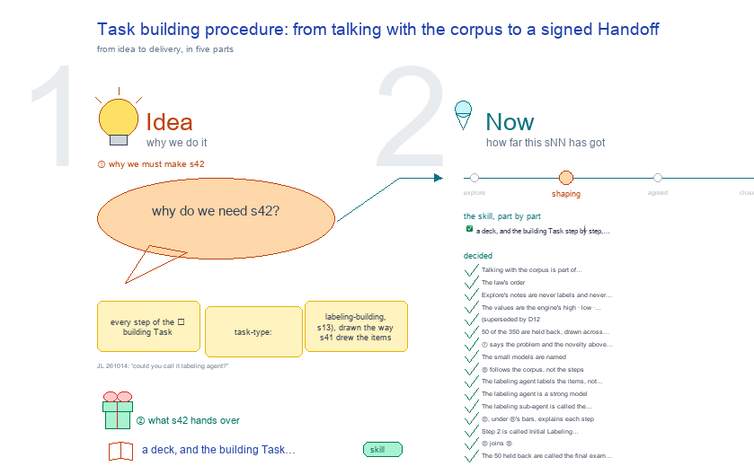

# s42 · Task building procedure: from talking with the corpus to a signed Handoff <!-- root #fe16ac -->

**Tags:** `Levels`
**Stage:** shaping

- For <!-- @for #f78806 -->
  - a deck, and the building Task step … <!-- @for/0 #3b6bba -->
    a deck, and the building Task step by step, from talking with the corpus to a signed Handoff, for the people who write the toolkit skills
- Delivery type <!-- @delivery-type #58a44f -->
  - skill <!-- @delivery-type/0 #34b33e -->
- Topic <!-- @topic #7e13bd -->
  - every step of the 🏗 building Task … <!-- @topic/0 #0396c5 -->
    every step of the 🏗 building Task (`task-type: labeling-building`, s13), drawn the way s41 drew the items Task: one tab per step, Operation over Result, screens as the tab develops, and above them one workflow map of who does what.
  - Building takes the items Task's items and … <!-- @topic/1 #9be69b -->
    Building takes the items Task's items and ends at a signed Label Handoff that the 🔍 scanning Task reads.
  - The person gets to know the corpus … <!-- @topic/2 #61a88f -->
    The person gets to know the corpus by talking with it before the meaning is fixed (JL 261014: "we want the user to talk with the corpus and during the process to make the labeling ... get familiar with the labeling").
  - The first real one is dices350 `t03_dices350_response_safety_labeling` <!-- @topic/3 #2370b3 -->
  - The law (who decides what, the gates, … <!-- @topic/4 #81a554 -->
    The law (who decides what, the gates, the verbs, the step order) stays `haipipe-labeling-building`'s (SKILL.md, ref/step-order.md); this topic draws its screens.
- Feeds <!-- @feeds #ffe8e9 -->
  - `reports/` q02_building_scanning_gates <!-- @feeds/0 #6a4f44 -->
- Files <!-- @files #6ce6c5 -->
  - [py] [build_s42_task_building_procedure.py](build_s42_task_building_procedure.py) <!-- @files/0 #49ab28 -->
  - delivery/ <!-- @files/1 #404761 -->
  - history/ <!-- @files/2 #9a00ab -->
  - passes/ <!-- @files/3 #49b302 -->
  - [excalidraw] [s42-task-building-procedure.excalidraw](s42-task-building-procedure.excalidraw) <!-- @files/4 #644e52 -->
  - [md] [s42-task-building-procedure.md](s42-task-building-procedure.md) <!-- @files/5 #b819ca -->
  - [png] [s42-task-building-procedure.png](s42-task-building-procedure.png) <!-- @files/6 #ce4d46 -->
    
- 1 · The levels: Task → Stage → round → Step → Run <!-- @1-the-levels-task-stage-round-step-run #3f551a -->
  - A Stage is one tab <!-- @1-the-levels-task-stage-round-step-run/0 #dd0feb -->
    A Stage is one tab. Stage 3 repeats in rounds; a round is a folder, `rounds/round_<t>/`, not a Run. Each Step is one Run (LABEL two), named on disk `run-labeling-<operation>-<MMDD>-<target>`.
- 2 · The Stages, in the law's order <!-- @2-the-stages-in-the-law-s-order #93da24 -->
  - | tab | the engine's Run Types … <!-- @2-the-stages-in-the-law-s-order/0 #ae3f3a -->
    | tab | the engine's Run Types (ref/step-order.md) | the person's gate | |---|---|---| | 1 · Contract | corpus-contract (the reservation inside it) · embedding-build* (done in the items Task) | none: no label is made | | 2 · Meaning | discovery-search* · definition-discussion · G0 Confirm meaning · guideline-seed* | meaning (Sign) | | 3 · Rounds | round-prepare · weak-prelabel* · human-calibration · guideline-learn · round-measure · round-close | release · item (first, final) · rule · stop | | 4 · Handoff | handoff-freeze | freeze (Sign G*) |
  - A round folder `rounds/round_<t>/` is an episode, … <!-- @2-the-stages-in-the-law-s-order/1 #bc68fa -->
    A round folder `rounds/round_<t>/` is an episode, not a Run; its Runs are the six above.
- Decided <!-- @decided #55615a -->
  - s42-D01 · Talking with the corpus is … <!-- @decided/0 #2c48bd -->
    s42-D01 · Talking with the corpus is part of building, before its meaning is signed, not a Task type of its own (261014; JL asked "how do you think?"): the meaning needs what the person learned, and the law already has it (definition-discussion and discovery-search, then the G0 gate).
  - s42-D02 · The law's order (ref/step-order.md; the … <!-- @decided/1 #67622d -->
    s42-D02 · The law's order (ref/step-order.md; the reviewer, 261014): 1 Contract (import, the sealed set held back, guideline v0, the register) before anyone reads an item; 2 Meaning (talk, then Sign at G0); 3 Rounds; 4 Handoff.
  - s42-D03 · Explore's notes are never labels … <!-- @decided/2 #f93b23 -->
    s42-D03 · Explore's notes are never labels and never gold: P0 makes no label, and gold comes only from a person's judgment in a closed round. The up to 30 items read in the talk are never drawn into a round, so a small model's seal always comes before the person's first sight (Law 2). (261014, the agent's call: the law decides it.)
  - s42-D04 · The values are the engine's … <!-- @decided/3 #863061 -->
    s42-D04 · The values are the engine's high · low · none (ordinal, how unsafe the reply is); none means no harm in it, never unsure; unsure is a note beside a label. The Meaning step writes what low means for DICES. (261014)
  - s42-D05 · (superseded by D12: the labeling … <!-- @decided/4 #3b791a -->
    s42-D05 · (superseded by D12: the labeling agent labels, the person reviews) The person labels in the chat with the agent (the moderator is the only one who talks with the person); the Rounds tab shows the session live, read-only, item by item: first label, lock, the small models revealed, final. (261014)
  - s42-D06 · 50 of the 350 are … <!-- @decided/5 #628209 -->
    s42-D06 · 50 of the 350 are held back, drawn across the items Task's groups with a seed; a round draws 20 (the engine's default) per arm; round 1 one arm at random, later rounds two, near a register cell and at random. Items glanced at in the items Task (Draw again, the map) may be in the sealed set: accepted and written in the Contract as a limitation, since nothing records what was seen there (s41's Open 1). (261014)
  - s42-D09 · ① says the problem and … <!-- @decided/6 #30a7cc -->
    s42-D09 · ① says the problem and the novelty above the map, each novelty marked ✨1-✨4 where it happens (JL 261014: "what is the novelty? what is the problem we want to solve here?"; "add more here ... I want all the things here"). The claims are the agent's reading, not yet checked against related work (Open 3).
  - s42-D10 · The small models are named: … <!-- @decided/7 #ba6e68 -->
    s42-D10 · The small models are named: Haiku 4.5 (claude-haiku-4-5-20251001) leads the committee, beside one open small model so the results can be reproduced; each labels alone and sealed, and their agreement is never gold (JL 261014: "could we call it haiku 5.5?"; there is no Haiku 5.5, the newest small Claude is Haiku 4.5).
  - s42-D11 · Ⓑ follows the corpus, not … <!-- @decided/8 #706127 -->
    s42-D11 · Ⓑ follows the corpus, not the steps (JL 261014: "another frame to show ... the data side ... the corpus ... selected and chosen and labeled ... in the perspective of the corpus"): one bar of the 350 items per step, split into sealed · read in the talk · your gold · not yet chosen, and at the end what scanning labels.
  - s42-D12 · The labeling agent labels the … <!-- @decided/9 #933cb8 -->
    s42-D12 · The labeling agent labels the items, not the person (JL 261014: "I don't want a human to do the labeling. I want the agent has a subagent to do it ... with this guideline"; chosen: "Review disagreements"). Each round Haiku 4.5 labels sealed, the labeling agent labels with the current guideline and names the rule it used, and the person reviews only where the two disagree or the labeling agent is unsure. Gold is what the person confirms or corrects; agreed labels are kept, never gold. This changes haipipe-labeling-building's law (the person no longer makes every judgment): the law and its engine still need the change (Open 4).
  - s42-D13 · The labeling agent is a … <!-- @decided/10 #d42b02 -->
    s42-D13 · The labeling agent is a strong model (Sonnet 5 or Opus 5.5) given the guideline; Haiku 4.5 is the cheap model that should come to match it, and scanning runs Haiku on the corpus (chosen: "Strong labels, Haiku learns").
  - s42-D15 · The labeling sub-agent is called … <!-- @decided/11 #e7aaa2 -->
    s42-D15 · The labeling sub-agent is called the labeling agent (JL 261014: "could you call it labeling agent?").
  - s42-D16 · Ⓓ, under Ⓑ's bars, explains … <!-- @decided/12 #063f7d -->
    s42-D16 · Ⓓ, under Ⓑ's bars, explains each step: what you do, its input, its process, its output (JL 261014: "could you explain each step, what to do, input, process, and output?").
  - s42-D17 · Step 2 is called Initial … <!-- @decided/13 #e4fe72 -->
    s42-D17 · Step 2 is called Initial Labeling Definition, not Meaning (JL 261014: "could we change this to the Initial Labeling Definition"); it matches the law's Labeling › Definition view and its G0 gate.
  - s42-D18 · Ⓓ joins Ⓑ: one row … <!-- @decided/14 #0a52ca -->
    s42-D18 · Ⓓ joins Ⓑ: one row per step, its corpus bar beside what you do, its input, process and output (JL 261014: "what I mean is B and D into one").
  - s42-D19 · The 50 held back are … <!-- @decided/15 #28451a -->
    s42-D19 · The 50 held back are called the final exam wherever they show (JL 261014: "could you add that (like final testing, final exam)"): they test, once building is over, whether a model with the frozen guideline matches the person on items nobody has seen.
  - s42-D20 · Ⓑ and Ⓒ are one … <!-- @decided/16 #56bbfa -->
    s42-D20 · Ⓑ and Ⓒ are one table (JL 261014: "these two can be merged together as well"): one row per Run, grouped under its step, with the corpus bar after it, then the agent, the labeling agent, you, Haiku, the corpus, the guideline and the labels. "You do" is the you column; "process" is the acting columns; "input → output" is the corpus, guideline and labels from one row to the next. The step table (D16, D18) is folded into it.
  - s42-D21 · Plain words for the round … <!-- @decided/17 #eacc08 -->
    s42-D21 · Plain words for the round card (JL 261014: "a card and a forecast is very hard to understand ... we are trying to collect the examples from the dataset, right?"): the card is "pick this round's items", the forecast "what we expect", and Release is "Approve". The law keeps its own words (card, prospect, release).
  - s42-D22 · Every item takes part in … <!-- @decided/18 #c88a7d -->
    s42-D22 · Every item takes part in every round (JL 261014: "the whole corpus, all the items, interact with it ... we got these types of items ... based on the items we just cycle around"; chosen: "Every item in the pool"): each round the labeling agent and Haiku label all 270 with the current guideline, each item gets a type (✅ settled: both agree, sure · 🤔 unsure · ⚖️ disagree), the pick comes from 🤔 and ⚖️ plus a few ✅ to check, your rulings are gold, your corrections drive the rules, and after a rule changes every item is labeled again. Stop when few 🤔 ⚖️ are left and no hard region is open. Ⓑ counts the types round by round.
  - s42-D23 · The cheap model is a … <!-- @decided/19 #aa8822 -->
    s42-D23 · The cheap model is a small open model, not Haiku 4.5 (JL 261014: "this could be even weaker model ... that we can scale up for large amount of data"): an open model of about 30B (the Qwen3 or Gemma family; the exact one is chosen when built) runs on our own hardware over any amount of data, can be fine-tuned on the gold, and lets a reader reproduce the results. It labels every item each round, sealed, and labels the corpus in scanning. Supersedes D10's Haiku 4.5.
  - s42-D24 · The sort uses both (JL … <!-- @decided/20 #02ca7e -->
    s42-D24 · The sort uses both (JL 261014: "how do we do the sort here? using the embeddings method or what? maybe we can do it in both way?"): the two models' labels give the type (✅ same label, both sure · 🤔 same, not sure · ⚖️ different); the items Task's map flags 🧭 a ✅ whose nearest gold neighbours carry another label, or that sits in a group with no gold yet. The pick takes 🤔 ⚖️ and the 🧭, spread across the map's groups. The map only picks; it never sets a label.
  - s42-D25 · The pools are the register's … <!-- @decided/21 #3aefa9 -->
    s42-D25 · The pools are the register's seven regions (JL 261014: "we have several types of the pools ... H, L, None, H-L, H-None, L-None, L-H-N, I think we have the definition as before"; the Guide's "By in-between regions"): each round every item lands in H, L or N when both models give that label and are sure, in HL, LN or HN when it sits between two labels, in HLN when the definition does not cover it. The register keeps each pool open, covered or risky; a round picks from the open pools and the map's 🧭; you give each ruled item its label and its region; Stop when no pool is open, or one is accepted as a limitation. Supersedes D22's ✅ 🤔 ⚖️ types and D24's sort.
  - s42-D26 · One round is seven steps, … <!-- @decided/22 #b2c650 -->
    s42-D26 · One round is seven steps, each with its purpose, who acts and what it leaves: LABEL · SORT · PICK · JUDGE · LEARN · MEASURE · CLOSE, drawn as a loop in Ⓒ and named on the map's rows (JL 261014: "for each round, we can separate them into different steps, and each step with the purpose ... I remember I discussed about this"; "I think it is correct, please go ahead"). They are the law's CARD · PREPARE · PRELABEL · JUDGE · LEARN · MEASURE · CLOSE (haipipe-labeling-building ref/step-order.md; haipipe-labeling-rounds), with every item labeled and sorted first and PREPARE folded into PICK.
  - s42-D27 · The frames read ① then … <!-- @decided/23 #d62345 -->
    s42-D27 · The frames read ① then Ⓑ then Ⓐ, left to right, as the person arranged them (JL 261014: "I would like to have this arrange"); Ⓒ, the round, sits under Ⓐ, clear of the screens.
  - s42-D28 · The levels are named Task … <!-- @decided/24 #fa7591 -->
    s42-D28 · The levels are named Task → Stage → round → Step → Run (JL 261014: "how do we call this, also the step? what is the tree like description for it"; "make things like this ... as a new frame"): the building Task has four Stages (its tabs); Stage 3 repeats in rounds, each a folder, not a Run; a round has seven Steps; each Step is one Run, LABEL two. Ⓓ draws it as one table, a tree by indent: purpose, who, Run, what it leaves. pool-sort is a new Run type, beside agent-label (Open 4).
  - s42-D29 · Every frame names its levels … <!-- @decided/25 #085c05 -->
    s42-D29 · Every frame names its levels the same way (JL 261014: "add them into the sNN"): "Stage 1 · Contract" to "Stage 4 · Handoff" on the map, Ⓑ, the screens and the acts; "Step 1 · LABEL" to "Step 7 · CLOSE" in Ⓒ and Ⓓ. The face's § 1 holds the tree.
  - s42-D30 · The agent reads the corpus … <!-- @decided/26 #94f63c -->
    s42-D30 · The agent reads the corpus through tools, and a round picks by search rules (JL 261014: "if we have the very large corpus, it is impossible to put all the items to ask the agent to read, so we should have some searching rules"; "how did the agent talk to the corpus"): stats, sample, search, neighbors, contrast, get, over the frozen items and the map; the final exam is not in the index, and every item shown is logged. At scale the rounds run on a development sample (2-5k across the map's groups), the whole corpus only in scanning; DICES's sample is its whole pool. A pick takes items by six rules (random across groups · open pools · neighbours of corrections · queries from the definition · 🧭 · diversity), each item naming its rule. Ⓔ draws it. Step 1 · LABEL labels the development sample, not every item (refines D22).
  - s42-D31 · Design versions are drawn side … <!-- @decided/27 #2181d6 -->
    s42-D31 · Design versions are drawn side by side, linked by dashed arrows (JL 261014: "we can propose different versions of design, you can add them to the new frame and use ---> to link"): Ⓕ shows four ways to run the rounds as the corpus grows: V1 label everything · V2 development sample + search rules (proposed) · V3 growing sample · V4 search only, each with how, cost, fit and risk. The version is chosen in the Contract.
  - s42-D32 · Ⓒ and Ⓓ are one … <!-- @decided/28 #2707ef -->
    s42-D32 · Ⓒ and Ⓓ are one frame (JL 261014: "these two can be merged together"): the round's seven Steps as a loop, then the Task's Stages and Steps as a tree table under it.
  - s42-D33 · The method frames sit left … <!-- @decided/29 #9a5d60 -->
    s42-D33 · The method frames sit left of ① (JL 261014: "we can put these method things to the left"): Ⓐ, under it Ⓒ, under that Ⓔ - - -▶ Ⓕ, right-aligned past the act names; Ⓑ stays right of ①, the screens below ①. Updates D27.
  - s42-D34 · The Handoff's Sign names what … <!-- @decided/30 #668617 -->
    s42-D34 · The Handoff's Sign names what it signs, "✍ Sign (G*)", as Stage 2's says "Sign (G0)" (JL 261014: "for the last Sign, could we say Sign(G*)"); in the map, the ledger and the tree.
  - s42-D35 · ① gains a fifth lane, … <!-- @decided/31 #09b4e4 -->
    s42-D35 · ① gains a fifth lane, the corpus, and every box its input above and its output below (JL 261014: "we should have the column for the corpus as well ... what is the input and output for each box ... before and below the box"). The corpus lane says what the corpus holds after each row (dashed: a state, not an actor). With the in and out lines ① is past a map's 200 words, so it is marked a detail frame read down (⑥ measures it). Updates D07.
  - s42-D36 · Stage 2 runs in passes … <!-- @decided/32 #8f516c -->
    s42-D36 · Stage 2 runs in passes (JL 261014: "we can have multiple rounds of asking and discussions"): the agent asks, you read a few items and write notes, it drafts the definition; another pass until you Sign (G0), still at most 30 items read. Drawn as a loop in ①, lines 3-4 of Algorithm 1, the ledger and the tree.
  - s42-D37 · ①'s lanes, left to right: … <!-- @decided/33 #ec8f7f -->
    s42-D37 · ①'s lanes, left to right: corpus, agent, labeling agent, small open model, you (JL 261014: "put them in the middle and you in the right most, and the corpus to the leftmost"): the two models in the middle, the person's gates on the right, the corpus they all read on the left. Updates D35.
  - s42-D38 · LABEL's two ways in are … <!-- @decided/34 #02ebdc -->
    s42-D38 · LABEL's two ways in are named (JL 261014: "the left one can be a updated G* as well, is that so?"): from above, the first round, G_1 from Sign (G0); from the left, every later round, G_t+1 from your accepted rules. Not G*: G* is only the last G_t, named when you Stop and Sign the Handoff.
  - s42-D39 · ① shows what changes over … <!-- @decided/35 #b9fbee -->
    s42-D39 · ① shows what changes over time, beside who acts (JL 261014: "should we have G_t+1 to G_t ... show how the corpus and guideline and the corpus pool is changed along the time"): two state lanes on the left, 📚 corpus (sealed, read, U, the 7 pools, gold) and 📜 guideline (G_0 → G_1 → G_t → G_t+1 drafted → G_t ← G_t+1 at CLOSE → G*), each joined down by a thin arrow; the round's loop says t ← t+1. Updates D35, D37, D38.
  - s42-D40 · Each timeline change is the … <!-- @decided/36 #a447bf -->
    s42-D40 · Each timeline change is the out of a box in its row (JL 261014: "will these also shown in the process box above and below?"): import leaves 🔒 50 · pool 300, LABEL leaves U's labels, SORT the 7 pools, JUDGE + gold, LEARN G_t+1 drafted, CLOSE G_t ← G_t+1, freeze G* · D*; the in lines name what the box reads (U · G_t, gold · G_t).
  - s42-D41 · ① and Ⓐ name sizes … <!-- @decided/37 #c7160a -->
    s42-D41 · ① and Ⓐ name sizes by symbol, not number (JL 261014: "change the number from the specific number to the symbol"): n = |X| the items, m = |S| the sealed final exam, r the talk's most items read, b a round's picks; DICES's 350 · 50 · 30 stay only in Ⓑ, whose bars draw an example.
  - s42-D42 · In the corpus and guideline … <!-- @decided/38 #ab4390 -->
    s42-D42 · In the corpus and guideline lanes, one box holds the round's rows, named "round t" (JL 261014, drawn on the canvas: "could we add this to indicate this is the box?"): what changes inside it changes every round.
  - s42-D43 · The agent has a reading … <!-- @decided/39 #c09168 -->
    s42-D43 · The agent has a reading budget per step (JL 261014: "agent can see at most N numbers of items ... we might have different types of N, please label them carefully"): c_ask a talk pass, c_pick a PICK, c_learn a LEARN; SORT, MEASURE, CLOSE and freeze read no text (👁 0); each labeler sees one item a call. N stays the talk's set, so the budgets get their own letters; ① ends with a symbols table (n m u r b c_•), Ⓐ's notation and Ⓔ's guards say it.
  - s42-D44 · The screens ②–⑪ follow ① … <!-- @decided/40 #066bf9 -->
    s42-D44 · The screens ②–⑪ follow ① (JL 261014: "update the UI based on this", screens first): sizes as symbols (n m r b), each step's 👁 budget, Stage 2 a pass k with Sign · Another pass, a round's screens titled by its Step (PICK, JUDGE, LEARN, CLOSE) with a Now card (corpus, pools, G_t), both labelers' label + region, CLOSE showing G_t ← G_t+1.
  - s42-D45 · JUDGE shows each picked item … <!-- @decided/41 #dd7125 -->
    s42-D45 · JUDGE shows each picked item on the 3-D map (JL 261014: "for this show them, we can use the 3d embeddings as well"): the item ringed among its nearest neighbours, coloured by your gold so far, rotatable, hover for text (the items Task's 📍 Map, s41-D19); you see what it sits beside before you rule it.
  - s42-D46 · PICK is a funnel over … <!-- @decided/42 #3ed7f1 -->
    s42-D46 · PICK is a funnel over the whole corpus (JL 261014: "how could we select the most valuable new data to review ... from the large corpus"; "what is the final score here?"): ① seed by the six rules (rule 1 now a random audit of the settled pools), ② retrieve neighbours over X∖S (👁 0), ③ score by the small model, v(x) = unsure · dense^β · new · (1 + γ·near) (information density, after Settles & Craven 2008), ④ the agent reads the top c_pick and picks b, one per cluster. b is split across pools by expected error mass; Stop when each pool's is under ε. Picks join U.
  - s42-D47 · The novelty box states the … <!-- @decided/43 #3830b2 -->
    s42-D47 · The novelty box states the paper's three contributions (JL 261014: "our main contribution is ... the researcher can propose their subjective labeling ... second ... it is easy to use, so that's why we have the UI ... a user and agent talk with the corpus ... the third one is it will be quick ... guideline and labeling at the same time"): C1 your own subjective label (✨1), C2 easy to use (✨2), C3 quick (✨3), kept honest by ✨4.
  - s42-D48 · The contributions are what the … <!-- @decided/44 #067f01 -->
    s42-D48 · The contributions are what the person and others get (JL 261014: "a guideline like people are confident with and they can also give the good performance even for some like a weak LM"; "we are trying to build a very good benchmark and we can use it to apply to others"): C1 a guideline you are confident in, C2 a guideline that transfers (a weak model following G* labels like you, measured on S), C3 a benchmark anyone builds quickly with measured confidence. Stop also reads whether the weak model still gains. Updates D47.
  - s42-D49 · The work is framed as … <!-- @decided/45 #13cc8f -->
    s42-D49 · The work is framed as a tool for researchers to build their own benchmark (JL 261014: "this is a tool for the researcher to build their own benchmark"), and C3 is a benchmark that knows where it is unsure: every item keeps its region (H, L, N or a border), so an algorithm is scored on settled and border items apart. Updates D48.
  - s42-D50 · The tool ends by picking … <!-- @decided/46 #6dbbab -->
    s42-D50 · The tool ends by picking the labeler (JL 261014: "and then select the most suitable tools for them to generalize it"): scanning scores each candidate labeler (weak open models, the labeling agent, a classifier) on S under G*, and the best one labels all of X; its score on S is the confidence the labels carry. Updates D49.
  - s42-D51 · The problem is the codebook … <!-- @decided/47 #ba3d0a -->
    s42-D51 · The problem is the codebook written before the data (JL 261014: "many sociologists ... have very subjective conceptions ... they want to have the reliable things ... people are doing it using their proposed guideline. But this is not interactive ... without seeing the real data they are not sure what ... rules they will have"): today a guideline is fixed first and its performance unknown; C1 is an interactive guideline, drawn out on real data.
  - s42-D52 · The small model is a … <!-- @decided/48 #3d5d1c -->
    s42-D52 · The small model is a panel, E (JL 261014: "we might need to provide a list of models, to test and run it to get the performance"): each open model labels U every round, sealed; MEASURE scores each against your gold, round by round, so you watch which model G_t teaches best; the pick of the labeler for all of X is made on S only (scanning), never on the gold the rounds chose. Panel agreement stays a sampling signal, never gold.
  - s42-D53 · One retrieval tool, neighbor_rank(items, k, … <!-- @decided/49 #304bd2 -->
    s42-D53 · One retrieval tool, neighbor_rank(items, k, corpus, method) (JL 261014: "what if we want the neighbours with (item_list, k) ... the item_list is a H pool, or the HL pool ... rank them with the confidences ... the simple model to rank them"): a set in (a pool, your corrections, the talk's hard cases), k new items out of the corpus, ordered by one named method: nearest, confidence, disagree, classifier (trained on your gold only), or value. The funnel's retrieve and rank are this one call; S is never in its corpus. Named find_neighbours(seed, k, corpus, rank_by) (JL 261014: "why not make it to be: extract, or just find_neighbour should be okay"): plain, and says what it does.
  - s42-D54 · The guideline has a format … <!-- @decided/50 #2edd67 -->
    s42-D54 · The guideline has a format and the pools have names (JL 261014: "another issue we haven't make sure is the guideline format"; "for the seven pool, I think we could name each of them"): one source of rule cards rendered for two readers (guideline.md for the person, cheatsheet.md as the labelers' prompt); seven sections; a rule card (if · then · border · precedence · evidence · since · why · status); pools named Settled high · low · none, Degree border (HL), Presence border (LN), Clash (HN), Unmapped (HLN). Written in haipipe-labeling-guideline ref/guideline-format.md and haipipe-labeling-building § The register; not yet drawn.
  - s42-D54 · Both labelers are one tool, … <!-- @decided/51 #1b9436 -->
    s42-D54 · Both labelers are one tool, lm_labeler(items, guideline, engine) (JL 261014: "what I see the things here are the labelers, right? ... a tool like lm_labeler(item_list, guideline, engine = xxx) ... the engine could be many things"): the labeling agent is one engine, each open model in E another; each call returns label, region, confidence and reason, sealed. Built on engine/label.py, which already has claude_sdk, codex and openai_api.
  - s42-D55 · Each agent box in ① … <!-- @decided/52 #6a840f -->
    s42-D55 · Each agent box in ① is the call it makes (JL 261014: "for the next data extraction ... I want things like lm_labeler(U, G_t) ... show that in each step, how do we get the new data from the large corpus"): seal(X, m), get(sample(X∖S)), draft(notes), lm_labeler(U, G_t), sort_pools(A_t, P_t, 🧭), find_neighbours(pools), show(picks, 📍), learn(D, G_t), measure · close, freeze(G_t, D), lm_labeler(X, G*); its in line names where the data comes from.
  - s42-D14 · Ⓒ is the ledger, Run … <!-- @decided/53 #136563 -->
    s42-D14 · Ⓒ is the ledger, Run by Run: who acts (agent, labeling agent, you, Haiku) and what changes (corpus, guideline, labels) (JL 261014: "columns ... the agent, subagent of labeling, the human, the small model, the corpus, the guideline and the labels, and each row is a Run").
  - s42-D08 · Ⓐ writes the same workflow … <!-- @decided/54 #ed75e1 -->
    s42-D08 · Ⓐ writes the same workflow as a paper's Method would (JL 261014: "if we are going to write the ACL paper ... how do we write the method ... a new frame to describe the workflow with the algorithm box"): Algorithm 1 in pseudocode, each human gate a comment beside its line, and the Method's sections mapped to its lines.
  - s42-D07 · ① is a workflow map, … <!-- @decided/55 #ef5cb4 -->
    s42-D07 · ① is a workflow map, the main frame: one row per moment, three lanes (the agent, you, the small models), the round loop drawn closed; the screens below explain it (JL 261014: "we also need to make a workflow mindmap").
- Open <!-- @open #cf9b77 -->
  - ~~Should the items Task log which items … <!-- @open/0 #2b297e -->
    ~~Should the items Task log which items a person opened~~: the corpus tools log every item shown (D30); the
  - items Task's own views (Draw again, the … <!-- @open/1 #70f4ec -->
    items Task's own views (Draw again, the map) should log through the same door.
  - The review lives in the chat (D05, … <!-- @open/2 #69d745 -->
    The review lives in the chat (D05, D12): does the workbench also need a way to rule there, for a person without a
  - chat? <!-- @open/3 #2ab3ae -->
  - The novelty claims ✨1-✨3 are not yet … <!-- @open/4 #e3d41c -->
    The novelty claims ✨1-✨3 are not yet checked against related work (LLM-assisted annotation, rubric or
  - constitution refinement, perspectivist labeling, active learning) <!-- @open/5 #4938aa -->
  - The building law and engine still say … <!-- @open/6 #80660c -->
    The building law and engine still say the person makes every judgment (Law, human gates "item"); a new Run
  - type `agent-label` and the review-only gate are … <!-- @open/7 #141f41 -->
    type `agent-label` and the review-only gate are needed there before s42 can be built.
  - The sealed test needs your answers to … <!-- @open/8 #83e6c7 -->
    The sealed test needs your answers to score anything: do you label all 50 blind, the one time you label every
  - item? <!-- @open/9 #271653 -->
  - Agree its **For:** line and **Delivery type:** … <!-- @open/10 #09a2ba -->
    Agree its **For:** line and **Delivery type:** (skill), proposed by the agent 261030?
