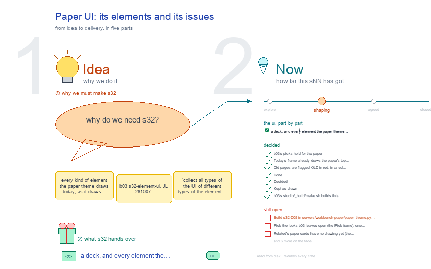
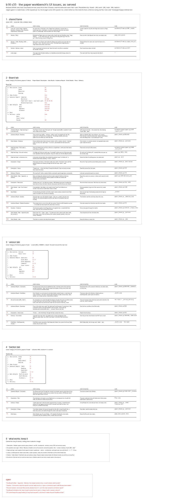

# s32 · Paper UI: its elements and its issues <!-- root #54d81d -->

**Tags:** `UI`
**Stage:** shaping

- For <!-- @for #f78806 -->
  - a deck, and every element the paper … <!-- @for/0 #bb206a -->
    a deck, and every element the paper theme draws today and its UI problems, for the people who build the workbench
- Delivery type <!-- @delivery-type #58a44f -->
  - ui <!-- @delivery-type/0 #636117 -->
- Topic <!-- @topic #7e13bd -->
  - every kind of element the paper theme … <!-- @topic/0 #ebd890 -->
    every kind of element the paper theme draws today, as it draws it, side by side, so the paper takes the one look per element that b03 picks for every theme (b03 `s32-element-ui`, JL 261007: "collect all types of the UI of different types of the element ... so we can unify them").
  - The versions are shot live from the … <!-- @topic/1 #b7fb14 -->
    The versions are shot live from the frame (`/_board/workbench`) at the paper's Block, Job and Task levels, every Space and every view, and from its old pages, flagged OLD.
  - Beside each element, its proposed look: b03's … <!-- @topic/2 #e11ae9 -->
    Beside each element, its proposed look: b03's picks, a short why, a green line for what changed and a red line for what is open.
- Feeds <!-- @feeds #ffe8e9 -->
  - `reports/` q01_paper_ladder (each level's elements and screens); … <!-- @feeds/0 #9ea8a0 -->
    `reports/` q01_paper_ladder (each level's elements and screens); b03 Q08 (one shared base, a theme each).
- Files <!-- @files #6ce6c5 -->
  - [py] [build_s32_paper_ui.py](build_s32_paper_ui.py) <!-- @files/0 #20a083 -->
  - [py] [build_ui_issue.py](build_ui_issue.py) <!-- @files/1 #2ef6a5 -->
  - delivery/ <!-- @files/2 #404761 -->
  - passes/ <!-- @files/3 #49b302 -->
  - [excalidraw] [s32-paper-ui.excalidraw](s32-paper-ui.excalidraw) <!-- @files/4 #46e8d4 -->
  - [md] [s32-paper-ui.md](s32-paper-ui.md) <!-- @files/5 #17820e -->
  - [png] [s32-paper-ui.png](s32-paper-ui.png) <!-- @files/6 #0f4980 -->
    
  - shots/ <!-- @files/7 #4d5052 -->
  - [excalidraw] [ui-issue.excalidraw](ui-issue.excalidraw) <!-- @files/8 #431c83 -->
  - [png] [ui-issue.png](ui-issue.png) <!-- @files/9 #87ea77 -->
    
- What the gallery holds <!-- @what-the-gallery-holds #69fd53 -->
  - Walked: the paper Board on the ladder … <!-- @what-the-gallery-holds/0 #c61546 -->
    Walked: the paper Board on the ladder (TestToLearn: its Block, its versions j01 and j02, and j01's t01_introduction, which has delivery/, results/ and runs/), and an older Board in the A1-Story layout (its Block and its Story group). A "distinct" element is one card per look met (its first place, "+N more places"), told apart by its class and computed style. The old pages: the old paper Board page (rendered by `paper.render_paper`, since `/_board/paper-board` now forwards to the frame), a Section's Page workbench page (`/_board/draft`, where a Section row's ↗ goes), its Page Runs page (`/_board/runs`), and one run's results page (`/_board/run-result`, from a High-level logic row).
  - How the review was done (261008): every … <!-- @what-the-gallery-holds/1 #622eda -->
    How the review was done (261008): every view of the three tabs fetched and shot with headless Chrome (it needs `--timeout`, issue F5), every fold opened for a full-height shot, every link printed by those views checked for its status, and each view compared with the files on disk and with the s11 · s12 · s13 drawings and b03's studio-and-report design. Rebuild the issues: `python build_ui_issue.py`, then render `ui-issue.excalidraw` to `ui-issue.png`.
- Decided <!-- @decided #55615a -->
  - s32-D01 · b03's picks hold for the … <!-- @decided/0 #d01731 -->
    s32-D01 · b03's picks hold for the paper (261008, b03 s32-D01 · D02 · D05 · D08 · D09): top tabs in the D · E look and the view row in the E look, both drawn by the base frame, the paper giving its words only (Paper Board · Version ▾ · Section ▾); every question view's row is Question │ Work │ Report with the Question cell as the Insight row; Disk inside the Runs panel; no tags.
  - s32-D02 · Today's frame already draws the … <!-- @decided/1 #503a15 -->
    s32-D02 · Today's frame already draws the paper's top tabs, view row, header and Disk · Runs panel in the picked looks at every level (frames 1, 2, 7, 9: green "kept"); the Job's Questions view already draws the Insight row and is the proposal for every paper question view.
  - s32-D03 · Old pages are flagged OLD … <!-- @decided/2 #7cfe2d -->
    s32-D03 · Old pages are flagged OLD in red, in a red dashed box (b03 s32-D03): the old paper Board page (its address forwards to the frame; its look lives on inside the frame through `pv()`), and the item pages a paper row opens outside the frame (`/_board/draft`, `/_board/runs`, `/_board/run-result`).
  - s32-D04 · Done (261008, b03's ruling <!-- @decided/3 #66f367 -->
    s32-D04 · Done (261008, b03's ruling; JL 261007: reuse the old cards): the paper's views keep the old paper page's cards inside the base box through `pv()`: the Sections list (sec-row), the item cards (Draft-Main, Draft-Appendix, Comments, Cover letter, Letters) and the paper cards (Related). Only the Delivery grid tables take the base `table()`. (Replaces this topic's first proposal to retire `pv()`.)
  - s32-D05 · Decided (261008, b03's rulings), to … <!-- @decided/4 #31ea78 -->
    s32-D05 · Decided (261008, b03's rulings), to build in `paper_theme.py`:
  - Block › Ideation and Narrative rows take … <!-- @decided/5 #3b7480 -->
    Block › Ideation and Narrative rows take the base `question_cell()` (a "Question N" label with its
  - state dot, the slug, one sentence) <!-- @decided/6 #e409dc -->
    state dot, the slug, one sentence); High-level logic keeps its lw rows.
  - No tags in the paper's views (`rp-tags` … <!-- @decided/7 #b97f55 -->
    No tags in the paper's views (`rp-tags` and the other kinds): a state is a word or a dot.
  - A Section's ↗ and a run row … <!-- @decided/8 #cd8307 -->
    A Section's ↗ and a run row point at the frame (`/_board/workbench?path=…&view=draft`), not at
  - `/_board/draft` or `/_board/run-result` <!-- @decided/9 #51b5e5 -->
  - The views s11 and s12 plan, built … <!-- @decided/10 #e1994a -->
    The views s11 and s12 plan, built in this order: Block Work Details (All · versions · grants · slides),
  - the Job's Delivery cards (Manuscript · Letters … <!-- @decided/11 #aed542 -->
    the Job's Delivery cards (Manuscript · Letters · Checks · Sent), the Block's Delivery per version, the Runs third row.
  - s32-D06 · Kept as drawn (261008, b03's … <!-- @decided/12 #bd1eb3 -->
    s32-D06 · Kept as drawn (261008, b03's rulings): Task › Runs embeds the Page Runs page until the base's Page views (`?view=runs`) draw lanes; Description › Venue shows one line while no `venues/` is on disk.
  - s32-D07 · b03's `studio/_build/make.sh` builds this topic … <!-- @decided/13 #4b0fe4 -->
    s32-D07 · b03's `studio/_build/make.sh` builds this topic (draw only), and b03's s32 reads the Theme elements list below (261008).
- Theme elements <!-- @theme-elements #bfa59f -->
  - The elements the paper theme uses, by … <!-- @theme-elements/0 #e4bdc1 -->
    The elements the paper theme uses, by level and Space › view, planned in s11 (Block), s12 (Job) and s13 (Task): same as the base, or its own and why; then whether today's frame draws it, a gap marked `? …` (red on the drawing, frame 11 · proposed).
  - Top tabs · all levels · the … <!-- @theme-elements/1 #361b42 -->
    Top tabs · all levels · the level row and the six Spaces · base · drawn
  - View row · all levels · every … <!-- @theme-elements/2 #438b00 -->
    View row · all levels · every Space with views · base · drawn
  - Question rows · Block · Audience Report … <!-- @theme-elements/3 #e77b98 -->
    Question rows · Block · Audience Report › Ideation (ID…: why this paper) · base question_cell(), the paper's words · ? the older cell: take question_cell()
  - Question rows · Block · Audience Report … <!-- @theme-elements/4 #b96a9a -->
    Question rows · Block · Audience Report › Narrative (N1–N4: says · drawn · told · attracts) · base question_cell(), the paper's words · ? the older cell: take question_cell()
  - Question rows · Block · Audience Report … <!-- @theme-elements/5 #87e9d4 -->
    Question rows · Block · Audience Report › High-level logic + Low-level work (RQ │ work │ report) · own: the RQ's hypothesis and claim, the work tree under it · kept: its lw rows
  - Question rows · Block · Audience Report … <!-- @theme-elements/6 #3329da -->
    Question rows · Block · Audience Report › Related Questions · base · drawn
  - Question rows · Job · Audience Report … <!-- @theme-elements/7 #a9a822 -->
    Question rows · Job · Audience Report › Questions (J1–J5) · base · drawn (the Insight row)
  - Old item cards · Job · Audience … <!-- @theme-elements/8 #349ca4 -->
    Old item cards · Job · Audience Report › Draft-Main · Draft-Appendix · Comments · Cover letter · own: the old paper cards (pv()) · kept: JL reuses the old cards
  - Question rows · Task · Audience Report … <!-- @theme-elements/9 #ce7e16 -->
    Question rows · Task · Audience Report › Questions · Comments · base · drawn
  - Space body · all levels · every … <!-- @theme-elements/10 #d0aaab -->
    Space body · all levels · every Space · base box, the old cards inside (pv()) · drawn
  - Tables · Block · Job · Task … <!-- @theme-elements/11 #60a25a -->
    Tables · Block · Job · Task · Description › Scope · Version · the reader contract · base · drawn
  - Tables · Block · Delivery › LaTeX … <!-- @theme-elements/12 #513e4b -->
    Tables · Block · Delivery › LaTeX · Word (checks, artifacts) · base table() · ? grid tables: take table()
  - Rows · Block · Work Details › … <!-- @theme-elements/13 #61c178 -->
    Rows · Block · Work Details › Jobs (All · versions · grants · slides, s11) · base · ? build 1: today Jobs · Main · Appendix · Evidence
  - Old Section rows · Block · Job … <!-- @theme-elements/14 #85ec26 -->
    Old Section rows · Block · Job · Work Details › Main · Appendix: the Sections · own: the old sec-row (pv()) · kept: JL reuses the old cards
  - Old paper cards · Block · Description … <!-- @theme-elements/15 #d7a53d -->
    Old paper cards · Block · Description › Related: paper cards, each opening on its drawing · own: the old rp-card (pv()) · kept; no drawing on a card yet
  - Rows · Block · Description › Venue: … <!-- @theme-elements/16 #80e70d -->
    Rows · Block · Description › Venue: one row per `venues/<venue>/` · base · kept: no venues/ on disk, one line
  - Rows · all levels · Idea Studio: … <!-- @theme-elements/17 #74f820 -->
    Rows · all levels · Idea Studio: one topic per row · base · drawn
  - Disk · Runs panel · Block · … <!-- @theme-elements/18 #ed4837 -->
    Disk · Runs panel · Block · Job · every Space · base · drawn
  - Disk · Runs panel · Task · … <!-- @theme-elements/19 #79c141 -->
    Disk · Runs panel · Task · Runs Space · base · for now: embeds the Page Runs page (until ?view=runs draws lanes)
  - Delivery cards · Job · Delivery (Manuscript … <!-- @theme-elements/20 #168cf9 -->
    Delivery cards · Job · Delivery (Manuscript · Letters · Checks · Sent, s12) · base cards · ? build 2: today a folding list and a table
  - Delivery cards · Block · Delivery (All … <!-- @theme-elements/21 #735b62 -->
    Delivery cards · Block · Delivery (All · j01 · j02: each version's build, s11) · base cards · ? build 3: today LaTeX · Word · Cover letter · Rounds
  - Runs third row · Block · Job … <!-- @theme-elements/22 #967e41 -->
    Runs third row · Block · Job · Runs (venue · question · draw · version · from below, s11 · s12) · base · ? build 4: no third row yet
  - Delivery cards · Task · Delivery (◆ … <!-- @theme-elements/23 #603179 -->
    Delivery cards · Task · Delivery (◆ Ready, then Web · LaTeX · Word · Slides · Render, s13) · base cards and the paper's own Ready · drawn
  - Table · Reading · Task · Audience … <!-- @theme-elements/24 #aefe83 -->
    Table · Reading · Task · Audience Report › Table · Reading · the base's Page Task views · embedded, in the Page's own look
  - Draft-… · Evidence-… · Task · Work … <!-- @theme-elements/25 #12e39c -->
    Draft-… · Evidence-… · Task · Work Details · the base's Page Task views · embedded, in the Page's own look
  - Reader contract · Task · Description › … <!-- @theme-elements/26 #acce5e -->
    Reader contract · Task · Description › Scope (◆) · own lines in a base table · drawn
  - SUB-* rows · Task · Description › … <!-- @theme-elements/27 #d913a6 -->
    SUB-* rows · Task · Description › Requirement (◆) · own lines in a base row · drawn
  - Tags · all levels · — · … <!-- @theme-elements/28 #2930b3 -->
    Tags · all levels · — · none (b03 s32-D09) · ? 12 kinds drawn today: remove
  - Page header · all levels · the … <!-- @theme-elements/29 #3abf32 -->
    Page header · all levels · the title line · base · drawn
  - One item's display · Task · a … <!-- @theme-elements/30 #407caf -->
    One item's display · Task · a Section opens as the Task tab · base · ? a Section's ↗ and a run row: point at /_board/workbench?…&view=draft
- Open <!-- @open #cf9b77 -->
  - Build s32-D05 in `servers/workbench-paper/paper_theme.py` (the paper's own … <!-- @open/0 #ec8a20 -->
    Build s32-D05 in `servers/workbench-paper/paper_theme.py` (the paper's own code, not the base): the
  - question cells, no tags, the Delivery tables, … <!-- @open/1 #3214f3 -->
    question cells, no tags, the Delivery tables, the links into the frame, then the four planned views in order. Not done in this topic, whose brief was no server change; waiting for JL's go.
  - Pick the looks b03 leaves open (the … <!-- @open/2 #39c881 -->
    Pick the looks b03 leaves open (the Pick frame): one item's display, once the links point at the frame.
  - Related's paper cards have no drawing yet … <!-- @open/3 #d69d0b -->
    Related's paper cards have no drawing yet (the discovery read's draw step, s11).
  - (was s33 open 1) The Board's Main … <!-- @open/4 #6639aa -->
    (was s33 open 1) The Board's Main · Appendix · Delivery: the newest version only, or each version side by side?
  - (was s33 open 2) Section › Comments: … <!-- @open/5 #ae436b -->
    (was s33 open 2) Section › Comments: read the comments report's concern table as it is, or give a comments report a
  - `## Review Items` table? <!-- @open/6 #225b08 -->
  - (was s33 open 3) A sent version: … <!-- @open/7 #68466c -->
    (was s33 open 3) A sent version: do its sent files and its decision live in it, or in the next version's comments report?
  - (was s33 open 4) The Board's Evidence … <!-- @open/8 #132fde -->
    (was s33 open 4) The Board's Evidence list: drop it (each version has its own), or keep it with a version column?
  - (was s33 open 5) What keeps the … <!-- @open/9 #f84fbd -->
    (was s33 open 5) What keeps the page loading after it has drawn (F5), and does it matter beyond headless screenshots?
  - Agree its **For:** line and **Delivery type:** … <!-- @open/10 #7b11a4 -->
    Agree its **For:** line and **Delivery type:** (ui), proposed by the agent 261030?
