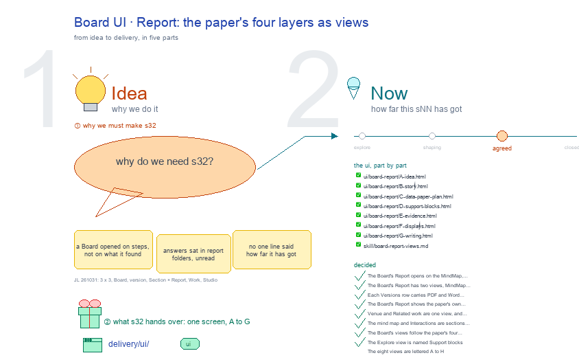

# s32 · Board UI: Report <!-- root #5baceb -->

**Tags:** `Block UI`
**Stage:** agreed

- For <!-- @for #f78806 -->
  - a deck, and the paper Board's Report … <!-- @for/0 #43e7e8 -->
    a deck, and the paper Board's Report screen on the focus page (`delivery/ui/board-report`), for the people who build the workbench
- Delivery type <!-- @delivery-type #58a44f -->
  - ui <!-- @delivery-type/0 #636117 -->
- Covers <!-- @covers #a6c44a -->
  - the Board's Report: seven views, A Idea … <!-- @covers/0 #0cdeac -->
    the Board's Report: seven views, A Idea · B Story (Venue inside it) · C Data + Paper Plan · D Support blocks · E Evidence · F Displays · G Writing, each its own numbered sections (no bands), every bar closed at first, 🙋 Interaction the last section; a topic's drawing after the dashed rule.
- Excluded <!-- @excluded #980495 -->
  - the other eight cells of the 3 … <!-- @excluded/0 #f43667 -->
    the other eight cells of the 3 × 3 (j01's other sNN); the draft Task page itself (b32-s42:draft @ draft_task_focus_page).
- Topic <!-- @topic #7e13bd -->
  - The Board's Report: the paper's four layers … <!-- @topic/0 #76832e -->
    The Board's Report: the paper's four layers as views, Idea to Writing; one cell of the paper's 3 × 3, the paper Board × Report (check) (JL 261031: "we have the board, then job of the paper version, and task of the section draft, I think it should be 3 x 3").
  - Its drawing is haipipe-studio's five parts, drawn … <!-- @topic/1 #6d3750 -->
    Its drawing is haipipe-studio's five parts, drawn by `build_s32_board_ui_report.py` through j01's `paper_ui_cells.py`; its Design is the screen as proposed (A) and what it leans on (B).
  - Names are placeholders: the papers are unpublished, … <!-- @topic/2 #76e63f -->
    Names are placeholders: the papers are unpublished, and Tools is public.
- Feeds <!-- @feeds #ffe8e9 -->
  - `reports/` q01_paper_ladder <!-- @feeds/0 #9e5812 -->
- Files <!-- @files #6ce6c5 -->
  - [py] [build_s32_board_ui_report.py](build_s32_board_ui_report.py) <!-- @files/0 #bfdab7 -->
  - delivery/ <!-- @files/1 #404761 -->
  - passes/ <!-- @files/2 #49b302 -->
  - result/ <!-- @files/3 #d4a42c -->
  - review/ <!-- @files/4 #7928fb -->
  - [excalidraw] [s32-board-ui-report.excalidraw](s32-board-ui-report.excalidraw) <!-- @files/5 #4b06ed -->
  - [md] [s32-board-ui-report.md](s32-board-ui-report.md) <!-- @files/6 #b17758 -->
  - [png] [s32-board-ui-report.png](s32-board-ui-report.png) <!-- @files/7 #aaab48 -->
    
- Decided <!-- @decided #55615a -->
  - s32-D01 · The Board's Report opens on … <!-- @decided/0 #9bf142 -->
    s32-D01 · The Board's Report opens on the MindMap, not Findings (JL 261031, r01_collect_board_ui_report Q1: B, changed from my pick A).
  - s32-D02 · The Board's Report has two … <!-- @decided/1 #8cc3a0 -->
    s32-D02 · The Board's Report has two views, MindMap and Versions; Findings, Status and Questions are dropped (JL 261031, r04_collect_board_report_views Q1: A). Versions says where each send stands (venue, send, round); Work › Job-Versions says what waits (Q2: A). (superseded by s32-D12)
  - s32-D03 · Each Versions row carries PDF … <!-- @decided/2 #565cb6 -->
    s32-D03 · Each Versions row carries PDF and Word buttons that open that version's latest build in the pop-out, so a version's delivery is checked in one click (JL 261031, r04 Q2 note: "How to make the version of the j01_xx, or j02 etc, to check their dleivery very quickly").
  - s32-D04 · The Board's Report shows the … <!-- @decided/3 #42c483 -->
    s32-D04 · The Board's Report shows the paper's own parts first, one view each: Idea, Story, Venue, Data flow, Paper flow, Related work (JL 261031: "for the report, I think we should have the things like the idea, the story, the venue, and the data flow, and the paper flow, etc."). Each view is that topic's line, its drawing and its face's parts; Venue is venues/<venue>/call.md and the Story's venue comparison. MindMap, Status, Findings and Questions follow for now (this replaces s32-D02's two views); Versions stay in Work › Job-Versions. Live: focus_draft.board_report_views. (superseded by s32-D12)
  - s32-D05 · Venue and Related work are … <!-- @decided/4 #a84217 -->
    s32-D05 · Venue and Related work are one view, and Status, Findings and Questions go: the Report is Idea · Story · Venue · Data flow · Paper flow · MindMap (JL 261031: "I think venue and related work should be together, right? and we don't need to have the status, findings or questions, no need to use them anymore"). Venue holds the desk rules, the ladder of journals, then the venue's related work (the s10 topic); a Board with no venues/ says no desk record exists yet. (superseded by s32-D12)
  - s32-D06 · The mind map and Interactions … <!-- @decided/5 #06cbec -->
    s32-D06 · The mind map and Interactions are sections inside each part's view, not views of their own: Report and Work list Idea · Story · Venue · Data flow · Paper flow · Draft (JL 261031: "I think the interaction and MindMap should be something like the sections under the view"). Recorded: runs/r05_collect_board_ui_report_decisions. (superseded by s32-D22)
  - s32-D07 · The Board's views follow the … <!-- @decided/6 #1feb78 -->
    s32-D07 · The Board's views follow the paper's four layers: Idea, Story, Venue, Data flow, Paper flow (plan), Explore (the work Blocks, internal, and the discovery Blocks, external, that this paper draws on, read from the paths its pages name), Evidence, Writing (JL 261031: "one paper's studio should be \"explore blocks\" this will be one of the view as well, which indicate what are the work blocks and what are the citation blocks will be used to support this work"). Live: focus_draft.explore_html. Recorded: t01 runs/r05_collect_board_ui_report_decisions.
  - s32-D08 · The Explore view is named … <!-- @decided/7 #4975ec -->
    s32-D08 · The Explore view is named Support blocks: the work Blocks (internal exploration, the analysis) and discovery Blocks that support this paper (JL 261031, b16 runs/r02_collect_paper_jobs Q1: "This should be in the support-blocks in the View.")
  - s32-D09 · The eight views are lettered … <!-- @decided/8 #c138be -->
    s32-D09 · The eight views are lettered A to H (A Idea, B Story, C Venue, D Data flow, E Paper flow, F Support blocks, G Evidence, H Writing) and settled one round each; the same letter names the small screen in the drawing, its decision here and its file in delivery/ui/board-report/ (JL 261031: "we might want to update them one by one, right? ... I think you should have the A, B, C, D"). (superseded by s32-D12)
  - s32-D10 · A · Idea opens answer … <!-- @decided/9 #5e571f -->
    s32-D10 · A · Idea opens answer first: 1 · Direction, then 🙋 Interactions only when one waits, then the drawing and the mind map, then 2 · Directions considered and 3 · Hand-off, the answered forms last (JL 261031: "do you think we should put the Direction to the top?"; "yes, please update them accordingly"). Live: focus_draft.ANSWER_FIRST. (superseded by s32-D14)
  - s32-D11 · The delivery is one ui … <!-- @decided/10 #91d9ad -->
    s32-D11 · The delivery is one ui delivery with two targets: delivery/ui/board-report/ (A to H, built into servers/workbench-paper/) and delivery/skill/board-report-views.md (the views' manual, rendered into workbench-paper/SKILL.md); render.yaml lists both (JL 261031: "this should be reconsidered as well, like we should have the skill folder and workbench folder as well").
  - s32-D12 · Venue is merged into Story, … <!-- @decided/11 #29029f -->
    s32-D12 · Venue is merged into Story, so the views are seven, A to G (A Idea, B Story, C Data flow, D Paper flow, E Support blocks, F Evidence, G Writing); each journal is a tab in Story's 4 · Venues, its related papers inside it (JL 261031: "I want to merge the venue to the story"; "the journal can serve the same ... merge the 4 and 5 together").
  - s32-D13 · Every view's shape: numbered heading … <!-- @decided/12 #8a1fd3 -->
    s32-D13 · Every view's shape: numbered heading bars with one emoji each, in reading order; the main point large under section 1, no coloured edge; content shown as tiles, tabs or a chain; the helpers (🙋 Interactions, 🖼️ The drawing, 🧠 The mind map) at the bottom after a dashed line (JL 261031: "I still want each section to be the [heading bar] ... seems to be ordered"; "at the bottom, we should check the Interaction, Draw"; "I don't want to have this" of the edge).
  - s32-D14 · A · Idea passed the … <!-- @decided/13 #e8aa94 -->
    s32-D14 · A · Idea passed the design loop: drawing review/A-s1-r02.md (8.7), live page review/A-s2-r04.md (8.5); live in focus_draft.idea_view. It replaces s32-D10's order.
  - s32-D15 · Cards that hold more than … <!-- @decided/14 #6a1f9e -->
    s32-D15 · Cards that hold more than their line are card tabs, the open card's detail in a panel below; joined by arrows, a card-tab chain (JL 261031: "what is the name for this structure?"; "we will use the cards-tab"). A's directions considered became card tabs (JL 261031: "could you make it the same to [the Questions]").
  - s32-D16 · C to G take the … <!-- @decided/15 #934a01 -->
    s32-D16 · C to G take the same shape (JL 261031: "Please go ahead to update other views as well"): C · Data flow (1 Flow with its drawing, 2 Questions to Runs, 3 Waits on (moved to PROCESS by s32-D22)), D · Paper flow (1 Send, 2 Sections, 3 Displays, 4 Timeline), E · Support blocks (1 Work Blocks, 2 Discovery Blocks), F · Evidence (1 Displays, 2 Values, 3 Citations), G · Writing (one section per version, its Sections as card tabs, then the assembled paper). Live in focus_draft.dataflow_view to writing_view; their review rounds are in review/.
  - s32-D17 · C · Data flow leads … <!-- @decided/16 #fa41dd -->
    s32-D17 · C · Data flow leads with the map of how the data come together: the data, the linking, the tables, the questions, joined by lines, read from the data-flow topic's own `<topic>-drawing.yaml`; its drawing moves to the helpers (JL 261101: "for the data flow, we should focus on the mindmap, show the mind map of how these data are collected together"). F · Evidence reads Values, Citations, then Displays, with all displays as one PDF (JL 261101).
  - s32-D18 · C · Data flow has … <!-- @decided/17 #744544 -->
    s32-D18 · C · Data flow has no mind-map helper: its Flow map is the mind map (JL 261101: "I think the mind map here is the Flow, right?"). E · Support blocks is two sections, 1 · Work and 2 · Discovery, each a folder tree of only what this paper uses, one tree per Project (the paper's own and any other it names, as Project-Example-B bNN_<block>): work/ or discovery/, then each Block, Job and Task its pages name by path or by address (bNN.jNN.tNN), one line each, each a link (JL 261101: "more like the folder tree, only show the related folder tree"; "we will have both the work and discovery, as two sections"; "we can have the works from multiple projects").
  - s32-D19 · Report is for reading, so … <!-- @decided/18 #a5ccff -->
    s32-D19 · Report is for reading, so F · Evidence and G · Writing use side tabs: the items as a list on the left (each Section, value set, citation set, display), the open one's content on the right to read; G's panel is the Section's text itself, not its step words (JL 261101: "we just report the report"; "in the left there is a panel, and we can read the content quickly").
  - s32-D20 · G's assembled paper is side … <!-- @decided/19 #e573da -->
    s32-D20 · G's assembled paper is side tabs too: each output on the left (the paper as LaTeX builds it, as Word prints it, the Word supplement, then each earlier round), the open one shown on the right as its PDF, page by page, with Open the PDF and Open the Word file (JL 261101: "should we show it as well? like different versions of the output with the left panel?"). The PDF is a large view, so a "⤢ Pop out" button above it opens it over the page at full size and closes back to the same place (JL 261101: "we want to make the things to be pop out as well").
  - s32-D21 · All seven views pass the … <!-- @decided/20 #94b9d9 -->
    s32-D21 · All seven views pass the live design loop (stage 2): A Idea A-s2-r05 (9.5), B Story B-s2-r06 (8.1), C Data flow C-s2-r03 (8.6), D Paper flow D-s2-r03 (8.5), E Support blocks E-s2-r04 (8.5), F Evidence F-s2-r03 (8.3), G Writing G-s2-r03 (8.75). Round 2 failed C to G on Phone alone: the phone rules sat before the base rules they change, so the base rules won; they now come last in focus_draft.PB_CSS. E marks the Job the paper's pages name most as its "main analysis" and shows only the words that set sibling Tasks apart.
  - s32-D22 · Every view is two bands, … <!-- @decided/21 #435f14 -->
    s32-D22 · Every view is two bands, RESULTS and PROCESS, each numbered from 1: RESULTS is the view's own sections (as s32-D21 passed them), PROCESS is how the layer is being made: 1 · 🙋 Interactions (what was decided, each answered form), 2 · 🚧 Open (Evidence: 📋 Where each stands; Writing: 🪜 Steps); Report reads RESULTS first. Data flow's Waits on moves into PROCESS as Open. The drawing and the mind map stay at the bottom after the dashed rule (JL 261101: "the index for each section should be 1, 2, ... 1, 2, 3"; "the results should be consistent to the report"). Live: focus_draft.banded, process_html.
  - s32-D23 · Report's PROCESS uses the same … <!-- @decided/22 #5e8fae -->
    s32-D23 · Report's PROCESS uses the same rows as Work's (s33-D06), read side: 1 · 🙋 N decisions made, one row per answered question with its pick and a green Answered pill; 2 the same to-dos with their pills (JL 261101).
  - s32-D24 · The Report is agreed, all … <!-- @decided/23 #e87ac9 -->
    s32-D24 · The Report is agreed, all seven views A to G, and handed over: the agreed screens in delivery/ui/board-report/ (written by paper_ui_cells.py from AGREED), the views' manual in delivery/skill/board-report-views.md, rendered into workbench-paper/SKILL.md; the code lives in workbench-paper's board_views.py, board_results.py, board_process.py, board_read.py and the shared servers/workbench/ui_parts.py, split out of focus_draft.py (JL 261101: "s32 is very good now"; "for the blocks I think they are good to go"; "try to split them").
  - s32-D26 · Displays leaves Evidence and becomes … <!-- @decided/24 #730ed2 -->
    s32-D26 · Displays leaves Evidence and becomes its own view, G, after Evidence and before Writing, to highlight it: its RESULTS the display plan against the venue's rules, then each display as the paper prints it (preview.pdf); Writing becomes H (JL 261101: "I am thinking to put the display outside of the Evidence, and put it after the Evidence and before the Writing, to highlight it"; "Please go ahead for it").
  - s32-D27 · The Report is the view's … <!-- @decided/25 #06a131 -->
    s32-D27 · The Report is the view's own sections only, numbered 1, 2, 3, with no PROCESS or RESULTS band; the two bands are Work's, PROCESS first, its RESULTS the Report's sections drawn by the same code. Replaces s32-D22's Report half (JL 261101: "for the Results and Process, they will just be in the Work, why report have that?"; "report will only have the things like the 1, 2, 3, 4"; the bands removed, the sections kept).
  - s32-D28 · Idea and Story are one … <!-- @decided/26 #77b926 -->
    s32-D28 · Idea and Story are one view, Idea + Story; Data flow and Paper flow are one view, Plan: six views, A to F, replacing the letters above (JL 261104: "add Idea + Story to be in one view, and Data flow and Paper flow to be one view of Plan").
  - s32-D29 · The Plan view's button reads … <!-- @decided/27 #463a26 -->
    s32-D29 · The Plan view's button reads Data + Paper Plan (JL 261104: "could you call it Data+Paper Plan?").
  - s32-D30 · Idea + Story ends in … <!-- @decided/28 #4214eb -->
    s32-D30 · Idea + Story ends in a numbered Related section: the Board's related/related.md rows, one small tab per `bears on`, a row with a kept PDF reading it in the pop-out (JL 261104, relayed by Paper-PhyAbsence-PatientCare: "could you put the related section to be here?"; "make this smaller and more compact"; "I want it can pop out and read"). The Related view stays.
  - s32-D31 · Every choice list in a … <!-- @decided/29 #d76319 -->
    s32-D31 · Every choice list in a paper Board view is left tabs and right content, Directions considered, Stakes, Roadmaps, Questions, Venues and Related included; card tabs with a panel below are gone, and Related reads its paper in the right panel (JL 261104: "make all types of this into this left right style"). Checked in Chrome on Paper-PersonalityPrescriptionDemand; 0 card grids on two papers' views.
  - s32-D32 · Direction and Directions considered are … <!-- @decided/30 #6bebad -->
    s32-D32 · Direction and Directions considered are one section, Direction first; in the left tabs the direction's name is bold and its status small under it (JL 261104: "1 and 2 here can be merged together"; "make the name to be more saleint and the status to be small").
  - s32-D33 · The Direction section no longer … <!-- @decided/31 #08b600 -->
    s32-D33 · The Direction section no longer shows the stage word or the START, SETTING, OUTCOME, CONTRAST rows; the topic's face keeps them (JL 261104: "could we just remve this?").
  - s32-D34 · A side tab's open box … <!-- @decided/32 #a3187e -->
    s32-D34 · A side tab's open box ends with its content, so a short one leaves no empty box; a glossary line ("GLP-1 = ...") is never a Direction's large line (JL 261104: "yes clean them up").
  - s32-D35 · Idea + Story reads: Studio … <!-- @decided/33 #ed36dc -->
    s32-D35 · Idea + Story reads: Studio (Idea Studio and Story Studio as left tabs), Direction, Pitch, Research Questions, Stakes and evidence, Related, Venues, Story by Section, Interaction. Hand-off is no section (a 🙋 question it holds stays under Direction); Roadmaps move to Data + Paper Plan (JL 261104: "we can have both Idea Studio and Story studio and also hve the left tab right content"; "Please update it again").
  - s32-D36 · The last section, 🙋 Interaction, … <!-- @decided/34 #6693a6 -->
    s32-D36 · The last section, 🙋 Interaction, shows the collection Runs about the Idea or Story topic: a left tab per question, the Run's built form in one frame on the right, one card at a time, so its picks, Copy feedback and collect.py save are the form's own (JL 261104, relayed by CMS-Server-AI-Code: "could you have the section named Interaction ... left to be the tab, and right to be the questions").
  - s32-D37 · Interaction walks one question at … <!-- @decided/35 #5d8673 -->
    s32-D37 · Interaction walks one question at a time: Back and Next, each left tab's small line its pick with ✓ once visited, Copy feedback on a set's last question. One left list, each Run a folding group, waiting sets open and newest first; Next stops at a set's end, as each Run is saved on its own (JL 261104, relayed by CMS-Server-AI-Code: "we can click the questions one by one, by next --->"; "what if we will have a new qusetion listhere?"; the folding is that session's recommendation, JL's confirmation not seen here).
  - s32-D38 · 🙋 Interaction closes every Report … <!-- @decided/36 #77e98d -->
    s32-D38 · 🙋 Interaction closes every Report and Work view of a Block, a Job or a Task, every theme, showing the collection Runs at the page or below; the code moved to the shared live.interaction_section, and Displays' own list left (JL 261104: "could you try to make this section at the bottom for each of the view? not matter for the block, or job or task").
  - s32-D39 · A paper page is one … <!-- @decided/37 #076219 -->
    s32-D39 · A paper page is one column about 1200 px wide: title, Purpose, view buttons, bars and open sections share both edges, a paragraph stays at most 880 px, the rail marks stay in the gutters (`board_views.PAGE_CSS`). It replaces the 1400 px breakout, which hung out past its bars (JL 261104: "I think you can make it wider."; "no ,this is not good ... why you don't review it yourself?", relayed by CMS-Server-AI-Code).
  - s32-D40 · This Interaction is the one … <!-- @decided/38 #39ad3c -->
    s32-D40 · This Interaction is the one standard look: the last section of a view, the Interactions rail and the Interaction button's pop-out all draw `live.interaction_section`; a small line under the form says who asked, what about, and who applies it; a Run with no built form keeps its plain row (JL 261104: "make this to be the standard items for any of them"; "the workbecnh UI code").
  - s32-D41 · A view's 🙋 Interaction stands … <!-- @decided/39 #01d90c -->
    s32-D41 · A view's 🙋 Interaction stands there even with no question, saying so (JL 261104: "I still didn't see them here.").
  - s32-D42 · The section is a folding … <!-- @decided/40 #0fd345 -->
    s32-D42 · The section is a folding row on every page, also where the page has no folding sections of its own, closed at first (JL 261104: "you might make this to be like this style as well").
  - s32-D44 · Idea and Story are two … <!-- @decided/41 #0d242c -->
    s32-D44 · Idea and Story are two view buttons, Idea first. Idea is for the many directions: its Studio and every direction weighed, left tabs. Story is for the one chosen: its Studio, Direction, Pitch, Research Questions, Stakes and evidence, Related, Venues, Story by Section. Each ends in 🙋 Interaction. It replaces the one-view decision (JL 261104: "add Idea + Story to be in one view"; JL 261105: "I mean seperate this!!!", on the Idea + Story button; "idea for multiple direction, story for one direction").
  - s32-D45 · Idea and Story each have … <!-- @decided/42 #2389e9 -->
    s32-D45 · Idea and Story each have a 🎓 Theory section, always shown: Idea each direction's theory as left tabs, Story the chosen one's, after Pitch; empty, it says how to fill it, and flags it when the Board's `venue:` is an IS journal (JL 261105: "I think for both of them, we should have the section named theory as well."; "espeically for the IS.").
  - s32-D25 · Report's Data flow PROCESS shows … <!-- @decided/43 #aff015 -->
    s32-D25 · Report's Data flow PROCESS shows the same plan rows as Work's (s33-D07), read side: each step with Open, the skill to use and Copy prompt. A PROCESS title names the step and carries no count (JL's rule "labels carry no counts", decided 261101): the code no longer shows "7 decisions" or "5 of 9 open".
- Open <!-- @open #cf9b77 -->
  - (none) <!-- @open/0 #3c6b18 -->
