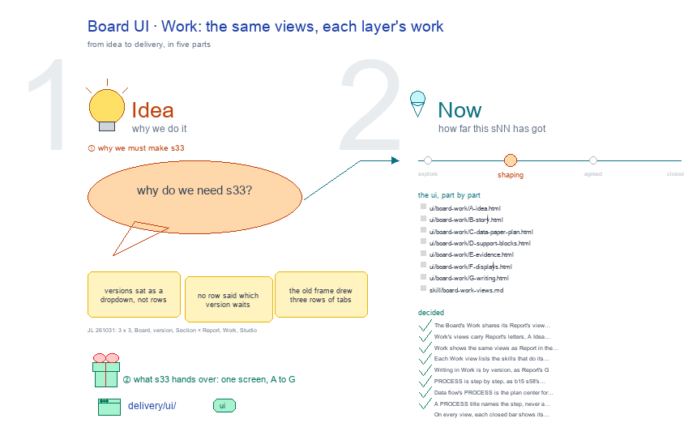

# s33 · Board UI: Work <!-- root #a8f5d3 -->

**Tags:** `Block UI`
**Stage:** shaping

- For <!-- @for #f78806 -->
  - a deck, and the paper Board's Work … <!-- @for/0 #b2f570 -->
    a deck, and the paper Board's Work screen on the focus page (`delivery/ui/board-work`), for the people who build the workbench
- Delivery type <!-- @delivery-type #58a44f -->
  - ui <!-- @delivery-type/0 #636117 -->
- Covers <!-- @covers #a6c44a -->
  - the Board's Work: the Report's view list, … <!-- @covers/0 #c16ca8 -->
    the Board's Work: the Report's view list, each view what waits and what is open;
  - Writing holds each writing Job and its … <!-- @covers/1 #9278a9 -->
    Writing holds each writing Job and its Sections.
- Excluded <!-- @excluded #980495 -->
  - the other eight cells of the 3 … <!-- @excluded/0 #f43667 -->
    the other eight cells of the 3 × 3 (j01's other sNN); the draft Task page itself (b32-s42:draft @ draft_task_focus_page).
- Topic <!-- @topic #7e13bd -->
  - The Board's Work: the same views as … <!-- @topic/0 #e35628 -->
    The Board's Work: the same views as Report, each layer's work; one cell of the paper's 3 × 3, the paper Board × Work (do) (JL 261031: "we have the board, then job of the paper version, and task of the section draft, I think it should be 3 x 3").
  - Its drawing is haipipe-studio's five parts, drawn … <!-- @topic/1 #d6a8d3 -->
    Its drawing is haipipe-studio's five parts, drawn by `build_s33_board_ui_work.py` through j01's `paper_ui_cells.py`; its Design is the screen as proposed (A) and what it leans on (B).
  - Names are placeholders: the papers are unpublished, … <!-- @topic/2 #76e63f -->
    Names are placeholders: the papers are unpublished, and Tools is public.
- Feeds <!-- @feeds #ffe8e9 -->
  - `reports/` q01_paper_ladder <!-- @feeds/0 #9e5812 -->
- Files <!-- @files #6ce6c5 -->
  - [py] [build_s33_board_ui_work.py](build_s33_board_ui_work.py) <!-- @files/0 #ff1fdb -->
  - result/ <!-- @files/1 #d4a42c -->
  - review/ <!-- @files/2 #7928fb -->
  - [excalidraw] [s33-board-ui-work.excalidraw](s33-board-ui-work.excalidraw) <!-- @files/3 #bd41e9 -->
  - [md] [s33-board-ui-work.md](s33-board-ui-work.md) <!-- @files/4 #5fedaf -->
  - [png] [s33-board-ui-work.png](s33-board-ui-work.png) <!-- @files/5 #d6d01e -->
    
- Decided <!-- @decided #55615a -->
  - s33-D01 · The Board's Work shares its … <!-- @decided/0 #ce11d9 -->
    s33-D01 · The Board's Work shares its Report's view list: Idea · Story · Venue · Data flow · Paper flow · Draft (Report adds MindMap last). Each Work view is that part's work: what waits on you (its sign lines, its form), its Open list, its work rows (Roadmap, Timeline), then a link to its result in Report; Venue adds what the desk record still lacks; Draft holds the versions (the old Job-Versions rows). JL 261031: "here the work and report should share the same view list". Live: focus_draft.board_work_views. (superseded by s33-D03)
  - s33-D02 · Work's views carry Report's letters, … <!-- @decided/1 #651c4c -->
    s33-D02 · Work's views carry Report's letters, A Idea to H Writing (superseded by s32-D12: A to G), and are settled one round each, after Report's same letter (JL 261031: "we might want to update them one by one, right? ... I think you should have the A, B, C, D"; s32-D09).
  - s33-D03 · Work shows the same views … <!-- @decided/2 #421d2b -->
    s33-D03 · Work shows the same views as Report in the same two bands, PROCESS first: 1 · 🙋 Interactions (the forms and sign lines that wait on you, each with Answer), 2 · 🚧 Open (Evidence: 📋 Where each stands; Writing: 🪜 Steps, each Section's five step words, each opening that step), 3 · 🧰 Skills; then RESULTS, exactly Report's sections with Report's numbers, so the two never disagree (JL 261101: "add the large section of Process and Results, and also the things like the interaction"; "the results should be consistent to the report"). This replaces s33-D01's per-view work lists. Live: focus_draft.board_work_views.
  - s33-D04 · Each Work view lists the … <!-- @decided/3 #c1d0d6 -->
    s33-D04 · Each Work view lists the skills that do its work, as the name you type and what it does here: Idea /haipipe-paper-ideation, /haipipe-ideation; Story /haipipe-paper-story, -venue, -related; Data flow /haipipe-paper-plan, /haipipe-report, /haipipe-task; Paper flow /haipipe-paper-plan, /haipipe-paper; Support blocks /haipipe-work, /haipipe-discovery; Evidence /haipipe-paper-evidence, /haipipe-evidence, /haipipe-display; Writing /haipipe-paper-draft, /haipipe-draft-writing, /haipipe-paper-assemble (JL 261101: "show what is the skills related to each UI"). Live: focus_draft.VIEW_SKILLS.
  - s33-D05 · Writing in Work is by … <!-- @decided/4 #5729e0 -->
    s33-D05 · Writing in Work is by version, as Report's G: one section of steps per version (closes the Open "rows by version, or Sections across versions").
  - s33-D06 · PROCESS is step by step, … <!-- @decided/5 #d94a6c -->
    s33-D06 · PROCESS is step by step, as b15 s58's Decide view: each section a thing to do, its title saying how many (1 · 🙋 7 decisions waiting for you; the count superseded by s33-D08), one full-width row per item with its words, its state as a coloured pill (orange waits on you, blue running, green done, grey not started) and its verb (Answer, Open, Open Plan). 1 is each question of each waiting form, then the sign lines; 2 is the view's own to-dos: Data flow ⚙️ Runs to do (the Story's T table, T0 first) (for Data flow, D07 puts the Plan first), Paper flow 🗓️ Next steps (the timeline not done), Evidence 📋 Where each stands, Writing 🪜 Sections (each one's next step), else 🚧 Open; 3 is 🧰 Skills that do it (JL 261101: "in the process, in each step, we should have something to do step by step"; "this is not what we expected", of a placeholder Interactions row; "check this", of s58). Live: focus_draft._todo, _steps, process_html.
  - s33-D07 · Data flow's PROCESS is the … <!-- @decided/6 #43bf0f -->
    s33-D07 · Data flow's PROCESS is the plan center for the work and discovery: 2 · 🧭 Plan, four steps in order (🗂️ Design the dataset, 📈 Design the regressions, ⚙️ Make them run, 🔎 Plan the reading), each one row with the skill to use (/haipipe-paper-plan, /haipipe-task, /haipipe-run, /haipipe-discovery), Open (the data-flow mind map, the main analysis Job, the Story's Task and Discovery Roadmaps) and Copy prompt; the prompt sends a session to that thing, has it screenshot the mind map, and asks for the plan before any change; then 3 · ⚙️ Runs to do. Its skills sit on its steps, so it has no Skills section (JL 261101: "the design of the dataset, the design of the regression, and how to make them run ... the plan center for the work and discovery"; "just open it, and just say use this skill, and copy it"). Live: focus_draft._plan_steps.
  - s33-D08 · A PROCESS title names the … <!-- @decided/7 #0ccd86 -->
    s33-D08 · A PROCESS title names the step, never a count (JL's rule "labels carry no counts", decided 261101): the pills carry each row's state, so "1 · 🙋 7 decisions waiting for you" is now "1 · 🙋 Decisions waiting for you".
- Open <!-- @open #cf9b77 -->
  - A new review round on A to … <!-- @open/0 #9d93f1 -->
    A new review round on A to G: the s2-r01 rounds came before D06 and D07.
