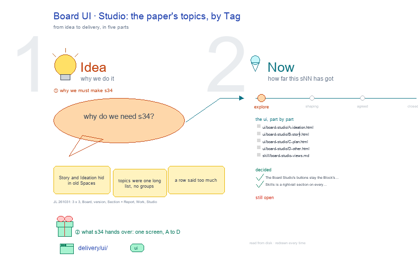

# s34 · Board UI: Studio <!-- root #55d309 -->

**Tags:** `Block UI`
**Stage:** explore

- For <!-- @for #f78806 -->
  - a deck, and the paper Board's Studio … <!-- @for/0 #f40737 -->
    a deck, and the paper Board's Studio screen on the focus page (`delivery/ui/board-studio`), for the people who build the workbench
- Delivery type <!-- @delivery-type #58a44f -->
  - ui <!-- @delivery-type/0 #636117 -->
- Covers <!-- @covers #a6c44a -->
  - the Board's Studio: the paper's topics, by … <!-- @covers/0 #5dbe08 -->
    the Board's Studio: the paper's topics, by group.
- Excluded <!-- @excluded #980495 -->
  - the other eight cells of the 3 … <!-- @excluded/0 #f43667 -->
    the other eight cells of the 3 × 3 (j01's other sNN); the draft Task page itself (b32-s42:draft @ draft_task_focus_page).
- Topic <!-- @topic #7e13bd -->
  - The Board's Studio: the paper's topics, by … <!-- @topic/0 #a928d3 -->
    The Board's Studio: the paper's topics, by group; one cell of the paper's 3 × 3, the paper Board × Studio (think) (JL 261031: "we have the board, then job of the paper version, and task of the section draft, I think it should be 3 x 3").
  - Its drawing is haipipe-studio's five parts, drawn … <!-- @topic/1 #1d1306 -->
    Its drawing is haipipe-studio's five parts, drawn by `build_s34_board_ui_studio.py` through j01's `paper_ui_cells.py`; its Design is the screen as proposed (A) and what it leans on (B).
  - Names are placeholders: the papers are unpublished, … <!-- @topic/2 #76e63f -->
    Names are placeholders: the papers are unpublished, and Tools is public.
- Feeds <!-- @feeds #ffe8e9 -->
  - `reports/` q01_paper_ladder <!-- @feeds/0 #9e5812 -->
- Files <!-- @files #6ce6c5 -->
  - [py] [build_s34_board_ui_studio.py](build_s34_board_ui_studio.py) <!-- @files/0 #bb9a48 -->
  - result/ <!-- @files/1 #d4a42c -->
  - [excalidraw] [s34-board-ui-studio.excalidraw](s34-board-ui-studio.excalidraw) <!-- @files/2 #7865db -->
  - [md] [s34-board-ui-studio.md](s34-board-ui-studio.md) <!-- @files/3 #33f071 -->
  - [png] [s34-board-ui-studio.png](s34-board-ui-studio.png) <!-- @files/4 #56b93b -->
    
- Decided <!-- @decided #55615a -->
  - s34-D01 · The Board Studio's buttons stay … <!-- @decided/0 #14455a -->
    s34-D01 · The Board Studio's buttons stay the Block's own groups, its topics' Tags; they need not match the Report's views (JL 261104: "sutdio, not need that, I get confused. But if possible, we can make them consistent as well, that is flexible"; r03 Q1 B).
- Open <!-- @open #cf9b77 -->
  - (none: s34-D01 settled it, the buttons are … <!-- @open/0 #2597f1 -->
    (none: s34-D01 settled it, the buttons are the topics' Tags)
