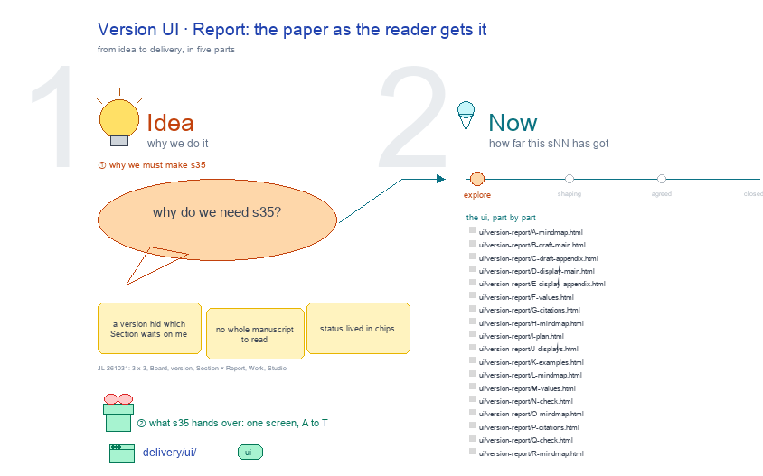

# s35 · Version UI: Report <!-- root #7f273b -->

**Tags:** `Job UI`
**Stage:** explore

- For <!-- @for #f78806 -->
  - a deck, and a version (a Job)'s … <!-- @for/0 #3d98c6 -->
    a deck, and a version (a Job)'s Report screen on the focus page (`delivery/ui/version-report`), for the people who build the workbench
- Delivery type <!-- @delivery-type #58a44f -->
  - ui <!-- @delivery-type/0 #636117 -->
- Covers <!-- @covers #a6c44a -->
  - a version's Report: which Section waits <!-- @covers/0 #132943 -->
- Excluded <!-- @excluded #980495 -->
  - the other eight cells of the 3 … <!-- @excluded/0 #f43667 -->
    the other eight cells of the 3 × 3 (j01's other sNN); the draft Task page itself (b32-s42:draft @ draft_task_focus_page).
- Topic <!-- @topic #7e13bd -->
  - A version's Report: which Section waits; one … <!-- @topic/0 #c8ae2a -->
    A version's Report: which Section waits; one cell of the paper's 3 × 3, a version (a Job) × Report (check) (JL 261031: "we have the board, then job of the paper version, and task of the section draft, I think it should be 3 x 3").
  - Its drawing is haipipe-studio's five parts, drawn … <!-- @topic/1 #805c8b -->
    Its drawing is haipipe-studio's five parts, drawn by `build_s35_version_ui_report.py` through j01's `paper_ui_cells.py`; its Design is the screen as proposed (A) and what it leans on (B).
  - Names are placeholders: the papers are unpublished, … <!-- @topic/2 #76e63f -->
    Names are placeholders: the papers are unpublished, and Tools is public.
- Feeds <!-- @feeds #ffe8e9 -->
  - `reports/` q01_paper_ladder <!-- @feeds/0 #9e5812 -->
- Files <!-- @files #6ce6c5 -->
  - [py] [build_s35_version_ui_report.py](build_s35_version_ui_report.py) <!-- @files/0 #df1549 -->
  - review/ <!-- @files/1 #7928fb -->
  - [excalidraw] [s35-version-ui-report.excalidraw](s35-version-ui-report.excalidraw) <!-- @files/2 #366766 -->
  - [md] [s35-version-ui-report.md](s35-version-ui-report.md) <!-- @files/3 #24ffd7 -->
  - [png] [s35-version-ui-report.png](s35-version-ui-report.png) <!-- @files/4 #ecb5a8 -->
    
- Decided <!-- @decided #55615a -->
  - (none yet: a decision is one line, … <!-- @decided/0 #552349 -->
    (none yet: a decision is one line, s35-D01 · <what was decided> (<who> <date>))
- Open <!-- @open #cf9b77 -->
  - ? <!-- @open/0 #0e7c74 -->
    ? (proposed 261101) a version's Report shows the frame's own Job views as today (focus_page.py: MindMap, the version and its Sections as a map; Status, its Tasks and where each stands; Findings, its takeaways), each regrouped as 📊 Results then ⚙️ Process (1 · 🙋 Interactions). The live regroup is focus_page.py's, the shared frame's owner (the Basic-Design-BJTR-v2 session): a hook like the Board's paper_board_report would let paper_version draw it. Recorded: t02 runs/r04_collect_version_work_decisions.
  - ? <!-- @open/1 #8557ef -->
    ? Text: the whole manuscript, or the built PDF
