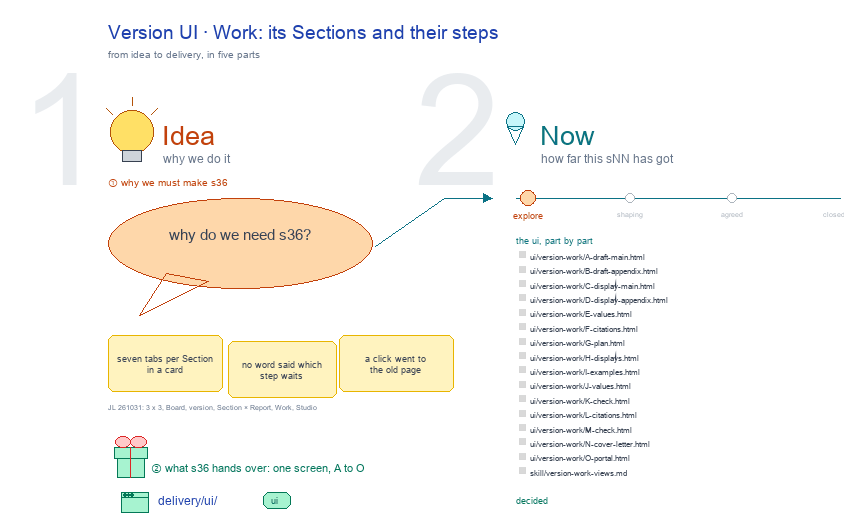

# s36 · Version UI: Work <!-- root #9c7b09 -->

**Tags:** `Job UI`
**Stage:** explore

- For <!-- @for #f78806 -->
  - a deck, and a version (a Job)'s … <!-- @for/0 #be99f5 -->
    a deck, and a version (a Job)'s Work screen on the focus page (`delivery/ui/version-work`), for the people who build the workbench
- Delivery type <!-- @delivery-type #58a44f -->
  - ui <!-- @delivery-type/0 #636117 -->
- Covers <!-- @covers #a6c44a -->
  - a version's Work: its Sections and their … <!-- @covers/0 #1c3de0 -->
    a version's Work: its Sections and their steps.
- Excluded <!-- @excluded #980495 -->
  - the other eight cells of the 3 … <!-- @excluded/0 #f43667 -->
    the other eight cells of the 3 × 3 (j01's other sNN); the draft Task page itself (b32-s42:draft @ draft_task_focus_page).
- Topic <!-- @topic #7e13bd -->
  - A version's Work: its Sections and their … <!-- @topic/0 #5b9d43 -->
    A version's Work: its Sections and their steps; one cell of the paper's 3 × 3, a version (a Job) × Work (do) (JL 261031: "we have the board, then job of the paper version, and task of the section draft, I think it should be 3 x 3").
  - Its drawing is haipipe-studio's five parts, drawn … <!-- @topic/1 #41ae68 -->
    Its drawing is haipipe-studio's five parts, drawn by `build_s36_version_ui_work.py` through j01's `paper_ui_cells.py`; its Design is the screen as proposed (A) and what it leans on (B).
  - Names are placeholders: the papers are unpublished, … <!-- @topic/2 #76e63f -->
    Names are placeholders: the papers are unpublished, and Tools is public.
- Feeds <!-- @feeds #ffe8e9 -->
  - `reports/` q01_paper_ladder <!-- @feeds/0 #9e5812 -->
- Files <!-- @files #6ce6c5 -->
  - [py] [build_s36_version_ui_work.py](build_s36_version_ui_work.py) <!-- @files/0 #3dd9df -->
  - review/ <!-- @files/1 #7928fb -->
  - [excalidraw] [s36-version-ui-work.excalidraw](s36-version-ui-work.excalidraw) <!-- @files/2 #692013 -->
  - [md] [s36-version-ui-work.md](s36-version-ui-work.md) <!-- @files/3 #724b2b -->
  - [png] [s36-version-ui-work.png](s36-version-ui-work.png) <!-- @files/4 #a2b7a8 -->
    
- Decided <!-- @decided #55615a -->
  - s36-D01 · A Section row shows its … <!-- @decided/0 #42c407 -->
    s36-D01 · A Section row shows its five step words, each opening that step (JL 261031, runs/r02_collect_version_ui_work Q1 A: "Yes, we can do this.")
  - s36-D02 · A version's views are Draft-Main … <!-- @decided/1 #7c9ca5 -->
    s36-D02 · A version's views are Draft-Main · Draft-Appendix · Display-Main · Display-Appendix, with more to come such as Citations; making each Job's view its Studio is for later (JL 261031, runs/r02_collect_version_ui_work Q2 A: "we will choose A, and even more of them. like the citations? and for each job's view button, later we can make them to be the studio as well. But that can be later.")
- Open <!-- @open #cf9b77 -->
  - ? <!-- @open/0 #342b8d -->
    ? (proposed 261101, replaces the earlier proposal) the same views and rows as today, regrouped: Draft-Main and Draft-Appendix ⚙️ Process (1 · 🙋 Interactions, 2 · 🪜 Sections with their five step words); Display, Values and Citations ⚙️ Process (1 · 🙋 Interactions) then 📊 Results (their items). Live: paper_version.version_work_views. Recorded: t02 runs/r04_collect_version_work_decisions.
  - ✓ five words a row (s36-D01) <!-- @open/1 #c61df6 -->
