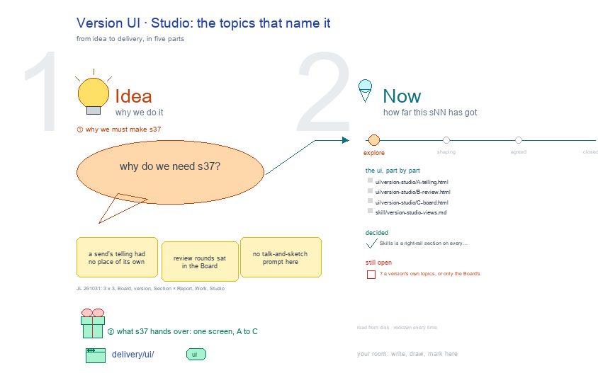

# s37 · Version UI: Studio <!-- root #beed0c -->

**Tags:** `Job UI`
**Stage:** explore

- For <!-- @for #f78806 -->
  - a deck, and a version (a Job)'s … <!-- @for/0 #a88a1a -->
    a deck, and a version (a Job)'s Studio screen on the focus page (`delivery/ui/version-studio`), for the people who build the workbench
- Delivery type <!-- @delivery-type #58a44f -->
  - ui <!-- @delivery-type/0 #636117 -->
- Covers <!-- @covers #a6c44a -->
  - a version's Studio: the topics that name … <!-- @covers/0 #dcf79f -->
    a version's Studio: the topics that name it.
- Excluded <!-- @excluded #980495 -->
  - the other eight cells of the 3 … <!-- @excluded/0 #f43667 -->
    the other eight cells of the 3 × 3 (j01's other sNN); the draft Task page itself (b32-s42:draft @ draft_task_focus_page).
- Topic <!-- @topic #7e13bd -->
  - A version's Studio: the topics that name … <!-- @topic/0 #27acb4 -->
    A version's Studio: the topics that name it; one cell of the paper's 3 × 3, a version (a Job) × Studio (think) (JL 261031: "we have the board, then job of the paper version, and task of the section draft, I think it should be 3 x 3").
  - Its drawing is haipipe-studio's five parts, drawn … <!-- @topic/1 #6b1e6d -->
    Its drawing is haipipe-studio's five parts, drawn by `build_s37_version_ui_studio.py` through j01's `paper_ui_cells.py`; its Design is the screen as proposed (A) and what it leans on (B).
  - Names are placeholders: the papers are unpublished, … <!-- @topic/2 #76e63f -->
    Names are placeholders: the papers are unpublished, and Tools is public.
- Feeds <!-- @feeds #ffe8e9 -->
  - `reports/` q01_paper_ladder <!-- @feeds/0 #9e5812 -->
- Files <!-- @files #6ce6c5 -->
  - [py] [build_s37_version_ui_studio.py](build_s37_version_ui_studio.py) <!-- @files/0 #90f76b -->
  - [excalidraw] [s37-version-ui-studio.excalidraw](s37-version-ui-studio.excalidraw) <!-- @files/1 #bb0389 -->
  - [md] [s37-version-ui-studio.md](s37-version-ui-studio.md) <!-- @files/2 #21718a -->
  - [png] [s37-version-ui-studio.png](s37-version-ui-studio.png) <!-- @files/3 #f2c958 -->
    
- Decided <!-- @decided #55615a -->
  - (none yet: a decision is one line, … <!-- @decided/0 #2b13cc -->
    (none yet: a decision is one line, s37-D01 · <what was decided> (<who> <date>))
- Open <!-- @open #cf9b77 -->
  - ? a version's own topics, or only … <!-- @open/0 #123068 -->
    ? a version's own topics, or only the Board's
