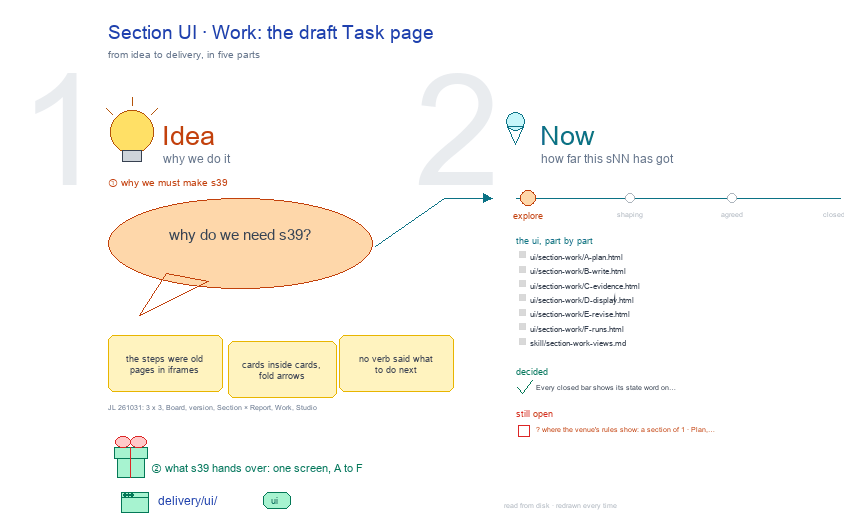

# s39 · Section UI: Work <!-- root #52b741 -->

**Tags:** `Task UI`
**Stage:** explore

- For <!-- @for #f78806 -->
  - a deck, and a Section (a draft … <!-- @for/0 #7a7ebf -->
    a deck, and a Section (a draft Task)'s Work screen on the focus page (`delivery/ui/section-work`), for the people who build the workbench
- Delivery type <!-- @delivery-type #58a44f -->
  - ui <!-- @delivery-type/0 #636117 -->
- Covers <!-- @covers #a6c44a -->
  - a Section's Work: the draft Task page <!-- @covers/0 #6954bc -->
- Excluded <!-- @excluded #980495 -->
  - the other eight cells of the 3 … <!-- @excluded/0 #f43667 -->
    the other eight cells of the 3 × 3 (j01's other sNN); the draft Task page itself (b32-s42:draft @ draft_task_focus_page).
- Topic <!-- @topic #7e13bd -->
  - A Section's Work: the draft Task page; … <!-- @topic/0 #449f87 -->
    A Section's Work: the draft Task page; one cell of the paper's 3 × 3, a Section (a draft Task) × Work (do) (JL 261031: "we have the board, then job of the paper version, and task of the section draft, I think it should be 3 x 3").
  - Its drawing is haipipe-studio's five parts, drawn … <!-- @topic/1 #e25994 -->
    Its drawing is haipipe-studio's five parts, drawn by `build_s39_section_ui_work.py` through j01's `paper_ui_cells.py`; its Design is the screen as proposed (A) and what it leans on (B).
  - Names are placeholders: the papers are unpublished, … <!-- @topic/2 #76e63f -->
    Names are placeholders: the papers are unpublished, and Tools is public.
- Feeds <!-- @feeds #ffe8e9 -->
  - `reports/` q01_paper_ladder <!-- @feeds/0 #9e5812 -->
- Files <!-- @files #6ce6c5 -->
  - [py] [build_s39_section_ui_work.py](build_s39_section_ui_work.py) <!-- @files/0 #c20e7c -->
  - review/ <!-- @files/1 #7928fb -->
  - [excalidraw] [s39-section-ui-work.excalidraw](s39-section-ui-work.excalidraw) <!-- @files/2 #d56ed3 -->
  - [md] [s39-section-ui-work.md](s39-section-ui-work.md) <!-- @files/3 #558973 -->
  - [png] [s39-section-ui-work.png](s39-section-ui-work.png) <!-- @files/4 #6db916 -->
    
- Decided <!-- @decided #55615a -->
  - (none yet: a decision is one line, … <!-- @decided/0 #f811a2 -->
    (none yet: a decision is one line, s39-D01 · <what was decided> (<who> <date>))
- Open <!-- @open #cf9b77 -->
  - ? <!-- @open/0 #d34fec -->
    ? (proposed 261101, replaces the earlier proposal) each step keeps the draft workbench's sections, regrouped: ⚙️ Process (1 · 🙋 Interactions: the step's sign, the Task's forms and records; 2 · 🤖 Ask the agent on Plan, Write, Revise; 3 · 📥 Input; 4 · 🏃 Runs of this step) then 📊 Results (the step's own cards by their names: Plan §1 Structure, Scratch, Examples, the Section's contract, Requirement and Rubric, Records). Live: focus_draft.step_html. Recorded: t03 runs/r04_collect_section_work_decisions.
  - ? where the venue's rules show: a … <!-- @open/1 #020cb1 -->
    ? where the venue's rules show: a section of 1 · Plan, or under the Aim
