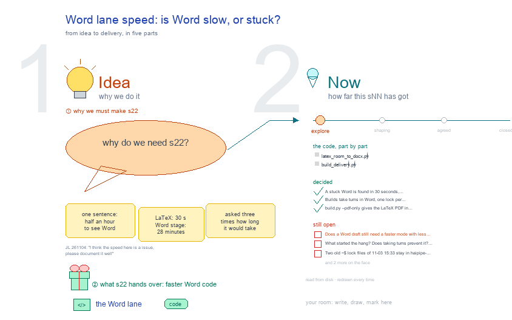

# s22 · Word lane speed: how to make a Word draft fast without losing … <!-- root #93ffee -->

**Tags:** `Run and Skill`
**Stage:** explore

- For <!-- @for #f78806 -->
  - a deck, and the Word lane code … <!-- @for/0 #a7067a -->
    a deck, and the Word lane code of haipipe-paper-assemble, for whoever waits on a paper build
- Delivery type <!-- @delivery-type #58a44f -->
  - code <!-- @delivery-type/0 #e6fb06 -->
- Covers <!-- @covers #a6c44a -->
  - why the Word stage takes 28 minutes, … <!-- @covers/0 #83519b -->
    why the Word stage takes 28 minutes, what must stay (a display at the top of the page after its citation), and the ways to make a draft fast.
- Excluded <!-- @excluded #980495 -->
  - the LaTeX lane (about 30 seconds, and … <!-- @excluded/0 #ab908f -->
    the LaTeX lane (about 30 seconds, and `--pdf-only` already gives the PDF in seconds); which Word template a venue uses (s03 and the venue template checklist).
- Topic <!-- @topic #7e13bd -->
  - JL 261104: "I think the speed here … <!-- @topic/0 #7bdcdf -->
    JL 261104: "I think the speed here is a issue, please document it well".
  - One sentence change cost half an hour … <!-- @topic/1 #9a4896 -->
    One sentence change cost half an hour before co-authors could see Word, and JL asked three times how long it would take.
  - The answer turned out to be a … <!-- @topic/2 #b46e88 -->
    The answer turned out to be a stuck Word, not slow work: 28 minutes on the stuck one, 40 seconds on a working one.
  - What is left open is keeping it … <!-- @topic/3 #05f0c6 -->
    What is left open is keeping it from happening again.
- Feeds <!-- @feeds #ffe8e9 -->
  - `reports/` none yet; its form is `j02_word_lane_speed/runs/r01_collect_word_lane_speed/` <!-- @feeds/0 #bfea51 -->
- What was measured <!-- @what-was-measured #0967dd -->
  - Paper-AgreeablePrescriptionDiscretion: 53 pages, 12 tables, 2 figures, … <!-- @what-was-measured/0 #9fd6e1 -->
    Paper-AgreeablePrescriptionDiscretion: 53 pages, 12 tables, 2 figures, a 656K `.docx`. Measured by Pp-AgreeableRx-Discrention and Theme_Paper on 261104.
  - **Word calls, 10 minutes of 3 builds**: … <!-- @what-was-measured/1 #bc668e -->
    **Word calls, 10 minutes of 3 builds**: 14 calls, 11 of them 119.6 to 120.5 seconds, the default AppleEvent timeout; 3 shorter ones were already running when the sample began.
  - **The error**: `Microsoft Word got an error: … <!-- @what-was-measured/2 #14564e -->
    **The error**: `Microsoft Word got an error: AppleEvent timed out. (-1712)`. In `render.docx_tail`, only the last 1500 characters: 6 on 11-03 16:20 (Paper-PhyAbsence-PatientCare), 11 on 11-04 03:38 (Paper-AgreeableOpioid-Jama), 10 at 11:01 (Discretion). None on builds up to 11-01 21:10.
  - **Word itself**: `sample` shows the main thread … <!-- @what-was-measured/3 #509033 -->
    **Word itself**: `sample` shows the main thread inside an AppleEvent handler on `__psynch_mutexwait`, 2561 of 2561 samples, 0% CPU. `version` answers in 0.1 s; `name of documents` gives no answer in 30 s.
  - **Left open**: Word holds two `haipipe-measure` copies, … <!-- @what-was-measured/4 #f08327 -->
    **Left open**: Word holds two `haipipe-measure` copies, with `~$` lock files of 11-03 15:33. Word has run since 11-02 17:48.
  - **The prints**: `pdfinfo` says LibreOffice on the … <!-- @what-was-measured/5 #01f9c8 -->
    **The prints**: `pdfinfo` says LibreOffice on the Word tabs' PDFs of 11-04; the 11-01 one says Quartz (Word's own print).
  - What that means: a display waited 2 … <!-- @what-was-measured/6 #bf3e4d -->
    What that means: a display waited 2 minutes, then fell back to right after its citing paragraph. In the 11:03 PDF, Figures 1 and 2 and Tables 1, 2, 4, B1 and D2 do not open their page. The trigger of the hang is not known; two builds opening documents together at 15:33 is a guess.
  - **On a working Word.** The stuck Word … <!-- @what-was-measured/7 #7a5414 -->
    **On a working Word.** The stuck Word was gone by 11:41; who or what ended it is not known.
  - A build began near the end of … <!-- @what-was-measured/8 #af27f1 -->
    A build began near the end of the placeholder run; the timed steps were mostly before it.
- The mechanism <!-- @the-mechanism #896b2f -->
  - `scripts/latex_room_to_docx.py` `save_docx` loops over each held display: … <!-- @the-mechanism/0 #ef3257 -->
    `scripts/latex_room_to_docx.py` `save_docx` loops over each held display: `doc.save`, then `word_page_boundaries` copies the file to `haipipe-measure/`, opens it in Word, runs `repaginate`, `execute find` for the citing text, a binary search on `get range information` for the page end (about 17 calls, an estimate), and closes without saving. Each placed display shifts later pages, so as written nothing is reused. Purpose (0.12.2, JL 261028): each display at the top of the page after its citation.
- Risks from reading the code (not reproduced) <!-- @risks-from-reading-the-code-not-reproduced #8e588b -->
  - **`selection` is Word's front document**: two builds … <!-- @risks-from-reading-the-code-not-reproduced/0 #80406a -->
    **`selection` is Word's front document**: two builds may search each other's file.
  - **One shared Word, one shared folder, no … <!-- @risks-from-reading-the-code-not-reproduced/1 #e30834 -->
    **One shared Word, one shared folder, no queue**: the delivery lock is per paper. The copy is named by `path.name`, so two Section builds' `t03-results.docx` can collide.
  - **The quit in `save_docx`'s `finally`**: if Word … <!-- @risks-from-reading-the-code-not-reproduced/2 #b4d791 -->
    **The quit in `save_docx`'s `finally`**: if Word was not running at the start, it quits Word, even if another build began using it.
  - **`close d` never runs after a timeout**: … <!-- @risks-from-reading-the-code-not-reproduced/3 #c55389 -->
    **`close d` never runs after a timeout**: a timed-out script may leave its document open in Word.
- The options <!-- @the-options #01a150 -->
  - D is built <!-- @the-options/0 #bea3af -->
    D is built. A, B, C and E would save seconds, so they are not worth building unless a much longer paper says otherwise.
- Files <!-- @files #6ce6c5 -->
  - [py] [build_s22_word_lane_speed.py](build_s22_word_lane_speed.py) <!-- @files/0 #33b816 -->
  - delivery/ <!-- @files/1 #404761 -->
  - [excalidraw] [s22-word-lane-speed.excalidraw](s22-word-lane-speed.excalidraw) <!-- @files/2 #bd522b -->
  - [md] [s22-word-lane-speed.ideas.md](s22-word-lane-speed.ideas.md) <!-- @files/3 #e85718 -->
  - [md] [s22-word-lane-speed.md](s22-word-lane-speed.md) <!-- @files/4 #d58df5 -->
  - [png] [s22-word-lane-speed.png](s22-word-lane-speed.png) <!-- @files/5 #41d8e5 -->
    
  - [html] [s22-word-lane-speed.slides.html](s22-word-lane-speed.slides.html) <!-- @files/6 #abcf63 -->
  - [json] [s22-word-lane-speed.slides.json](s22-word-lane-speed.slides.json) <!-- @files/7 #99499e -->
  - [pptx] [s22-word-lane-speed.slides.pptx](s22-word-lane-speed.slides.pptx) <!-- @files/8 #6c7e8d -->
- Decided <!-- @decided #55615a -->
  - s22-D01 · A stuck Word is found … <!-- @decided/0 #866d7f -->
    s22-D01 · A stuck Word is found in 30 seconds, skipped, and said in the build's report; the Word tab says when its PDF is not Word's (haipipe-paper-assemble 0.17.1, workbench-paper 0.44.6; Theme_Paper 261104, a bug fix, reversible).
  - s22-D03 · Builds take turns in Word, … <!-- @decided/1 #692593 -->
    s22-D03 · Builds take turns in Word, one lock per machine, and a build quits Word only if it started it and no document is open (`scripts/word_lock.py`, 0.17.2; Theme_Paper 261104; option D). Its tests use the lock alone; no two real builds have queued on it yet.
  - s22-D02 · `build.py --pdf-only` gives the LaTeX … <!-- @decided/2 #6a6ae2 -->
    s22-D02 · `build.py --pdf-only` gives the LaTeX PDF in seconds, no Word app (JL 261104, relayed by Paper-PhyAbsence: "Yes, let's focus on the pdf first"; 4 seconds on Paper-PhyAbsence-Maternity-JamaIM).
- Open <!-- @open #cf9b77 -->
  - Does a Word draft still need a … <!-- @open/0 #037ad0 -->
    Does a Word draft still need a faster mode with less neat placement (form Q1)? My pick is no.
  - What started the hang? <!-- @open/1 #0ba18c -->
    What started the hang? Does taking turns prevent it? Only time will tell; a stuck Word now costs 30 seconds and says so.
  - Two old `~$` lock files of 11-03 … <!-- @open/2 #1af6b9 -->
    Two old `~$` lock files of 11-03 15:33 stay in `haipipe-measure/` (Paper-AgreeableOpioid-Jama, Paper-PhyAbsence-Maternity-JamaIM): delete them when no build runs if those papers' measuring misbehaves.
  - Risks 1, 2 and 3 above are … <!-- @open/3 #5ef826 -->
    Risks 1, 2 and 3 above are closed by the turn only for builds; a person using Word during a build can still move its front document.
