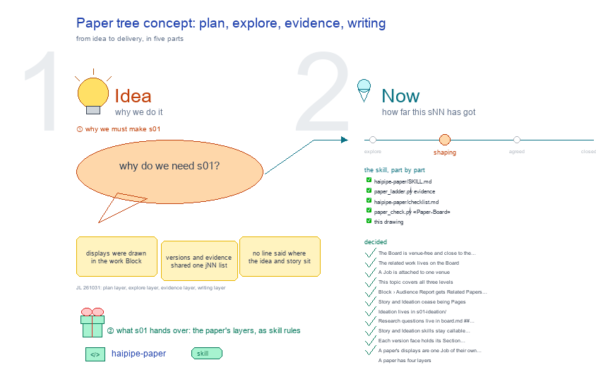

# s01 · Paper tree concept: plan, explore, evidence, writing <!-- root #aceda2 -->

**Tags:** `Structure`
**Stage:** shaping

- For <!-- @for #f78806 -->
  - a deck, and the boundary between a … <!-- @for/0 #01a2fc -->
    a deck, and the boundary between a paper Board, its version Jobs and their Section Tasks, for the people who write the toolkit skills
- Delivery type <!-- @delivery-type #58a44f -->
  - skill <!-- @delivery-type/0 #34b33e -->
- Topic <!-- @topic #7e13bd -->
  - the paper's concept in four layers and … <!-- @topic/0 #79c6ae -->
    the paper's concept in four layers and how they feed each other (JL 261031): the **plan layer** (the paper Board's own topics: idea, story, venue, data flow, paper flow, related work); the **explore layer**, internal (work Blocks: datasets and regressions on raw data) and external (discovery Blocks: papers and sources); the **evidence layer** (values from the internal side, citations from the external side, displays), three Jobs beside the versions; and the **writing layer**, one Job per send.
  - One paper Block links many discovery Blocks … <!-- @topic/1 #8ef346 -->
    One paper Block links many discovery Blocks (external) and work Blocks (internal), deposits them into its evidence Jobs, and writes them into papers.
  - Below it, the earlier boundaries: the boundaries … <!-- @topic/2 #0ad985 -->
    Below it, the earlier boundaries: the boundaries between a paper Board, its version Jobs and their Section Tasks: what each level holds, and the line that says which.
  - JL 261009 drew the first line at … <!-- @topic/3 #deca7e -->
    JL 261009 drew the first line at the venue: the Board is venue-free and close to the work (the basic research questions, the related work, the telling), and a Job is attached to one venue and decides which questions and results it reports, without calling the work itself.
  - The second line, proposed, is one Section: … <!-- @topic/4 #2458a3 -->
    The second line, proposed, is one Section: what only this Section needs is the Task's, what spans Sections is the Job's.
  - The ladder said only that each level's … <!-- @topic/5 #0e53d3 -->
    The ladder said only that each level's studio/ and reports/ hold "its own"; this topic is the line that says which (first drawn as s05-venue-boundary, then s05-board-job-boundary, the same day;
  - JL: "it should be the board job … <!-- @topic/6 #93f796 -->
    JL: "it should be the board job and task boundary").
- Feeds <!-- @feeds #ffe8e9 -->
  - `reports/` q01_paper_ladder · q02_venues_related_built · q04_story_into_topics <!-- @feeds/0 #60224a -->
- Files <!-- @files #6ce6c5 -->
  - [py] [build_s01_paper_tree_concept.py](build_s01_paper_tree_concept.py) <!-- @files/0 #98a01e -->
  - delivery/ <!-- @files/1 #404761 -->
  - history/ <!-- @files/2 #9a00ab -->
  - passes/ <!-- @files/3 #49b302 -->
  - [excalidraw] [s01-paper-tree-concept.excalidraw](s01-paper-tree-concept.excalidraw) <!-- @files/4 #79a28a -->
  - [md] [s01-paper-tree-concept.md](s01-paper-tree-concept.md) <!-- @files/5 #c4fa6b -->
  - [png] [s01-paper-tree-concept.png](s01-paper-tree-concept.png) <!-- @files/6 #33a552 -->
    
  - [md] [s01-paper-tree-concept.md](s01-paper-tree-concept.md) <!-- @files/7 #8c1fad -->
  - [png] [s01-paper-tree-concept.png](s01-paper-tree-concept.png) <!-- @files/8 #3df658 -->
    
  - [html] [s01-paper-tree-concept.slides.html](s01-paper-tree-concept.slides.html) <!-- @files/9 #bd91dc -->
  - [json] [s01-paper-tree-concept.slides.json](s01-paper-tree-concept.slides.json) <!-- @files/10 #1406c4 -->
  - [pptx] [s01-paper-tree-concept.slides.pptx](s01-paper-tree-concept.slides.pptx) <!-- @files/11 #abb7f8 -->
- Decided <!-- @decided #55615a -->
  - s01-D01 · The Board is venue-free and … <!-- @decided/0 #6cd13c -->
    s01-D01 · The Board is venue-free and close to the work: the basic research questions, their reports, the telling and the roadmaps (JL 261009)
  - s01-D02 · The related work lives on … <!-- @decided/1 #f0ae3b -->
    s01-D02 · The related work lives on the Board (JL 261009)
  - s01-D03 · A Job is attached to … <!-- @decided/2 #12b9df -->
    s01-D03 · A Job is attached to one venue; it decides which questions and results to report and does not call the work (JL 261009)
  - s01-D04 · This topic covers all three … <!-- @decided/3 #d457c3 -->
    s01-D04 · This topic covers all three levels: the Board, Job and Task boundary (JL 261009)
  - s01-D05 · Block › Audience Report gets … <!-- @decided/4 #142286 -->
    s01-D05 · Block › Audience Report gets Related Papers after Related Questions: the related papers under the question each bears on (JL 261009; built in workbench-paper 0.34.0)
  - s01-D06 · Story and Ideation cease being … <!-- @decided/5 #210755 -->
    s01-D06 · Story and Ideation cease being Pages; the paper Board has board.md with Questions, studio/ topics, reports/ answers and runs/ (carried from s04-D01, JL 261007)
  - s01-D07 · Ideation lives in s01-ideation/; each … <!-- @decided/6 #8cd482 -->
    s01-D07 · Ideation lives in s01-ideation/; each telling in studio/sNN-story-<telling>/, with identity, pitch and stakes in its face and drawings beside it; an earlier telling is an ended topic (carried from s04-D02, JL 261007)
  - s01-D08 · Research questions live in board.md … <!-- @decided/7 #3d3837 -->
    s01-D08 · Research questions live in board.md ## Questions, grouped by topic, with reports/qNN_<question>/ holding Answer, Evidence, Limits and Next; the Story's evidence, discovery and Task roadmaps become each report's Work (carried from s04-D03, JL 261007)
  - s01-D09 · Story and Ideation skills stay … <!-- @decided/8 #3dd5c5 -->
    s01-D09 · Story and Ideation skills stay callable from Idea Studio and Audience Report; they write a topic or register a Question (carried from s04-D04, JL 261007)
  - s01-D10 · Each version face holds its … <!-- @decided/9 #108542 -->
    s01-D10 · Each version face holds its Section Narrative and compile order in ## Narrative; the build reads that order (carried from s04-D05)
  - s01-D11 · A paper's displays are one … <!-- @decided/10 #6af25f -->
    s01-D11 · A paper's displays are one Job of their own beside its versions, one Task per figure or table, so every display is reviewed together; the evidence behind them stays in work (JL 261031, runs/r01_collect_display_tasks Q1 B: "I think display as the own job, and we can quickly review all the displays.")
  - s01-D12 · A paper has four layers: … <!-- @decided/11 #3343a8 -->
    s01-D12 · A paper has four layers: plan (the Board's topics, the idea first), explore (internal: work Blocks; external: discovery Blocks), evidence (values from the internal side, citations from the external side, displays), writing (one Job per send) (JL 261031: "plan layer · explore layer -- Internal explore layer (work) external explore layer (discovery) · evidence layer (value --- internal, cite -- external; displays) · writing layer"; recorded runs/r04_collect_paper_tree_concept_decisions)
  - s01-D13 · The evidence is three Jobs … <!-- @decided/12 #20f56f -->
    s01-D13 · The evidence is three Jobs of the paper Board beside the versions, one per kind, independent of the writing and the venue: j01_evidence_display, j02_evidence_value, j03_evidence_cite; it reads returned Results, never raw data (JL 261031; runs/r04_collect_paper_tree_concept_decisions, r04_collect_paper_tree_concept_decisions). Replaces s01-D11's one display Job.
  - s01-D14 · A paper Board's Jobs are … <!-- @decided/13 #c3eccf -->
    s01-D14 · A paper Board's Jobs are numbered by layer: evidence j01 to j03, writing j11_writing_v<MMDD>_<desk> and on (JL 261031: "you can call them j01_evidnece_xxx ... j11_writing_xxx"; runs/r04_collect_paper_tree_concept_decisions).
  - s01-D15 · This topic is s01-paper-tree-concept, the … <!-- @decided/14 #5fe2d8 -->
    s01-D15 · This topic is s01-paper-tree-concept, the paper's concept, not its folder tree (JL 261031: "call the paper_tree to be paper_tree_concept").
  - s01-D16 · Work explores inside (the DID … <!-- @decided/15 #98a6b3 -->
    s01-D16 · Work explores inside (the DID and every regression stay in the work theme); the evidence a paper quotes (tables, values, displays) is Jobs of the paper Board; the work Blocks show in the Board's Support blocks view; no separate paper work Block (JL 261031, runs/r02_collect_paper_jobs Q1, his own decision: "Work is for the internal exploration, for the DID, it should be in the work theme ... This should be in the support-blocks in the View.")
  - s01-D17 · The citation Job holds one … <!-- @decided/16 #a67f95 -->
    s01-D17 · The citation Job holds one Task per claim group, one Run per paper with its checked entry (JL 261031, runs/r02_collect_paper_jobs Q2: A, "Yes, we should do this.")
  - s01-D18 · s01 also hands over a … <!-- @decided/17 #67b278 -->
    s01-D18 · s01 also hands over a checklist: haipipe-paper/checklist.md, what a paper needs layer by layer, and scripts/paper_check.py, which ticks it from a Board's files whenever someone asks where a paper stands (JL 261031: "here we should also try to add the checklist.md, so everytime, the haipipe-paper we can have the things like check the progress").
- Retired topics (261010) <!-- @retired-topics-261010 #3415cb -->
  - JL approved removing s01-s04 from the current … <!-- @retired-topics-261010/0 #574d5e -->
    JL approved removing s01-s04 from the current Studio. Their complete working copies, including s02's uncommitted builder and drawing and s03's migration history, are preserved under `_archive/20261010/studio/` beside this Board's studio/. These are frozen records, not current build inputs. The retired s01-s04 stay frozen under `_archive/20261010/`. On 261011 this topic moved from s05 to s01, the paper ladder being s01's own subject, so b16 follows b10's view numbers (s01 tree, s02 Studio, s03 Delivery, s04 Related, s05 Report); its decisions moved with it (s05-D01..D10 are s01-D01..D10). It holds s01's useful shared ladder and all five s04 decisions (s01-D06..D10). No real paper Board is migrated by this cleanup.
- Open <!-- @open #cf9b77 -->
  - The two lines, proposed: the venue (Board … <!-- @open/0 #14c79b -->
    The two lines, proposed: the venue (Board | Job: send the paper elsewhere; what must change is the Job's) and one Section (Job | Task: what only this Section needs is the Task's; what spans Sections, the Job's).
  - Each level asks its own kind of … <!-- @open/1 #022ffc -->
    Each level asks its own kind of question (JL 261009: "in each three level, we might ask different questions"), proposed as frame 2: the Board asks what is true (a research question, answered by the work's Results, kept as `reports/qNN_`); the Job asks what to tell this venue and whether it is ready (J1-J5 and the comments, answered by the cut, the venue's rules and the checks); a Task asks what its reader needs (its row's reader question in the Job's `## Narrative`, answered by its sentences; its smaller asks stay in its plan).
  - `venues/<venue>/` into the Job (`jNN_…/venue/call.md`, frozen with … <!-- @open/2 #85d8ba -->
    `venues/<venue>/` into the Job (`jNN_…/venue/call.md`, frozen with each send): s11 (Block › Description › Venue) and Q02's hypothesis put it on the Board.
  - A telling's name drops the desk: `sNN-story-<desk>-<idea>` … <!-- @open/3 #7df88e -->
    A telling's name drops the desk: `sNN-story-<desk>-<idea>` → `sNN-story-<idea>` (haipipe-paper-story, `paper_ladder.py`); ScalingGlucose's `s02-story-nmi-cgm-scaling-axes` → `s02-story-cgm-scaling-axes`, its venue bits (the `desk:` line, the Opening sentence, D4, the NMI-first order of §5.3) to j01.
  - The Job's standard topics, names to pick: … <!-- @open/4 #bd03e0 -->
    The Job's standard topics, names to pick: `s01-venue-fit` · `s02-narrative-cut` · `s03-figure-plan` · `s04-response-map` (a revision).
  - Task-level `reports/`: haipipe-report calls a one-Section question … <!-- @open/5 #744c1a -->
    Task-level `reports/`: haipipe-report calls a one-Section question too narrow ("lift it a level"); drop them from the ladder?
  - A Task's `studio/`: only `sNN-argument-flow`, when a … <!-- @open/6 #ffc256 -->
    A Task's `studio/`: only `sNN-argument-flow`, when a Section's logic needs drawing?
  - Edges, proposed: a reviewer's new work and … <!-- @open/7 #48d8d8 -->
    Edges, proposed: a reviewer's new work and a Section's missing number are both asks the work's Tasks run; the Job only cites, the Task only binds; a Section never asks a new research question.
  - On screen: the Venue view moves from … <!-- @open/8 #67cc07 -->
    On screen: the Venue view moves from Block › Description to Job › Description; Description › Related keeps the list of every related item; Audience Report › Related Papers shows them by question.
  - Frames 5-7, proposed (JL 261009: "for each … <!-- @open/9 #ce7408 -->
    Frames 5-7, proposed (JL 261009: "for each level's studio, what are the typical questions (topics)? and what are not? ... for each level's of report, what are the subviews ... why we must keep it ... how does the three level's communicated with each other"): each level's studio topics and what is not one; each Audience Report view, what it shows and why the writing needs it; what moves down, up and sideways between the levels, and the field that carries it.
  - A Questions column in the Job's `## … <!-- @open/10 #227afa -->
    A Questions column in the Job's `## Narrative`, so each Section names the Board Questions it carries; today a row names the Story's claims (C1-C5), not Q00-Q06.
  - A field for an ask sent up … <!-- @open/11 #037043 -->
    A field for an ask sent up under a Board Question: a Section's gap, or a reviewer's request for new science. Nothing carries it today.
  - The Block's Audience Report › Narrative (the … <!-- @open/12 #ce6442 -->
    The Block's Audience Report › Narrative (the telling) and the Job face's `## Narrative` (the Sections' order) share a name; call the Block's view Story?
  - A Task's `studio/`: the ladder's `sNN-<topic>/` and … <!-- @open/13 #f28363 -->
    A Task's `studio/`: the ladder's `sNN-<topic>/` and the Page workbench's `studio/draw/` and `studio/chat/` lanes (workbench roster) would share one folder; one rule needed.
  - JL 261010 asks to see a Job's … <!-- @open/14 #9d01bf -->
    JL 261010 asks to see a Job's studio/ and reports/ smoothly from Block level too. Proposed: the Board's Idea Studio and Audience Report can show child items, labelled by their owning Job and version, with direct links to the same item. Decide all Jobs versus a selected version, whether Task items also appear, and which filters to keep. Each item keeps one owner; viewing it above does not copy it or turn a Job question into a Board research question. This is a design question; the workbench has not been changed to add it.
  - Carried from s04: older Story Pages still … <!-- @open/15 #5430eb -->
    Carried from s04: older Story Pages still need reader support until migrated; the treatment of an earlier telling's sent and judged questions remains open. Review batches have a home in the answering version's comments reports, and each version keeps its own Narrative.
  - Agree its **For:** line and **Delivery type:** … <!-- @open/16 #09a2ba -->
    Agree its **For:** line and **Delivery type:** (skill), proposed by the agent 261030?
