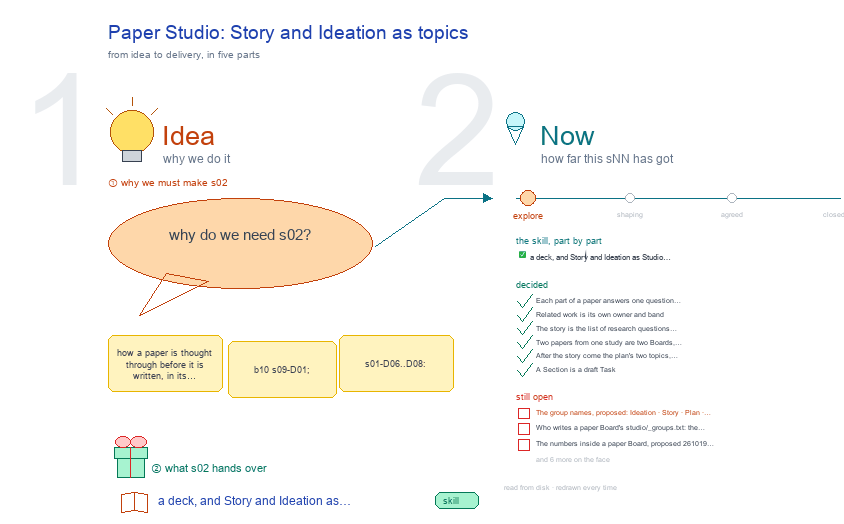

# s02 · Paper Studio: Story and Ideation as topics <!-- root #0a4b84 -->

**Tags:** `Structure`
**Stage:** explore

- For <!-- @for #f78806 -->
  - a deck, and Story and Ideation as … <!-- @for/0 #33fe13 -->
    a deck, and Story and Ideation as Studio topics of a paper Board, for the people who write the toolkit skills
- Delivery type <!-- @delivery-type #58a44f -->
  - skill <!-- @delivery-type/0 #34b33e -->
- Topic <!-- @topic #7e13bd -->
  - how a paper is thought through before … <!-- @topic/0 #823e0a -->
    how a paper is thought through before it is written, in its Board's one Studio (b10 s09-D01; s01-D06..D08: Story and Ideation are studio topics, their research questions are Board Questions with reports).
  - The drawing is one frame (261011, JL: … <!-- @topic/1 #3c5266 -->
    The drawing is one frame (261011, JL: "the draw is too thin ...
  - What will be a groups for the … <!-- @topic/2 #f615bb -->
    What will be a groups for the studio items?"): row 1, six proposed groups for a paper Board's Studio topics, in the order a paper is thought through, each with its folder, what it holds, the skill that writes it and ScalingGlucose's topic; row 2, what a Story topic feeds (its Questions, the stage gate, the version built from it, its Sections, the built paper) and the loop back when a review comes in; row 3, the proposed `studio/_groups.txt`, ScalingGlucose's Studio today and what is open.
  - The view numbers (b16 s02 = the … <!-- @topic/3 #efd06c -->
    The view numbers (b16 s02 = the Studio's design) are for the blueprint Blocks; a real paper Board numbers its own topics by content (s01-ideation, s02-story-…).
- Feeds <!-- @feeds #ffe8e9 -->
  - `reports/` q04_story_into_topics <!-- @feeds/0 #dc2d4e -->
- Files <!-- @files #6ce6c5 -->
  - [py] [build_s02_paper_studio.py](build_s02_paper_studio.py) <!-- @files/0 #86555b -->
  - delivery/ <!-- @files/1 #404761 -->
  - [excalidraw] [s02-paper-studio.excalidraw](s02-paper-studio.excalidraw) <!-- @files/2 #5c091b -->
  - [md] [s02-paper-studio.md](s02-paper-studio.md) <!-- @files/3 #fe0246 -->
  - [png] [s02-paper-studio.png](s02-paper-studio.png) <!-- @files/4 #7e8c1a -->
    
- Decided <!-- @decided #55615a -->
  - s02-D01 · Each part of a paper … <!-- @decided/0 #92b45e -->
    s02-D01 · Each part of a paper answers one question at one grain (JL 261019: "What is the differneces between idea, related work, and story, and then sections, right, and then evidence, etc."): idea, which question is worth a paper (`s01-ideation/`, many, one picked at G0); related work, who did nearly this and what we add (s10-s19, haipipe-paper-related); story, what paper we make from the picked idea (`studio/s02-story-<desk>-<idea>/`); a research question's report, what its answer is (`reports/qNN_`); a version, what we send to whom (a Job); a Section, what one part says (a draft Task); evidence, what backs one sentence (its cards). Literature is `discovery/`'s wide reading, not related work.
  - s02-D02 · Related work is its own … <!-- @decided/1 #5413f7 -->
    s02-D02 · Related work is its own owner and band: `haipipe-paper-related`, s10 the map, s11-s19 one topic per type of closest work (JL 261019: "for the related work we can do things like s10-related-work, and after that, we have s11 s12"; "it is different from the literature"; "go ahead and do it")
  - s02-D04 · The story is the list … <!-- @decided/2 #ef1c74 -->
    s02-D04 · The story is the list of research questions it answers; read in order, the questions are its narrative, and each is drawn with what supports it and what is missing (JL 261019: "please make the story, I think it should be composed a list of the questions to answer, and the quesiton can be the narrative as well"; "should we have a things named /excalidraw-story?"). Built: `1_base/excalidraw/excalidraw-story` 0.1.0, haipipe-paper-story 0.22.0; a telling may open before G0, which is then JL's mark on it ("there are not s02, why????"). Each research question is one long, plain sentence a patient could ask, not a short label (JL 261019: "你不能太简短，你要说得像人话 ... 比较长，然后比较 straightforward、比较易懂的"). First: Project-LLMRec-Physician's MIS Quarterly story, four research questions.
  - s02-D05 · Two papers from one study … <!-- @decided/3 #584309 -->
    s02-D05 · Two papers from one study are two Boards, each with its own story: a quick, short paper lists only the few questions already answered on disk and never takes the long paper's headline (JL 261019: "我觉得你可以说我们有两篇文章嘛 ... MISQ version"; "for this one, we want to make it quick and most short"; "we don't need to list all of them"). First: Project-LLMRec-Physician's `paper/Paper-LLMRecPhy-Quick/` (since 261019 the JAMA Network Open Original Investigation with three questions, the project's original research, first planned as a letter) and its MIS Quarterly companion (four questions) on a Board of its own, the one-paper-per-Board rule kept.
  - s02-D06 · After the story come the … <!-- @decided/4 #9aee65 -->
    s02-D06 · After the story come the plan's two topics, numbered s03 and s04 on every paper Board and owned by the new `haipipe-paper-plan`: `s03-paper-dataflow`, how the data becomes each answer (the building map, excalidraw-workflow's `workflow_drawing.py`), and `s04-paper-workflow`, how the answers become the paper (the Sections, the displays with the Run that makes each, the dated steps to the send; `paperflow_drawing.py`) (JL 261019: "plan for the data flow and plan for the paper flow"; "please think about to make the s03 to be the paper-dataflow, and s04 to be the s04-paper-workflow"). A Figures topic folds into s04. First: Paper-LLMRecPhy-Quick.
  - s02-D03 · A Section is a draft … <!-- @decided/5 #a7598c -->
    s02-D03 · A Section is a draft Task: `haipipe-paper-section` is `haipipe-paper-draft`, and the new `haipipe-paper-evidence` keeps the paper's evidence rules and one ledger per version (JL 261019: "okay, please go ahead and do it"; "use the draft? so we have the draft task, right?"); s21 has the detail
- Open <!-- @open #cf9b77 -->
  - The group names, proposed: Ideation · Story … <!-- @open/0 #1af1c5 -->
    The group names, proposed: Ideation · Story · Plan · Figures · Review · Talk. JL picks.
  - Who writes a paper Board's `studio/_groups.txt`: the … <!-- @open/1 #3079a7 -->
    Who writes a paper Board's `studio/_groups.txt`: the paper scaffold (`paper_ladder.py`) or a person.
  - The numbers inside a paper Board, proposed … <!-- @open/2 #793bc0 -->
    The numbers inside a paper Board, proposed 261019 (s10-s19 decided, s02-D02; s02 to s04 decided, s02-D06): s00
  - index · s01 ideation · s02 the … <!-- @open/3 #b9c09e -->
    index · s01 ideation · s02 the story · s03 the data flow · s04 the paper flow · s10-s19 related work · s21-s29 versions and their Sections (results, section canvases) · s61-s69 slide drafts. Today four papers number four ways, and TestToLearn's Section drawings sit at s10-s16 (DrFirst moves them, with `renamed-from:`). JL picks.
  - The other three story topics (MISQ AgreeablePrescription, … <!-- @open/4 #0f3224 -->
    The other three story topics (MISQ AgreeablePrescription, FairGlucose, TestToLearn) still write §3 as the older
  - table or have no drawing; each moves … <!-- @open/5 #f05573 -->
    table or have no drawing; each moves to the question list and excalidraw-story when its owner asks.
  - A version's Studio view: only the telling … <!-- @open/6 #ff9c6b -->
    A version's Studio view: only the telling it is built from, or every topic of the Board?
  - A Figures topic folds into s04 (s02-D06), … <!-- @open/7 #79b26f -->
    A Figures topic folds into s04 (s02-D06), which names each display and its Run; still open: where a figure's
  - design on s04 ends and a Section's … <!-- @open/8 #6bc7f6 -->
    design on s04 ends and a Section's display unit (haipipe-display) begins.
  - Does a telling's group name the group … <!-- @open/9 #78342c -->
    Does a telling's group name the group of its Board Questions, one to one (ScalingGlucose:
  - s02-story-nmi-cgm-scaling-axes ↔ group: nmi-cgm-scaling-axes)? <!-- @open/10 #e67167 -->
  - ScalingGlucose's three topics have no Tags and … <!-- @open/11 #6987e3 -->
    ScalingGlucose's three topics have no Tags and no Stage, and s03-paper-workflow has no face file;
  - fixed only when JL asks (a real … <!-- @open/12 #8d1a85 -->
    fixed only when JL asks (a real Project).
  - Agree its **For:** line and **Delivery type:** … <!-- @open/13 #09a2ba -->
    Agree its **For:** line and **Delivery type:** (skill), proposed by the agent 261030?
