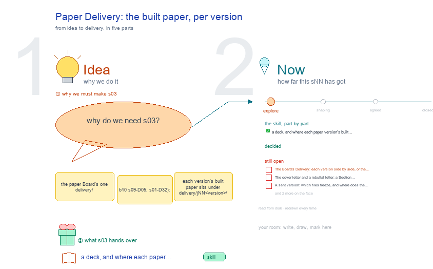

# s03 · Paper Delivery: the built paper, per version <!-- root #ae386e -->

**Tags:** `Structure`
**Stage:** explore

- For <!-- @for #f78806 -->
  - a deck, and where each paper version's … <!-- @for/0 #8d0d71 -->
    a deck, and where each paper version's built files go in the Board's delivery folder, for the people who write the toolkit skills
- Delivery type <!-- @delivery-type #58a44f -->
  - skill <!-- @delivery-type/0 #34b33e -->
- Topic <!-- @topic #7e13bd -->
  - the paper Board's one `delivery/` (b10 s09-D05, … <!-- @topic/0 #fc429c -->
    the paper Board's one `delivery/` (b10 s09-D05, s01-D32): each version's built paper sits under `delivery/jNN_<version>/` (LaTeX, Word, cover letter), and each Section's own output under `delivery/jNN_<version>/tNN_<section>/`. haipipe-paper-assemble builds the paper from the Sections' outputs; haipipe-delivery owns the folder and the rule that only a person marks a send done.
  - This topic settles what paper adds: the … <!-- @topic/1 #0e3d35 -->
    This topic settles what paper adds: the lanes a paper needs, how versions sit side by side, and what a send freezes.
- Feeds <!-- @feeds #ffe8e9 -->
  - `reports/` q02_venues_related_built <!-- @feeds/0 #afabfa -->
- Files <!-- @files #6ce6c5 -->
  - [py] [build_s03_paper_delivery.py](build_s03_paper_delivery.py) <!-- @files/0 #70c099 -->
  - delivery/ <!-- @files/1 #404761 -->
  - [excalidraw] [s03-paper-delivery.excalidraw](s03-paper-delivery.excalidraw) <!-- @files/2 #096401 -->
  - [md] [s03-paper-delivery.md](s03-paper-delivery.md) <!-- @files/3 #dc844c -->
  - [png] [s03-paper-delivery.png](s03-paper-delivery.png) <!-- @files/4 #9c4880 -->
    
- Decided <!-- @decided #55615a -->
  - (none yet: a decision is one line, … <!-- @decided/0 #8981bf -->
    (none yet: a decision is one line, s03-DNN · <what was decided> (<who> <date>))
- Open <!-- @open #cf9b77 -->
  - The Board's Delivery: each version side by … <!-- @open/0 #f0707f -->
    The Board's Delivery: each version side by side, or the newest first? (was s33 open 1)
  - The cover letter and a rebuttal letter: … <!-- @open/1 #3faf6b -->
    The cover letter and a rebuttal letter: a Section Task's output, or the version's own?
  - A sent version: which files freeze, and … <!-- @open/2 #c0f9f8 -->
    A sent version: which files freeze, and where does the send's decision live? (was s33 open 3)
  - The supplement: its own lane, or inside … <!-- @open/3 #c3e941 -->
    The supplement: its own lane, or inside latex/?
  - Agree its **For:** line and **Delivery type:** … <!-- @open/4 #09a2ba -->
    Agree its **For:** line and **Delivery type:** (skill), proposed by the agent 261030?
