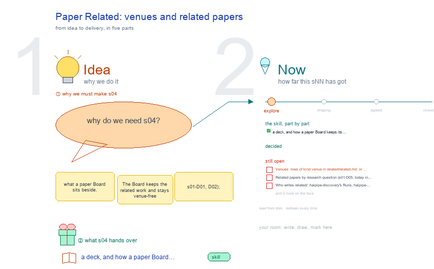

# s04 · Paper Related: venues and related papers <!-- root #02aa73 -->

**Tags:** `Structure`
**Stage:** explore

- For <!-- @for #f78806 -->
  - a deck, and how a paper Board … <!-- @for/0 #3937fa -->
    a deck, and how a paper Board keeps its related papers and each version its venue, for the people who write the toolkit skills
- Delivery type <!-- @delivery-type #58a44f -->
  - skill <!-- @delivery-type/0 #34b33e -->
- Topic <!-- @topic #7e13bd -->
  - what a paper Board sits beside <!-- @topic/0 #84021e -->
  - The Board keeps the related work and … <!-- @topic/1 #8f16ce -->
    The Board keeps the related work and stays venue-free (s01-D01, D02); each version Job is attached to one venue (s01-D03).
  - The Block's `related/` shelf (b10 s01-D34) holds … <!-- @topic/2 #b7509c -->
    The Block's `related/` shelf (b10 s01-D34) holds one table, `related/related.md` (kind · date · item · link · feeds · group), and its subfolders meetings/ · papers/ · files/ · emails/, each kept as it came (/haipipe-related).
  - A row's groups on the Studio's bar … <!-- @topic/3 #f31673 -->
    A row's groups on the Studio's bar are its subfolder first, then its `group` cell, comma-separated, a paper's research questions among them (b10 s04-D07, D08, D09).
  - On screen Related folds inside the Studio, … <!-- @topic/4 #b1323c -->
    On screen Related folds inside the Studio, under its topic cards (b10 s04-D05, 261011); the top row stays `Guide · Studio | Block · Job · Task | Delivery`.
  - A version and a Section keep no … <!-- @topic/5 #8204c1 -->
    A version and a Section keep no related/ of their own (JL 261011).
  - Paper's Description is now Scope · Venue … <!-- @topic/6 #7f801b -->
    Paper's Description is now Scope · Venue · Resources.
  - This topic settles where venues and related … <!-- @topic/7 #d0cda8 -->
    This topic settles where venues and related papers go on that shelf, and who writes them.
  - Its decisions start at s04-D06: s04-D01..D05 are … <!-- @topic/8 #2ef5a5 -->
    Its decisions start at s04-D06: s04-D01..D05 are the retired Story decisions, kept by their old ids in s01's notes.
- Feeds <!-- @feeds #ffe8e9 -->
  - `reports/` q02_venues_related_built <!-- @feeds/0 #afabfa -->
- Files <!-- @files #6ce6c5 -->
  - [py] [build_s04_paper_related.py](build_s04_paper_related.py) <!-- @files/0 #5be58e -->
  - delivery/ <!-- @files/1 #404761 -->
  - [excalidraw] [s04-paper-related.excalidraw](s04-paper-related.excalidraw) <!-- @files/2 #cf4eb3 -->
  - [md] [s04-paper-related.md](s04-paper-related.md) <!-- @files/3 #955eaa -->
  - [png] [s04-paper-related.png](s04-paper-related.png) <!-- @files/4 #a150a3 -->
    
- Decided <!-- @decided #55615a -->
  - This topic's decisions start at s04-D06 (s04-D01..D05 … <!-- @decided/0 #beb067 -->
    This topic's decisions start at s04-D06 (s04-D01..D05 are the retired Story decisions).
  - (none yet: a decision is one line, … <!-- @decided/1 #656852 -->
    (none yet: a decision is one line, s04-DNN · <what was decided> (<who> <date>))
- Open <!-- @open #cf9b77 -->
  - Venues: rows of kind venue in related/related.md, … <!-- @open/0 #68cb40 -->
    Venues: rows of kind venue in related/related.md, or their own venues/ folder?
  - Related papers by research question (s01-D05, today … <!-- @open/1 #e6b1e7 -->
    Related papers by research question (s01-D05, today in Block › Report): keep there, or move to Related?
  - Who writes related/: haipipe-discovery's Runs, haipipe-paper-venue, or … <!-- @open/2 #0e0d05 -->
    Who writes related/: haipipe-discovery's Runs, haipipe-paper-venue, or a person by hand?
  - An email that carries comments (a decision … <!-- @open/3 #6553c2 -->
    An email that carries comments (a decision letter, a coauthor's notes): saved once in related/emails/ and cited by the comments batch, as a meeting is, or kept in the batch's feedback/ as today?
  - Agree its **For:** line and **Delivery type:** … <!-- @open/4 #09a2ba -->
    Agree its **For:** line and **Delivery type:** (skill), proposed by the agent 261030?
