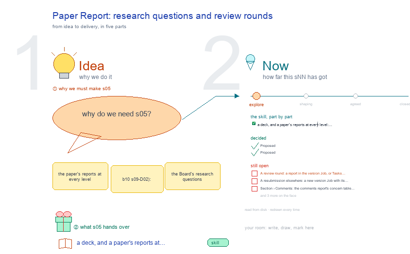

# s05 · Paper Report: research questions and review rounds <!-- root #8f856b -->

**Tags:** `Structure`
**Stage:** explore

- For <!-- @for #f78806 -->
  - a deck, and a paper's reports at … <!-- @for/0 #cde414 -->
    a deck, and a paper's reports at every level: research questions and review rounds, for the people who write the toolkit skills
- Delivery type <!-- @delivery-type #58a44f -->
  - skill <!-- @delivery-type/0 #34b33e -->
- Topic <!-- @topic #7e13bd -->
  - the paper's reports at every level (b10 … <!-- @topic/0 #2f9a40 -->
    the paper's reports at every level (b10 s09-D02): the Board's research questions (board.md
- Questions, s01-D08) each with a report; a version Job's standing questions every send answers <!-- @questions-s01-d08-each-with-a-report-a-version-job-s-standing-questions-every-send-answers #92ae6b -->
  - (haipipe-paper-workflow) and its comments and review rounds … <!-- @questions-s01-d08-each-with-a-report-a-version-job-s-standing-questions-every-send-answers/0 #70dc29 -->
    (haipipe-paper-workflow) and its comments and review rounds (haipipe-paper-comments); a Section's own questions. This topic settles where a review round and its answers live, and what each paper level must report.
  - **Feeds:** `reports/` q03_review_rounds · q04_story_into_topics <!-- @questions-s01-d08-each-with-a-report-a-version-job-s-standing-questions-every-send-answers/1 #4f50d2 -->
- Files <!-- @files #6ce6c5 -->
  - [py] [build_s05_paper_report.py](build_s05_paper_report.py) <!-- @files/0 #67f37b -->
  - delivery/ <!-- @files/1 #404761 -->
  - [excalidraw] [s05-paper-report.excalidraw](s05-paper-report.excalidraw) <!-- @files/2 #0bd5d9 -->
  - [md] [s05-paper-report.md](s05-paper-report.md) <!-- @files/3 #b4d90b -->
  - [png] [s05-paper-report.png](s05-paper-report.png) <!-- @files/4 #7abd11 -->
    
- Decided <!-- @decided #55615a -->
  - s05-D01 · Proposed (b16 261011, answers b10 … <!-- @decided/0 #c644fd -->
    s05-D01 · Proposed (b16 261011, answers b10 s05 Open 14): a paper Question's `group:` is its kind, one of the paper's groups in b10 s05-D07 (Ideation · Narrative · Random thoughts, renamed in b10 s05-D22; who asked, a reviewer, coauthor, editor or reader, goes in the Question's own text). Which telling a Question belongs to is said once, by the telling's **Feeds:** line, which already lists its reports (q00_… q06_…). So the Research questions are the Questions the current telling feeds, read by id, whatever their group line says, and a research question needs no group line. Why: a telling's name in `group:` says what Feeds already says, and a Question kept into the next telling would have to change group. ScalingGlucose's `group: nmi-cgm- scaling-axes` keeps working with no edit.
  - s05-D02 · Proposed (b16 261011, answers b10 … <!-- @decided/1 #8d490c -->
    s05-D02 · Proposed (b16 261011, answers b10 s05 Open 13 for the paper): b10 keeps the rule and its table; b16 keeps the paper's words: its four groups (b10 s05-D07's paper row) and its standing Questions, Narrative's three "Will it attract the editor / reviewer / public?" on the Board and J1 to J5 on every version (`STANDING` in paper_theme.py; b10 s05-D12). A Section's is still open (Open 4).
- Open <!-- @open #cf9b77 -->
  - A review round: a report in the … <!-- @open/0 #f89960 -->
    A review round: a report in the version Job, or Tasks in the same Job? (Q03)
  - A resubmission elsewhere: a new version Job … <!-- @open/1 #7ca7fd -->
    A resubmission elsewhere: a new version Job with its own reports?
  - Section › Comments: the comments report's concern … <!-- @open/2 #f2d58c -->
    Section › Comments: the comments report's concern table as it is, or a ## Review Items table? (was s33 open 2)
  - What a Section must report (the Board … <!-- @open/3 #9b334e -->
    What a Section must report (the Board and the version: s05-D02).
  - RQ0 to RQ6 in the telling and … <!-- @open/4 #6cbd31 -->
    RQ0 to RQ6 in the telling and Q00 to Q06 in the register are the same Questions under two names
  - (b10 s05, read 261011): show one name … <!-- @open/5 #d781c3 -->
    (b10 s05, read 261011): show one name on screen? Which one is JL's.
  - Agree its **For:** line and **Delivery type:** … <!-- @open/6 #09a2ba -->
    Agree its **For:** line and **Delivery type:** (skill), proposed by the agent 261030?
