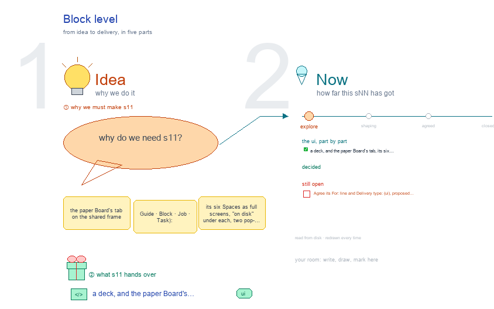

# s11 · Block level <!-- root #1269ee -->

**Tags:** `Levels`
**Stage:** explore

- For <!-- @for #f78806 -->
  - a deck, and the paper Board's tab, … <!-- @for/0 #adb1b8 -->
    a deck, and the paper Board's tab, its six Spaces as full screens with what is on disk, for the people who build the workbench
- Delivery type <!-- @delivery-type #58a44f -->
  - ui <!-- @delivery-type/0 #636117 -->
- Topic <!-- @topic #7e13bd -->
  - the paper Board's tab on the shared … <!-- @topic/0 #da122a -->
    the paper Board's tab on the shared frame (Guide · Block · Job · Task): its six Spaces as full screens, "on disk" under each, two pop-outs, then Guide › Method opened from the Block tab (JL 261007: "add the s11 s12 s13 like b11").
  - It draws Q01's proposal for the Board … <!-- @topic/1 #b86220 -->
    It draws Q01's proposal for the Board (`../s01-paper-tree-concept/`).
- Source <!-- @source #6da13a -->
  - the screens are drawn by `../_build/paper_ui.py`, shared … <!-- @source/0 #46b166 -->
    the screens are drawn by `../_build/paper_ui.py`, shared by s11 · s12 · s13; the Guide's steps and method cards are read from `servers/workbench-paper/guide/method.md` and its `methods/` (and the Page Task's `guide.yaml` at Task level) at build time.
  - Placeholders only <!-- @source/1 #998c54 -->
- Feeds <!-- @feeds #ffe8e9 -->
  - `../reports/` q01_paper_ladder (and the open marks of … <!-- @feeds/0 #cf0d19 -->
    `../reports/` q01_paper_ladder (and the open marks of q02, q03).
- Files <!-- @files #6ce6c5 -->
  - [py] [build_s11_paper_block.py](build_s11_paper_block.py) <!-- @files/0 #32e867 -->
  - delivery/ <!-- @files/1 #404761 -->
  - [excalidraw] [s11-paper-block.excalidraw](s11-paper-block.excalidraw) <!-- @files/2 #6f2285 -->
  - [md] [s11-paper-block.md](s11-paper-block.md) <!-- @files/3 #5498a6 -->
  - [png] [s11-paper-block.png](s11-paper-block.png) <!-- @files/4 #cc1120 -->
    
- Proposed (261007) <!-- @proposed-261007 #e4f68e -->
  - Description has four groups: Scope (the face, … <!-- @proposed-261007/0 #cc40d7 -->
    Description has four groups: Scope (the face, which Story it tells, the target now) · Venue
  - (`venues/<venue>/`) · Resources · Related (`related/related.md`) <!-- @proposed-261007/1 #b2f4c7 -->
  - Idea Studio: one drawing after another; the … <!-- @proposed-261007/2 #ea5247 -->
    Idea Studio: one drawing after another; the RoadMap Draw is its first topic.
  - Audience Report: Ideation · Spine · High-level … <!-- @proposed-261007/3 #e4ffde -->
    Audience Report: Ideation · Spine · High-level logic + Low-level work, read from the Story Pages and `reports/`.
  - Work Details: the Jobs (story · versions … <!-- @proposed-261007/4 #d6f1b6 -->
    Work Details: the Jobs (story · versions · grants · slides), each version open to its Sections.
  - Runs: the Board's own soft Runs <!-- @proposed-261007/5 #3c9f64 -->
    Runs: the Board's own soft Runs; Delivery: each version's build, from below (Q02 open).
  - Guide › Method from this tab: the … <!-- @proposed-261007/6 #e52c99 -->
    Guide › Method from this tab: the Block section open (frame the question, write the Story, fix
  - the evidence), Job and Task folded <!-- @proposed-261007/7 #2c8bd2 -->
- Open <!-- @open #cf9b77 -->
  - Agree its **For:** line and **Delivery type:** … <!-- @open/0 #7b11a4 -->
    Agree its **For:** line and **Delivery type:** (ui), proposed by the agent 261030?
  - See the drawing's red notes (open ?) <!-- @open/1 #d126bb -->
