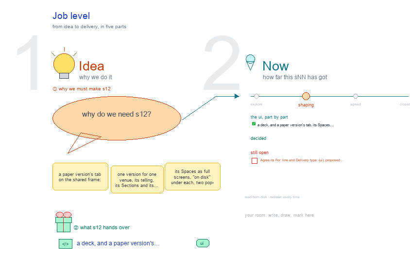

# s12 · Job level <!-- root #d4a128 -->

**Tags:** `Levels`
**Stage:** shaping

- For <!-- @for #f78806 -->
  - a deck, and a paper version's tab, … <!-- @for/0 #504b8b -->
    a deck, and a paper version's tab, its Spaces as full screens with what is on disk, for the people who build the workbench
- Delivery type <!-- @delivery-type #58a44f -->
  - ui <!-- @delivery-type/0 #636117 -->
- Topic <!-- @topic #7e13bd -->
  - a paper version's tab on the shared … <!-- @topic/0 #8323d9 -->
    a paper version's tab on the shared frame: one version for one venue, its telling, its Sections and its build; its Spaces as full screens, "on disk" under each, two pop-outs, then Guide › Method opened from the Job tab (JL 261007).
- Source <!-- @source #6da13a -->
  - the screens are drawn by `../_build/paper_ui.py`, shared … <!-- @source/0 #46b166 -->
    the screens are drawn by `../_build/paper_ui.py`, shared by s11 · s12 · s13; the Guide's steps and method cards are read from `servers/workbench-paper/guide/method.md` and its `methods/` (and the Page Task's `guide.yaml` at Task level) at build time.
  - Placeholders only <!-- @source/1 #998c54 -->
- Feeds <!-- @feeds #ffe8e9 -->
  - `../reports/` q01_paper_ladder (and the open marks of … <!-- @feeds/0 #cf0d19 -->
    `../reports/` q01_paper_ladder (and the open marks of q02, q03).
- Files <!-- @files #6ce6c5 -->
  - [py] [build_s12_paper_job.py](build_s12_paper_job.py) <!-- @files/0 #608f21 -->
  - delivery/ <!-- @files/1 #404761 -->
  - [excalidraw] [s12-paper-job.excalidraw](s12-paper-job.excalidraw) <!-- @files/2 #3c734f -->
  - [md] [s12-paper-job.md](s12-paper-job.md) <!-- @files/3 #f1be33 -->
  - [png] [s12-paper-job.png](s12-paper-job.png) <!-- @files/4 #548bba -->
    
- Decided and drawn (261007, green ✎ in the drawing) <!-- @decided-and-drawn-261007-green-in-the-drawing #75ee93 -->
  - A version is `jNN_v<MMDD>_<desk>/`, dated by its … <!-- @decided-and-drawn-261007-green-in-the-drawing/0 #3ddeb4 -->
    A version is `jNN_v<MMDD>_<desk>/`, dated by its send; its face carries venue · deadline · tells
  - (a studio topic, `studio/sNN-story-<telling>/`) · from · … <!-- @decided-and-drawn-261007-green-in-the-drawing/1 #f71b40 -->
    (a studio topic, `studio/sNN-story-<telling>/`) · from · answers, its `## Narrative` (the old §8, the build's order) and its `## Questions`. It holds `studio/` · `reports/` · `runs/`, its Tasks and `delivery/`.
  - Its Tasks: `t00_abstract` · `t0N_` Main · … <!-- @decided-and-drawn-261007-green-in-the-drawing/2 #b9a42a -->
    Its Tasks: `t00_abstract` · `t0N_` Main · `t2N_` Appendix (A = t21) · `t3N_` letters (t31 cover
  - letter, t32 response) <!-- @decided-and-drawn-261007-green-in-the-drawing/3 #55c39e -->
  - Audience Report: Questions (the register, then the … <!-- @decided-and-drawn-261007-green-in-the-drawing/4 #df82d2 -->
    Audience Report: Questions (the register, then the standing J1–J5) · Draft-Main · Draft-Appendix
  - (Question │ Work │ Report, the rendered … <!-- @decided-and-drawn-261007-green-in-the-drawing/5 #da0d31 -->
    (Question │ Work │ Report, the rendered draft beside the Section's drawing) · Comments (Review Items citing R1.1 · E1.2) · Cover letter (paragraph │ the question it answers │ its text).
  - Comments are a report of type comments, … <!-- @decided-and-drawn-261007-green-in-the-drawing/6 #70a52f -->
    Comments are a report of type comments, `reports/qNN_<kind>-<MMDD>/` in the version that answers
  - them (haipipe-paper-comments 1.1.0); never a Task <!-- @decided-and-drawn-261007-green-in-the-drawing/7 #daf468 -->
  - Delivery: item cards (Manuscript · Letters · … <!-- @decided-and-drawn-261007-green-in-the-drawing/8 #f28a63 -->
    Delivery: item cards (Manuscript · Letters · Checks · Sent), no third row.
  - A revision is a new version, starting … <!-- @decided-and-drawn-261007-green-in-the-drawing/9 #7ed813 -->
    A revision is a new version, starting as a copy of the last one's authored files.
  - Live: `servers/workbench-paper/paper_theme.py` (`version_spaces`) draws all of this … <!-- @decided-and-drawn-261007-green-in-the-drawing/10 #9d2af2 -->
    Live: `servers/workbench-paper/paper_theme.py` (`version_spaces`) draws all of this on TestToLearn's j01 and j02.
- Open <!-- @open #cf9b77 -->
  - Agree its **For:** line and **Delivery type:** … <!-- @open/0 #7b11a4 -->
    Agree its **For:** line and **Delivery type:** (ui), proposed by the agent 261030?
  - See the drawing's red notes (open ?) <!-- @open/1 #d126bb -->
