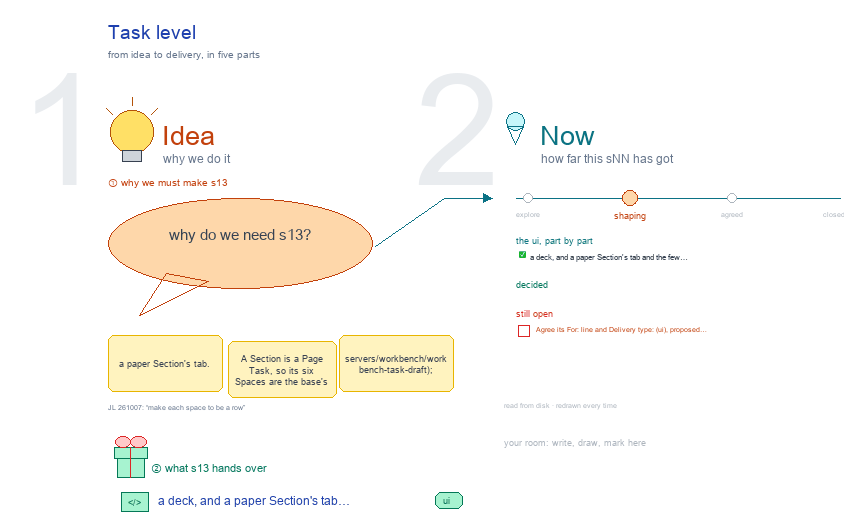

# s13 · Task level <!-- root #950a9d -->

**Tags:** `Levels`
**Stage:** shaping

- For <!-- @for #f78806 -->
  - a deck, and a paper Section's tab … <!-- @for/0 #7efaa5 -->
    a deck, and a paper Section's tab and the few things the paper theme adds to it, for the people who build the workbench
- Delivery type <!-- @delivery-type #58a44f -->
  - ui <!-- @delivery-type/0 #636117 -->
- Topic <!-- @topic #7e13bd -->
  - a paper Section's tab <!-- @topic/0 #8e3de5 -->
  - A Section is a Page Task, so … <!-- @topic/1 #6944c5 -->
    A Section is a Page Task, so its six Spaces are the base's Page Task views (`servers/workbench/workbench-task-draft`); ◆ marks the few things the paper theme adds: the Section's row in the version's Narrative, its venue's section norms, and the LaTeX fragment the version pulls in.
  - Then Guide › Method opened from the … <!-- @topic/2 #ec49c3 -->
    Then Guide › Method opened from the Task tab: the Page method's steps and cards (JL 261007).
- Source <!-- @source #6da13a -->
  - the screens are drawn by `../_build/paper_ui.py`, shared … <!-- @source/0 #46b166 -->
    the screens are drawn by `../_build/paper_ui.py`, shared by s11 · s12 · s13; the Guide's steps and method cards are read from `servers/workbench-paper/guide/method.md` and its `methods/` (and the Page Task's `guide.yaml` at Task level) at build time.
  - Placeholders only <!-- @source/1 #998c54 -->
- Feeds <!-- @feeds #ffe8e9 -->
  - `../reports/` q01_paper_ladder (and the open marks of … <!-- @feeds/0 #cf0d19 -->
    `../reports/` q01_paper_ladder (and the open marks of q02, q03).
- Files <!-- @files #6ce6c5 -->
  - [py] [build_s13_paper_task.py](build_s13_paper_task.py) <!-- @files/0 #75e2a2 -->
  - delivery/ <!-- @files/1 #404761 -->
  - [excalidraw] [s13-paper-task.excalidraw](s13-paper-task.excalidraw) <!-- @files/2 #a20835 -->
  - [md] [s13-paper-task.md](s13-paper-task.md) <!-- @files/3 #ff5e97 -->
  - [png] [s13-paper-task.png](s13-paper-task.png) <!-- @files/4 #447832 -->
    
- Layout (JL 261007: "make each space to be a row") <!-- @layout-jl-261007-make-each-space-to-be-a-row #69cd19 -->
  - One frame per Space, read left to … <!-- @layout-jl-261007-make-each-space-to-be-a-row/0 #42e9c1 -->
    One frame per Space, read left to right: that Space's views side by side, each a full screen with its "on disk" under it, then the Space explained on the right (◆ what the paper adds, red what is open). Description: Scope · Plan · Requirement · Records. Idea Studio: one screen. Audience Report: Table · Reading. Work Details: Draft-Scratch · Draft-Revise · Evidence-Citation · -Display · -Value · Supporting. Runs: All (the type tabs filter it). Delivery: LaTeX · Word. Then Guide › Method.
- Proposed (261007, redrawn from haipipe-paper-draft and the Section folders as they are) <!-- @proposed-261007-redrawn-from-haipipe-paper-draft-and-the-section-folders-as-they-are #069fe3 -->
  - The paper adds four things to a … <!-- @proposed-261007-redrawn-from-haipipe-paper-draft-and-the-section-folders-as-they-are/0 #ee924d -->
    The paper adds four things to a Page Task: the reader contract in the face's header (Description ›
  - Scope: reader-question, entry and exit state, must-establish, … <!-- @proposed-261007-redrawn-from-haipipe-paper-draft-and-the-section-folders-as-they-are/1 #ccaf6a -->
    Scope: reader-question, entry and exit state, must-establish, must-refuse, transitions, story-row, structure); the venue's rules in `draft/records/<stem>-requirement.md` (Description › Requirement: V-rules generated from the venue's section, W-rules authored); the form against the budget (Audience Report, measured by `section-stats.py`); and the Section's own PDF, the piece the version pulls in, and "ready for the build" (outline approved · every display has preview.pdf · PDF compiles), shown apart from "done" (the Page CHECK).
  - Everything else is the base's Page Task: … <!-- @proposed-261007-redrawn-from-haipipe-paper-draft-and-the-section-folders-as-they-are/2 #fd1875 -->
    Everything else is the base's Page Task: Table · Reading, Draft-… and Evidence-…, soft Runs only.
  - "On disk" follows today's Section folders: displays … <!-- @proposed-261007-redrawn-from-haipipe-paper-draft-and-the-section-folders-as-they-are/3 #58af31 -->
    "On disk" follows today's Section folders: displays in `results/run-display-<slug>/payload/`,
  - a soft Run as `runs/<name>.md` plus `results/<name>/`, … <!-- @proposed-261007-redrawn-from-haipipe-paper-draft-and-the-section-folders-as-they-are/4 #255e08 -->
    a soft Run as `runs/<name>.md` plus `results/<name>/`, the Bib in `delivery/latex/draft-bibliography/`. A Section `studio/` and `runs/README.md` are proposed (red).
  - A comments batch (feedback · meeting · … <!-- @proposed-261007-redrawn-from-haipipe-paper-draft-and-the-section-folders-as-they-are/5 #81ba81 -->
    A comments batch (feedback · meeting · sent, once `Bc-<desk>-Round/RD<NN>-<event>/`) is a report of
  - type comments in the version it answers: … <!-- @proposed-261007-redrawn-from-haipipe-paper-draft-and-the-section-folders-as-they-are/6 #20df91 -->
    type comments in the version it answers: `<version>/reports/qNN_<kind>-<MMDD>/`, `page-type: comments`, a row in `## Questions` (group comments). Never a Task; `t3N_` is Letters (t31 cover letter, t32 response). JL 261007: "comments … are a special type of report … in the reports/". Drawn as a pop-out.
  - Guide › Method from this tab: the … <!-- @proposed-261007-redrawn-from-haipipe-paper-draft-and-the-section-folders-as-they-are/7 #943dc7 -->
    Guide › Method from this tab: the Page method's steps and cards (read from the Page Task's guide).
- Decided (JL 261007, on the row drawing) <!-- @decided-jl-261007-on-the-row-drawing #8ba749 -->
  - Description › Requirement is its own tab … <!-- @decided-jl-261007-on-the-row-drawing/0 #83460c -->
    Description › Requirement is its own tab (today a lens in the Outline). It shows the venue's
  - rules (V), the Page's own (W), and … <!-- @decided-jl-261007-on-the-row-drawing/1 #50ad9e -->
    rules (V), the Page's own (W), and the rubric the draft is judged by: the shared four axes (Mechanics · Function · Evidence · Readability, `haipipe-draft-review/ref/evaluation-rubric.md`) and, at submission, the Section's `SUB-*` rows (`haipipe-paper/ref/submission-readiness.md`).
  - A Section folder has its own `studio/` … <!-- @decided-jl-261007-on-the-row-drawing/2 #5adc7b -->
    A Section folder has its own `studio/` and `reports/`, as every Task: `sNN-<topic>/` for its
  - drawings (the logic by hand, the Section … <!-- @decided-jl-261007-on-the-row-drawing/3 #a5658f -->
    drawings (the logic by hand, the Section map), `reports/qNN_<topic>/` for its questions. Both start empty and fill as they are made.
  - Audience Report › Table follows today's Draft … <!-- @decided-jl-261007-on-the-row-drawing/4 #835989 -->
    Audience Report › Table follows today's Draft table (`servers/workbench/workbench-task-draft/outline.py`,
  - `plan_card`): a Reads line, then one folding … <!-- @decided-jl-261007-on-the-row-drawing/5 #2992ab -->
    `plan_card`): a Reads line, then one folding row per paragraph with its (+) notes, then Bullet │ Draft, each Bullet its address, [role], statement and evidence chips.
  - Audience Report › Questions, after Reading: the … <!-- @decided-jl-261007-on-the-row-drawing/6 #9d37b4 -->
    Audience Report › Questions, after Reading: the discussion questions kept while the Section is
  - changed <!-- @decided-jl-261007-on-the-row-drawing/7 #3c6d95 -->
    changed. Each is a row in the face's `## Questions` and a report in `reports/qNN_<topic>/` (Answer · Evidence · Limits · Next, and what it changed in the draft), as a Block's Questions are. Its table is Question │ Work │ Report, the Block's shape: the question and where it was asked · the Runs that work it and what they changed · its report and status, or No answer. Run types: Ask a question · Write the report.
  - The Audience Report is for reading: a … <!-- @decided-jl-261007-on-the-row-drawing/8 #c653c3 -->
    The Audience Report is for reading: a person reads Table and Reading; skills and agents change the
  - content through the Runs in Work Details, … <!-- @decided-jl-261007-on-the-row-drawing/9 #74dd26 -->
    content through the Runs in Work Details, so Table and Reading carry no run types (only Questions has Ask a question · Write the report). Each Work Details view has its own run types, as today's Draft views do: Draft-Scratch Scratch · Structure revise · Evidence embed; Draft-Revise Section revise · Paragraph revise · Revise edits · Auto write; Evidence-… Bind citation · Build figure / table · Bind value; Supporting Task runs · Discovery runs (run-cards.md `views`).
  - Audience Report › Comments, after Questions (JL … <!-- @decided-jl-261007-on-the-row-drawing/10 #a08556 -->
    Audience Report › Comments, after Questions (JL 261007, via s12; was Reviews): the Review Items of the
  - version's comments reports (haipipe-paper-comments 1.1.0: `reports/qNN_<kind>-<MMDD>/`, page-type … <!-- @decided-jl-261007-on-the-row-drawing/11 #44f660 -->
    version's comments reports (haipipe-paper-comments 1.1.0: `reports/qNN_<kind>-<MMDD>/`, page-type comments) that land on this Section. An item is `Review-<slug>`, citing the original points it answers (R1.1 reviewer 1 point 1, E1.2 the editor, A1.2 a coauthor); one item may gather several points, each point cited by exactly one item. Review Item │ Work │ Report, in the Round's states (open · routed · applied · answered · declined · deferred); each opens the item (the words, the passage as sent beside it now, the Run, the reply). Read from the Round page's `## Review Items` table (item · cites · lands on · work · reply · state; agreed by JL 261007, in haipipe-paper-comments): the rows whose `lands on` starts with the Section's stem. Live in `paper_theme._reviews`. Read only: the item is worked by Revise edits, `run-revise-<slug>`, in Work Details › Draft-Revise.
  - Delivery is one card per kind of … <!-- @decided-jl-261007-on-the-row-drawing/12 #9551fd -->
    Delivery is one card per kind of delivery, no third row (JL 261007: "each card is a type of
  - delivery … the card and the preview … <!-- @decided-jl-261007-on-the-row-drawing/13 #bf11e5 -->
    delivery … the card and the preview of the results, the embedded content"): Ready (◆ the paper's) first, then Web · LaTeX · Word · Slides · Render, each with its state from the Page's own check, its files as small links and its result embedded (the PDF; the web page; Word through its PDF twin; the deck), as the old paper page's Preview did. Not built: "run Build". Live in `paper_theme._delivery_previews`. No form line over the Table (JL 261007: "I don't want this").
  - Runs is drawn as today's Page Runs … <!-- @decided-jl-261007-on-the-row-drawing/14 #c08c62 -->
    Runs is drawn as today's Page Runs view (`servers/workbench/workbench-task-draft/runs.py`), not a thin
  - Run │ type │ state table (JL … <!-- @decided-jl-261007-on-the-row-drawing/15 #813133 -->
    Run │ type │ state table (JL 261007: "is this a table what what?"): the view's own lane tabs (Workflow map · Page Writing · Evidence · Supporting Runs), count pills, then one group per kind, each Run a card (its name, its state, what it does; › opens its Result). No third row. Live in the base frame: a Page Task's Runs Space embeds the Page Runs view.
  - A Run's name carries no date (JL … <!-- @decided-jl-261007-on-the-row-drawing/16 #ab71d3 -->
    A Run's name carries no date (JL 261007: "one soft run can have multiple path(es), so we don't
  - need the MMDD"): `runs/run-<type>-<slug>.md`, its passes p01, … <!-- @decided-jl-261007-on-the-row-drawing/17 #58538e -->
    need the MMDD"): `runs/run-<type>-<slug>.md`, its passes p01, p02 … inside. Renamed (JL 261007: "rename them"): the page engine (`haipipe-draft/src/run_names.py`) mints `run-<kind>-<slug>` and still reads a dated name; `page.py run-names` dropped the day on 9 Sections. 7 wait for their delivery rebuild, since their built LaTeX points at the dated display folders.
  - The names follow the version's rename (s12): … <!-- @decided-jl-261007-on-the-row-drawing/18 #22ccef -->
    The names follow the version's rename (s12): a Section is `t0N_<title>/` (`t2N_` an appendix), a
  - comments batch is a report of type … <!-- @decided-jl-261007-on-the-row-drawing/19 #79b1f6 -->
    comments batch is a report of type comments (item 4). A Section's story-row comes from the version face's `## Narrative` (the Story is now studio/ topics, Q04). Every change to the drawing is marked with a short green ✎ note.
- Live (261007) <!-- @live-261007 #80fbf7 -->
  - A Section opens on the frame's Task … <!-- @live-261007/0 #3dacc5 -->
    A Section opens on the frame's Task tab: the base's Page Task views (`task_draft.draft_task_spaces`) with the paper's lines over them (`servers/workbench-paper/paper_theme.py`, `section_spaces`): the reader contract (Scope), the Section's SUB-* rows (Requirement), "ready for the build" apart from "done" and one preview card per kind of delivery (Delivery), and Comments read from the comments Pages' `## Review Items`.
- Open <!-- @open #cf9b77 -->
  - Agree its **For:** line and **Delivery type:** … <!-- @open/0 #7b11a4 -->
    Agree its **For:** line and **Delivery type:** (ui), proposed by the agent 261030?
  - See the drawing's red notes (open ?) <!-- @open/1 #d126bb -->
