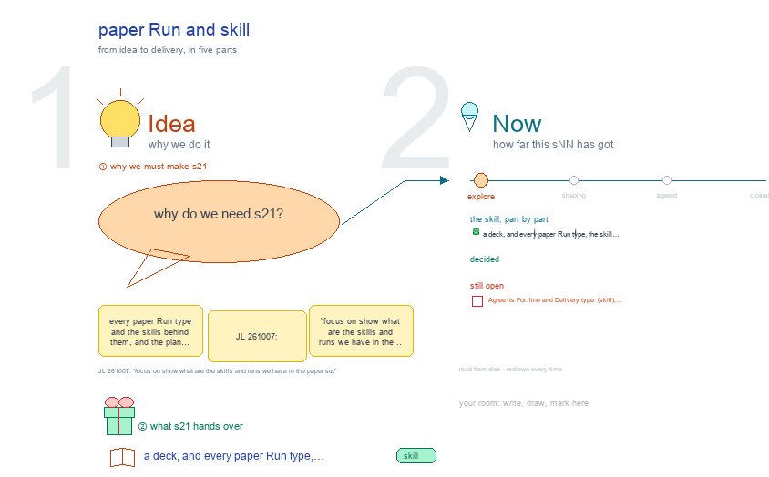

# s21 · paper Run and skill <!-- root #3ec694 -->

**Tags:** `Run and Skill`
**Stage:** explore

- For <!-- @for #f78806 -->
  - a deck, and every paper Run type, … <!-- @for/0 #ab6b36 -->
    a deck, and every paper Run type, the skill behind it, and the plan to update those skills, for the people who write the toolkit skills
- Delivery type <!-- @delivery-type #58a44f -->
  - skill <!-- @delivery-type/0 #34b33e -->
- Topic <!-- @topic #7e13bd -->
  - every paper Run type and the skills … <!-- @topic/0 #7db949 -->
    every paper Run type and the skills behind them, and the plan to make the skills carry the new ladder (JL 261007: "focus on show what are the skills and runs we have in the paper set"; then "the current skill is not that powerful enough … make a plan to update the skills").
  - Drawn in b12's `s21-run-skill` style: lines-only tables … <!-- @topic/1 #41b7d5 -->
    Drawn in b12's `s21-run-skill` style: lines-only tables in the studio palette: black, red for what is open, green for what changed.
  - Named `s21-paper-run-skill`, not `s21-run-skill`, because b12 has … <!-- @topic/2 #7d9ace -->
    Named `s21-paper-run-skill`, not `s21-run-skill`, because b12 has a drawing of that name.
- Source <!-- @source #6da13a -->
  - read from disk on every build: <!-- @source/0 #497260 -->
- Feeds <!-- @feeds #ffe8e9 -->
  - `../reports/q05_skills_and_runs/` (Q05, "Which skills and Runs make … <!-- @feeds/0 #b05eef -->
    `../reports/q05_skills_and_runs/` (Q05, "Which skills and Runs make the paper theme?") and `../reports/q01_paper_ladder/` (run types per level).
  - The plan is run by `../goals/g04-paper-skills.md` <!-- @feeds/1 #ac809c -->
- Files <!-- @files #6ce6c5 -->
  - [py] [build_s21_paper_run_skill.py](build_s21_paper_run_skill.py) <!-- @files/0 #7225aa -->
  - delivery/ <!-- @files/1 #404761 -->
  - [md] [haipipe-paper-comments-draft.md](haipipe-paper-comments-draft.md) <!-- @files/2 #9496c7 -->
  - history/ <!-- @files/3 #9a00ab -->
  - [excalidraw] [s21-paper-run-skill.excalidraw](s21-paper-run-skill.excalidraw) <!-- @files/4 #94a5ec -->
  - [md] [s21-paper-run-skill.md](s21-paper-run-skill.md) <!-- @files/5 #c1b065 -->
  - [png] [s21-paper-run-skill.png](s21-paper-run-skill.png) <!-- @files/6 #de1911 -->
    
- What the drawing holds <!-- @what-the-drawing-holds #e0b05d -->
  - Every Run is named `run-<type>-<target>` (JL 261007: … <!-- @what-the-drawing-holds/0 #ea80f6 -->
    Every Run is named `run-<type>-<target>` (JL 261007: "unify the run to be run-xxx-xxx"): a card's own ticket pattern where it has one, else the name in the builder's `RUN_NAME`; the button that makes it stands beside it, and two buttons that make one Run share a row. The only other form is a supporting Run of another theme, whose hard `rNN_` keeps its own name (run-naming.md: never renamed for the paper).
  - "today" says where a run type stands: … <!-- @what-the-drawing-holds/1 #9b4333 -->
    "today" says where a run type stands: **card** (a run card names its skill, agent and sign), **base** (the shared frame runs it), **screen** (the paper workbench shows the button, but no card says who runs it), **drawn** (only in the drawing).
  - Finding (261007, before g04; after it, every … <!-- @what-the-drawing-holds/2 #7b1b9e -->
    Finding (261007, before g04; after it, every Job and Task button has its card and the Block lacks only s11's two
- "?" buttons; Q05 § 4) <!-- @buttons-q05-4 #ac9246 -->
  - Counted as Runs (two buttons for one … <!-- @buttons-q05-4/0 #17e556 -->
    Counted as Runs (two buttons for one Run count once). The Task runs: all 19 of its Runs are the Page workflow's cards or the frame's. The Block and the Job are where the paper skills fall short: of the Block's 23 Runs 11 have no card (4 on screen, 7 drawn only), and of the Job's 21, 10 (4 on screen, 6 drawn only). Seven old cards (Idea review, Select idea, Claim review, Redraw, Evidence runs, Delivery runs, Page check) sit on no designed screen: place each or retire it. Two skills, haipipe-paper-story and haipipe-paper-ideation, still write the Pages that Q04 retired.
- Skill folders, before → after (proposed 261007) <!-- @skill-folders-before-after-proposed-261007 #937056 -->
  - Shaped like the design theme's skill: one … <!-- @skill-folders-before-after-proposed-261007/0 #3ac30d -->
    Shaped like the design theme's skill: one ladder contract in `ref/` and one scaffold script for every level.
  - The drawing's table gives every row its … <!-- @skill-folders-before-after-proposed-261007/1 #8a67a7 -->
    The drawing's table gives every row its what and its why; 16 files stay as they are.
- Skill update plan (proposed 261007) <!-- @skill-update-plan-proposed-261007 #04fa74 -->
  - The contract and the cards come first, … <!-- @skill-update-plan-proposed-261007/0 #ed8e60 -->
    The contract and the cards come first, so each later skill has a folder to write and a card to answer; the Task comes last, being mostly the Page's.
  - **Contract** (haipipe-paper): one folder law for B … <!-- @skill-update-plan-proposed-261007/1 #cd8280 -->
    **Contract** (haipipe-paper): one folder law for B J T R; scaffold new board · version · task · run with
  - runs/README.md <!-- @skill-update-plan-proposed-261007/2 #dfe809 -->
    runs/README.md. Gains Update the Board, Open a version, Update the version, Add a resource, Board status.
  - **Cards** (haipipe-paper-workflow, workbench-paper): run-cards.md re-cut by level … <!-- @skill-update-plan-proposed-261007/3 #2e2704 -->
    **Cards** (haipipe-paper-workflow, workbench-paper): run-cards.md re-cut by level × the six Spaces, one card per
  - run type, gates G0-G5 at their level; … <!-- @skill-update-plan-proposed-261007/4 #b1475a -->
    run type, gates G0-G5 at their level; the workbench reads its run types from the cards; the old page retires.
  - **Block** (haipipe-paper-story, -ideation, -venue): the Story as … <!-- @skill-update-plan-proposed-261007/5 #3145f6 -->
    **Block** (haipipe-paper-story, -ideation, -venue): the Story as `studio/sNN-story-<telling>/` with RQs as Board
  - Questions and reports, Narrative N1-N4 and Review … <!-- @skill-update-plan-proposed-261007/6 #ec7125 -->
    Questions and reports, Narrative N1-N4 and Review for an audience; the Ideation as `s01-ideation/`; venues as `venues/<venue>/` (Q02).
  - **Job** (haipipe-paper-comments, -assemble, -workflow): Add a review, … <!-- @skill-update-plan-proposed-261007/7 #109ed5 -->
    **Job** (haipipe-paper-comments, -assemble, -workflow): Add a review, Route an item, Reply to an item over
  - `## Review Items`; build, check and Send … <!-- @skill-update-plan-proposed-261007/8 #7f230d -->
    `## Review Items`; build, check and Send from the version folder, the cover letter from `t31_`; the version face's `## Narrative` and J1-J5; Release a Section (G3).
  - **Task** (haipipe-paper-draft): `t0N_` · `t2N_` · `t3N_`, … <!-- @skill-update-plan-proposed-261007/9 #426ab2 -->
    **Task** (haipipe-paper-draft): `t0N_` · `t2N_` · `t3N_`, the reader contract, Requirement with the rubric,
  - a Section's own studio/ and reports/ <!-- @skill-update-plan-proposed-261007/10 #90b448 -->
    a Section's own studio/ and reports/; Add a Section.
  - **Old words out** (all nine): no Story … <!-- @skill-update-plan-proposed-261007/11 #bcb167 -->
    **Old words out** (all nine): no Story Page, `B[abc]-`, `RD<NN>`, `S-<desk>`, `-<MMDD>-`; versions and CHANGELOGs.
- haipipe-paper-comments (261007) <!-- @haipipe-paper-comments-261007 #7db743 -->
  - `haipipe-paper-round` is gone: it is `haipipe-paper-comments` (JL … <!-- @haipipe-paper-comments-261007/0 #9ae215 -->
    `haipipe-paper-round` is gone: it is `haipipe-paper-comments` (JL 261007: "we do not need to keep the round anymore"). Designed here first (moved from s22), in `haipipe-paper-comments-draft.md`. A batch is a report of type comments, `reports/qNN_<kind>-<MMDD>/` in the version that answers it (1.1.0); its points keep ids by source (R1.1 · E1.2 · A1.1 · M2.3 · V1.1); Review Items (`Review-<slug>`) are what gets routed and answered.
- haipipe-paper-draft and haipipe-paper-evidence (261019) <!-- @haipipe-paper-draft-and-haipipe-paper-evidence-261019 #1dc3b1 -->
  - A paper Section is a draft Task … <!-- @haipipe-paper-draft-and-haipipe-paper-evidence-261019/0 #9dceaa -->
    A paper Section is a draft Task (b32_draft s03, s41-D06): `draft/`, `evidence/` and `display/` side by side, one writer each. So the paper pairs with the base trio (JL 261019: "should we chagne this to haipipe-paper-draft? and also have a haipipe-paper-evidence? ... it is like we have the paper to combine the evidence and draft together to make a draft task, right?"; then "okay, please go ahead and do it"; and on the name, "use the draft? so we have the draft task, right?"):
  - **haipipe-paper-draft 0.13.0** was haipipe-paper-section <!-- @haipipe-paper-draft-and-haipipe-paper-evidence-261019/1 #8f3c04 -->
    **haipipe-paper-draft 0.13.0** was haipipe-paper-section; `aliases: [haipipe-paper-section]` until the second
  - Tools clone (DrFirst's `platforms/SMSDesign-SPACE/Tools/`) pulls <!-- @haipipe-paper-draft-and-haipipe-paper-evidence-261019/2 #94dba6 -->
    Tools clone (DrFirst's `platforms/SMSDesign-SPACE/Tools/`) pulls. It declares `folder_owner: canonical` and `legacy_page_type: section`, so a face's `page-type: section` finds it by declaration, not by folder name. Faces keep `task-type: draft` over `page-type: section` (b32 s03-D04). 192 mentions in 153 files swept across Tools, Physician, WellDoc, DrFirst and REACH; 62 context records rewritten by `context-record.py`.
  - **haipipe-paper-evidence 0.1.0** is new: the paper's rules … <!-- @haipipe-paper-draft-and-haipipe-paper-evidence-261019/3 #d9f635 -->
    **haipipe-paper-evidence 0.1.0** is new: the paper's rules on top of `haipipe-evidence` and `haipipe-display`
  - (citations from verified CITE Results, never `bank.bib`; … <!-- @haipipe-paper-draft-and-haipipe-paper-evidence-261019/4 #da9a9f -->
    (citations from verified CITE Results, never `bank.bib`; one result, one number, one Run in every Section; displays numbered for the paper and within the venue's limit; claim words fit the design), and `scripts/evidence_ledger.py`, one version read as one ledger. First read, MISQ `j01_v0929_misq`: Metformin is 3.75e-05 in the Introduction's Result and −0.07 in the Results'.
- Open <!-- @open #cf9b77 -->
  - Agree its **For:** line and **Delivery type:** … <!-- @open/0 #09a2ba -->
    Agree its **For:** line and **Delivery type:** (skill), proposed by the agent 261030?
  - `venue/` is its own git repo inside … <!-- @open/1 #649ab4 -->
    `venue/` is its own git repo inside the skills tree the installer scans; `.gitmodules` names it, but
  - Tools does not register it <!-- @open/2 #30d977 -->
    Tools does not register it. Mount it outside `skills/`, and register it?
  - `haipipe-paper-venue` (a Venue Page) and b03's `venues/<venue>/` … <!-- @open/3 #b7df28 -->
    `haipipe-paper-venue` (a Venue Page) and b03's `venues/<venue>/` (call.md, kit/): one home (Q02).
  - An older paper-edit family is installed at … <!-- @open/4 #6ed87b -->
    An older paper-edit family is installed at user level from clones outside this SPACE: retire it, or
  - bring it into `2_theme/paper/`? <!-- @open/5 #3924b9 -->
  - Hard `rNN_` Runs sit on Story Pages, … <!-- @open/6 #901d85 -->
    Hard `rNN_` Runs sit on Story Pages, and compile is a hard ticket in `delivery/runs/`; Q01 proposes a
  - paper holds soft Runs only <!-- @open/7 #d6f83b -->
  - The four judgment run types (`run-paper-*`) have … <!-- @open/8 #5d8cd5 -->
    The four judgment run types (`run-paper-*`) have cards but no Run on disk yet.
