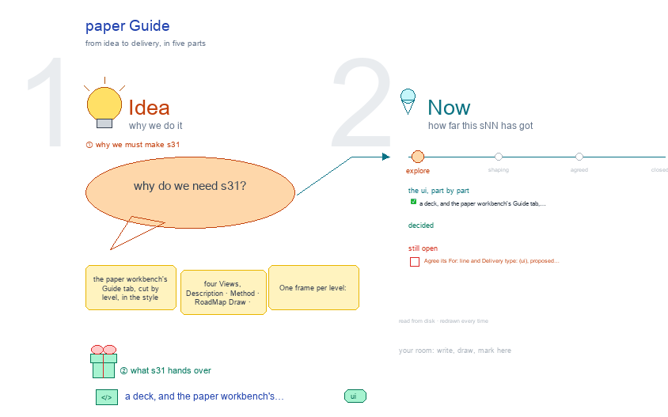

# s31 · paper Guide <!-- root #bee5b2 -->

**Tags:** `Guide`
**Stage:** explore

- For <!-- @for #f78806 -->
  - a deck, and the paper workbench's Guide … <!-- @for/0 #bf2d8c -->
    a deck, and the paper workbench's Guide tab, cut by level, for the people who build the workbench
- Delivery type <!-- @delivery-type #58a44f -->
  - ui <!-- @delivery-type/0 #636117 -->
- Topic <!-- @topic #7e13bd -->
  - the paper workbench's Guide tab, cut by … <!-- @topic/0 #8954a4 -->
    the paper workbench's Guide tab, cut by level, in the style of b03's s31-guide (four Views, Description · Method · RoadMap Draw · Related Paper, each in three folding sections Block · Job · Task, its items as cards of one shape per View).
  - One frame per level: the four Views … <!-- @topic/1 #b60418 -->
    One frame per level: the four Views opened from that level's tab, its section open and the other two folded, "on disk" under each, then that level's open points in red (JL 261007: one session per level).
- Source <!-- @source #6da13a -->
  - read at build time from the live … <!-- @source/0 #c6887b -->
    read at build time from the live paper Guide (`servers/workbench-paper/guide/guide.yaml`, `guide/method.md`, `related/papers.md`) and the paper theme's Spaces on the frame (over a placeholder Board in a temp folder), by `paper_guide_live.py`; each level's file adds its proposals, marked "?" (red).
  - The screen and card shapes are s31's … <!-- @source/1 #4fcb20 -->
    The screen and card shapes are s31's (`../../b10_project_workbench/s31-guide/`).
- Feeds <!-- @feeds #ffe8e9 -->
  - `../reports/` q01_paper_ladder; the proposed Guide text goes … <!-- @feeds/0 #d2d8a3 -->
    `../reports/` q01_paper_ladder; the proposed Guide text goes into `guide.yaml` and `method.md` once JL agrees.
- Files <!-- @files #6ce6c5 -->
  - [py] [build_s31_paper_guide.py](build_s31_paper_guide.py) <!-- @files/0 #a4c2fc -->
  - delivery/ <!-- @files/1 #404761 -->
  - [py] [guide_block.py](guide_block.py) <!-- @files/2 #df25fe -->
  - [py] [guide_job.py](guide_job.py) <!-- @files/3 #d0e324 -->
  - [py] [guide_task.py](guide_task.py) <!-- @files/4 #16734f -->
  - [py] [paper_guide_live.py](paper_guide_live.py) <!-- @files/5 #0c2444 -->
  - [excalidraw] [s31-paper-guide.excalidraw](s31-paper-guide.excalidraw) <!-- @files/6 #e36311 -->
  - [md] [s31-paper-guide.md](s31-paper-guide.md) <!-- @files/7 #953da3 -->
  - [png] [s31-paper-guide.png](s31-paper-guide.png) <!-- @files/8 #86b78f -->
    
- Proposed at the Block level (261007) <!-- @proposed-at-the-block-level-261007 #859df7 -->
  - A step 0, Set up the paper: … <!-- @proposed-at-the-block-level-261007/0 #a2c1d7 -->
    A step 0, Set up the paper: its scope, the venues it writes for, the related work it sits beside
  - (Description › Scope · Venue · Related; … <!-- @proposed-at-the-block-level-261007/1 #295c38 -->
    (Description › Scope · Venue · Related; runs Add a venue · Add a related item · Read a paper), signed by naming the target venue. Today the Board has the Spaces and the run types but no step.
  - Skills by level: the Block section names … <!-- @proposed-at-the-block-level-261007/2 #659a60 -->
    Skills by level: the Block section names the Board's own skills (haipipe-paper owns;
  - haipipe-paper-story, -ideation, -venue and haipipe-report work; workbench-paper … <!-- @proposed-at-the-block-level-261007/3 #305cf3 -->
    haipipe-paper-story, -ideation, -venue and haipipe-report work; workbench-paper shows).
  - Two pairs of words kept apart: Description … <!-- @proposed-at-the-block-level-261007/4 #46a1d0 -->
    Two pairs of words kept apart: Description › Related (what one paper sits beside) and Guide ›
  - Related Paper (the papers behind the method); … <!-- @proposed-at-the-block-level-261007/5 #313062 -->
    Related Paper (the papers behind the method); the Guide's RoadMap Draw (the theme's drawings) and a paper's own RoadMap drawing (its Idea Studio).
  - After the Q01 migration, the Audience Report … <!-- @proposed-at-the-block-level-261007/6 #e48bc5 -->
    After the Q01 migration, the Audience Report reads j00_story/, not A1-Story/.
  - The Job session proposes steps 4 to … <!-- @proposed-at-the-block-level-261007/7 #d78da8 -->
    The Job session proposes steps 4 to 7 (Open the send · Write the Sections · Deliver · Close on the decision); with step 0 the Block keeps 0 to 3.
- Open <!-- @open #cf9b77 -->
  - Agree its **For:** line and **Delivery type:** … <!-- @open/0 #7b11a4 -->
    Agree its **For:** line and **Delivery type:** (ui), proposed by the agent 261030?
  - See each frame's red "open at the … <!-- @open/1 #788e77 -->
    See each frame's red "open at the … level" lines.
