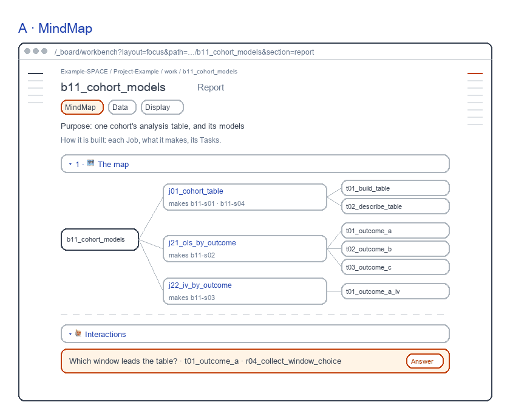
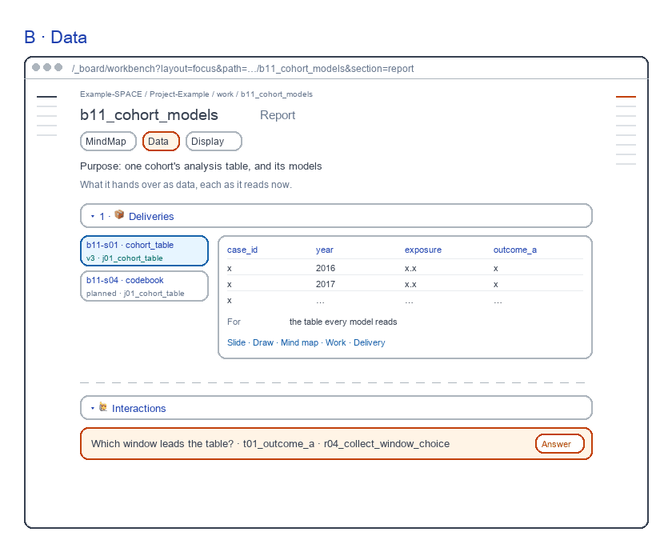
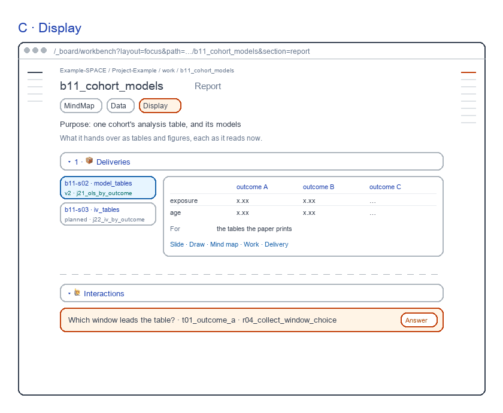
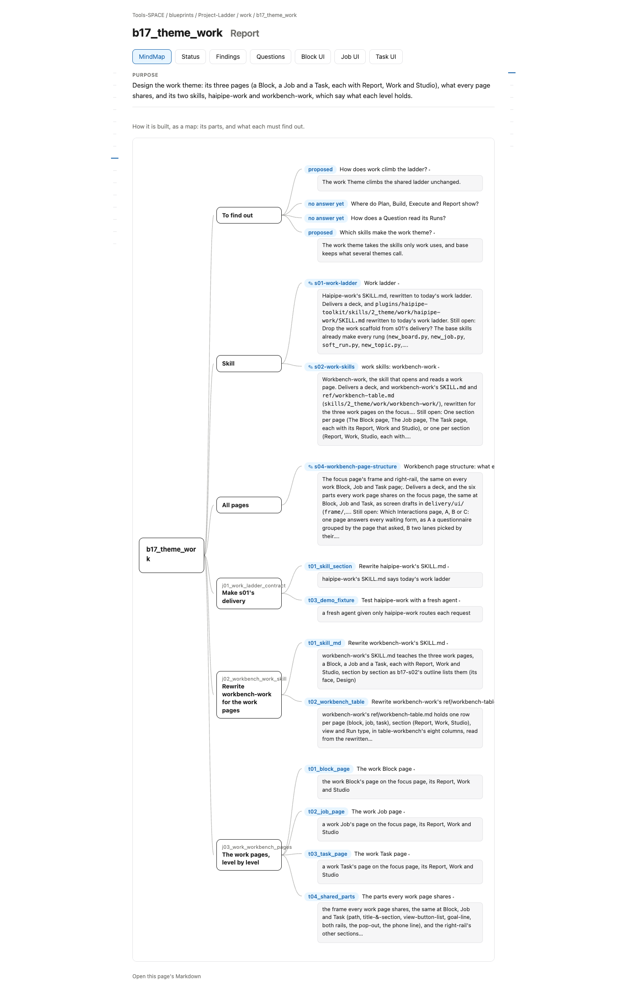

# Block Report screens

for: b17.j03.t01-s51:theme_work.work_workbench_pages.block_page @ block_ui_report

<!-- One card per question: ## QN · title, one short why, **the question?**, then - [x] A · my pick and
     - [ ] B · another, each with its picture, then Why A: one line. collect.py check holds the limits; collect.py build
     renders the form. The earlier questions (261031) are in passes/p01-1031/. -->

The Block's Report, redrawn as one screen per view on a made-up example Block. Each passed a fresh review; today's page is beside it.

## Q1 · A · MindMap

A · MindMap: each Job, what it makes, its Tasks; no state words. A fresh reviewer passed it in round 2, 8.9 of 10; today's page scored 6.5 and failed Lean 6 and One job 4.

**Build A · MindMap as drawn?**

- [x] A · Yes: build it as drawn.
  
- [ ] B · No: keep today's page.
  

Why A: It passed every rubric; today's page did not.

## Q2 · B · Data

B · Data: its data deliveries as side tabs, the open one's table to read. A fresh reviewer passed it in round 2, 9.3 of 10; today's page scored 6.5 and failed Lean 6 and One job 4.

**Build B · Data as drawn?**

- [x] A · Yes: build it as drawn.
  
- [ ] B · No: keep today's page.
  

Why A: It passed every rubric; today's page did not.

## Q3 · C · Display

C · Display: its tables and figures as side tabs, the open one to read. A fresh reviewer passed it in round 2, 9.1 of 10; today's page scored 6.5 and failed Lean 6 and One job 4.

**Build C · Display as drawn?**

- [x] A · Yes: build it as drawn.
  
- [ ] B · No: keep today's page.
  

Why A: It passed every rubric; today's page did not.
