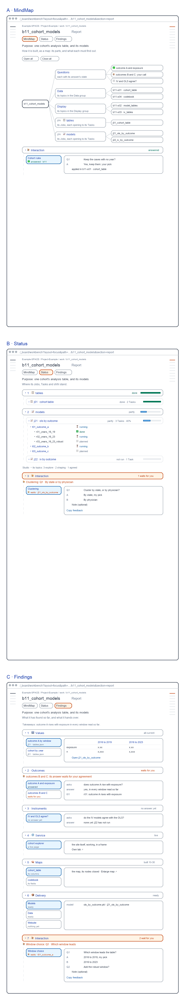

# Block Report screens

for: b17.j03.t01-s51:theme_work.work_workbench_pages.block_page @ block_ui_report

<!-- One card per question: ## QN · title, one short why, **the question?**, then - [x] A · my pick and
     - [ ] B · another, each with its picture, then Why A: one line. collect.py check holds the limits; collect.py build
     renders the form. The earlier question sets are in passes/p01-1031/ and passes/p02-1101/. -->

The Block's Report, redrawn 261105 to the live page; again 261106: each bar its state word, its waiting line, each view's own forms, Skills on the rail.

## Q1 · Agree the Report

A · MindMap, B · Status and C · Findings now follow the live page: Data and Display folded into Findings' Delivery, every section closed, 🙋 Interaction last.

**Agree A to C as drawn?**

- [x] A · Yes: agree them; the topic can move to agreed.
  
- [ ] B · No: my note says what differs.

Why A: Each screen is what you asked for on 261104.
