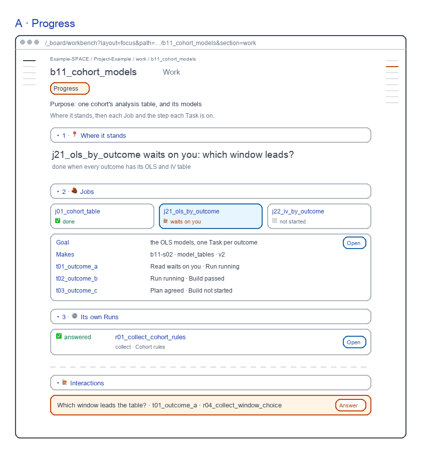
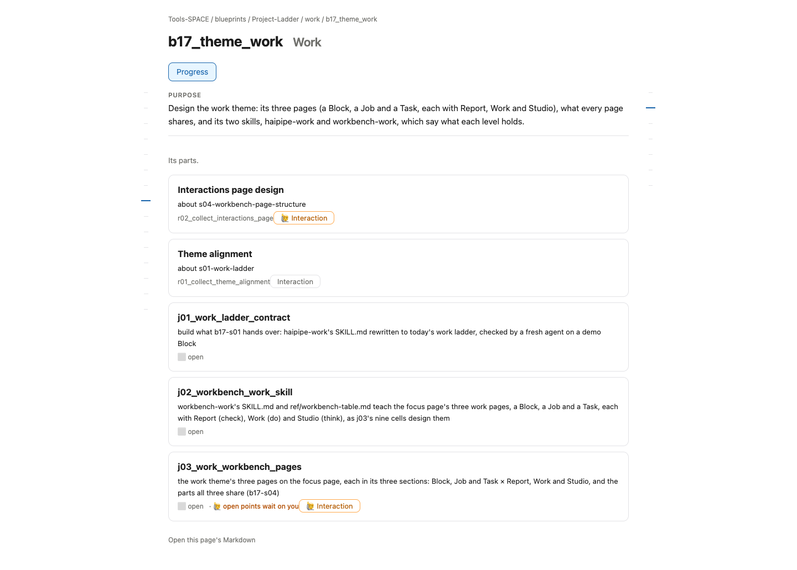

# Block Work screen

for: b17.j03.t01-s52:theme_work.work_workbench_pages.block_page @ block_ui_work

<!-- One card per question: ## QN · title, one short why, **the question?**, then - [x] A · my pick and
     - [ ] B · another, each with its picture, then Why A: one line. collect.py check holds the limits. The earlier
     question sets are in passes/p01-1031/ and passes/p02-1101/. -->

The Block's Work, redrawn the way b16 and b15 draw theirs: each view one step of the work. Each screen sits beside today's page.

## Q1 · A · Progress

A · Progress: what waits, each Job, the step each Task is on. A fresh reviewer passed it, 8.9 of 10; today's page scored 7.8 and failed Words 6 and One job 6.

**Build A · Progress as drawn?**

- [x] A · Yes: build it as drawn.
  
- [ ] B · No: keep today's page.
  

Why A: Each view is one step of the work, as b15 draws its Task UI.
