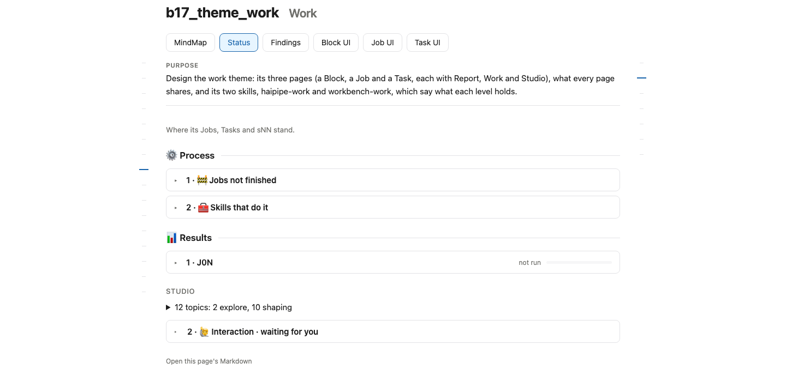
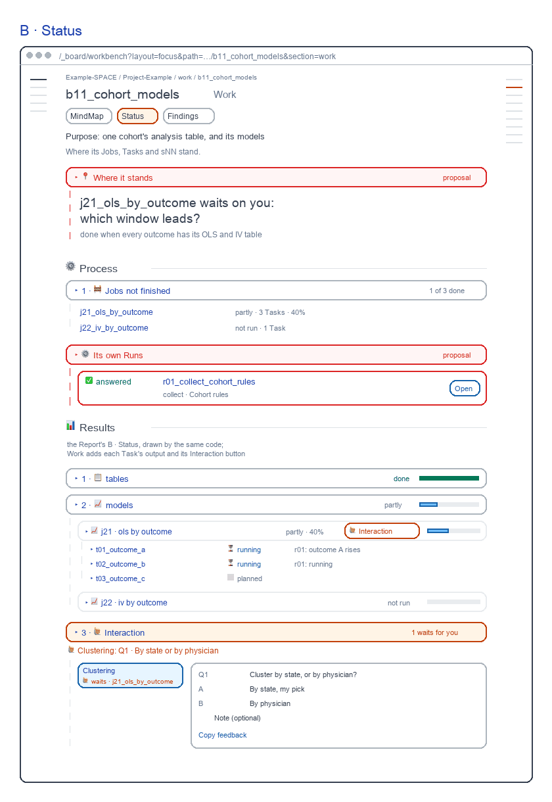
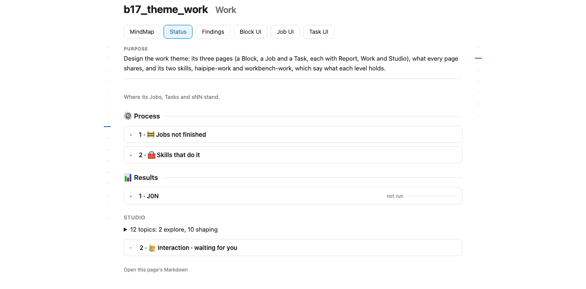

# Block Work screens

for: b17.j03.t01-s52:theme_work.work_workbench_pages.block_page @ block_ui_work

<!-- One card per question: ## QN · title, one short why, **the question?**, then - [x] A · my pick and
     - [ ] B · another, each with its picture, then Why A: one line. collect.py check holds the limits; collect.py build
     renders the form. The earlier question sets are in passes/p01-1031/ and passes/p02-1101/ and passes/p03-1101/. -->

The Block's Work: the Report's views, Process first; two reviewed parts stay red. Redrawn 261106: skills moved to the rail, each bar its word, each view its own forms.

## Q1 · Where it stands

B · Status: one large sentence, what waits and the close line, above Process. It was in the reviewed 261101 design; no 261104 ask overruled it.

**Keep Where it stands above Status's Process?**

- [ ] A · Yes: keep the sentence, as drawn in red.
  
- [x] B · No: Status opens on Process, as today's page.
  

Why B: You deleted next-step lines on 261104; Interaction already says what waits.

## Q2 · Its own Runs

B · Status: the Block's own Runs (a plan, a collection) as a Process section, a row each with Open. Today they show only in Interaction and Files.

**Show the Block's own Runs in Status's Process?**

- [x] A · Yes: a Process section, each Run a row with Open.
  
- [ ] B · No: they stay in Interaction and Files, as today.
  

Why A: A Block's own soft Runs have no other row on its page.
