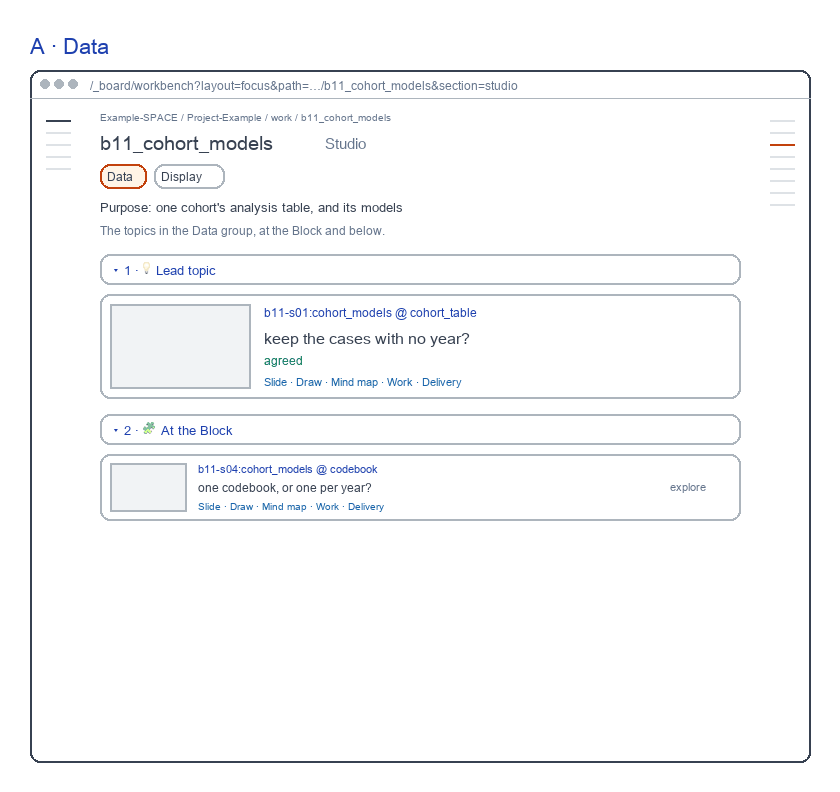
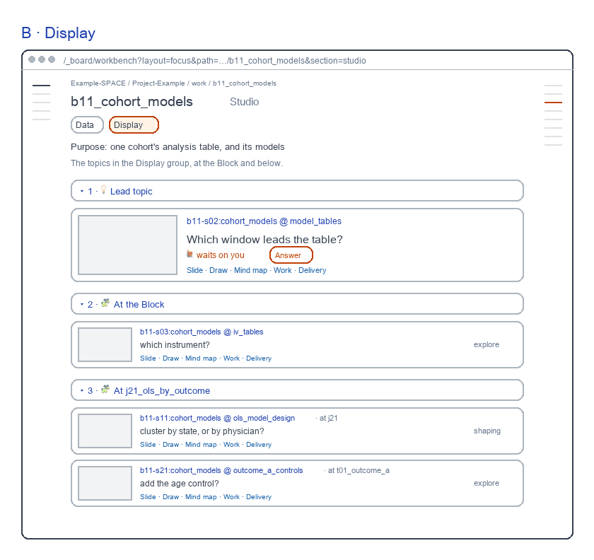
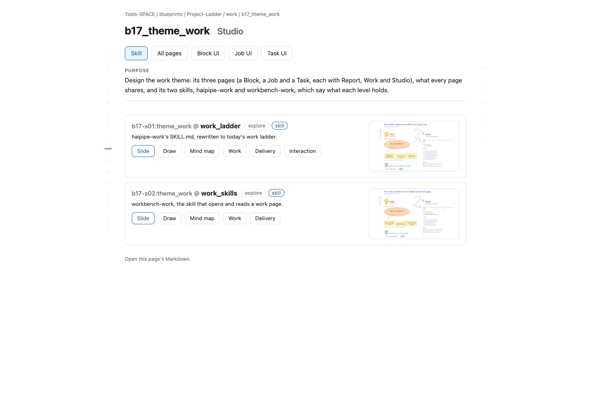

# Block Studio screens

for: b17.j03.t01-s53:theme_work.work_workbench_pages.block_page @ block_ui_studio

<!-- One card per question: ## QN · title, one short why, **the question?**, then - [x] A · my pick and
     - [ ] B · another, each with its picture, then Why A: one line. collect.py check holds the limits; collect.py build
     renders the form. The earlier questions (261031) are in passes/p01-1031/. -->

The Block's Studio, redrawn as one screen per view on a made-up example Block. Each passed a fresh review; today's page is beside it.

## Q1 · A · Data

A · Data: the Data group: the lead topic large, then each topic where it sits. A fresh reviewer passed it in round 2, 9.7 of 10; today's page passes too, at 8.2.

**Build A · Data as drawn?**

- [x] A · Yes: build it as drawn.
  
- [ ] B · No: keep today's page.
  

Why A: Both pass; this one names topics short and shows one large.

## Q2 · B · Display

B · Display: the Display group: the topic that waits on you leads, with Answer. A fresh reviewer passed it in round 2, 9.4 of 10; today's page passes too, at 8.2.

**Build B · Display as drawn?**

- [x] A · Yes: build it as drawn.
  
- [ ] B · No: keep today's page.
  

Why A: Both pass; this one leads with the topic that waits, with Answer.
