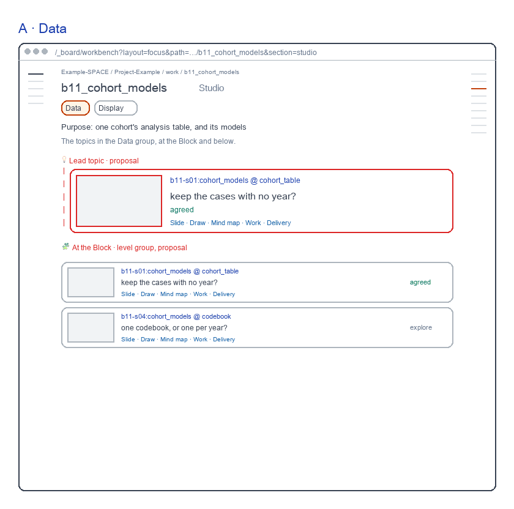
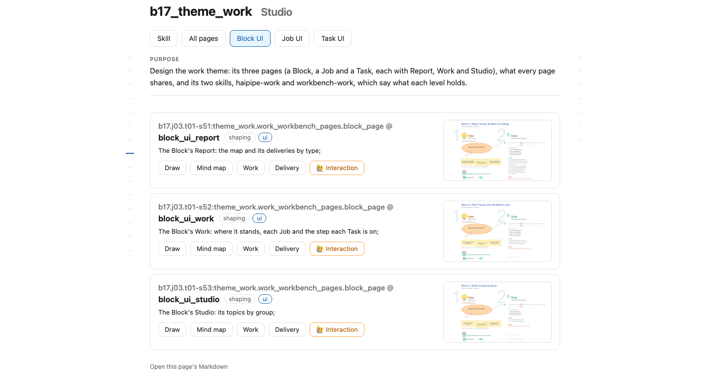
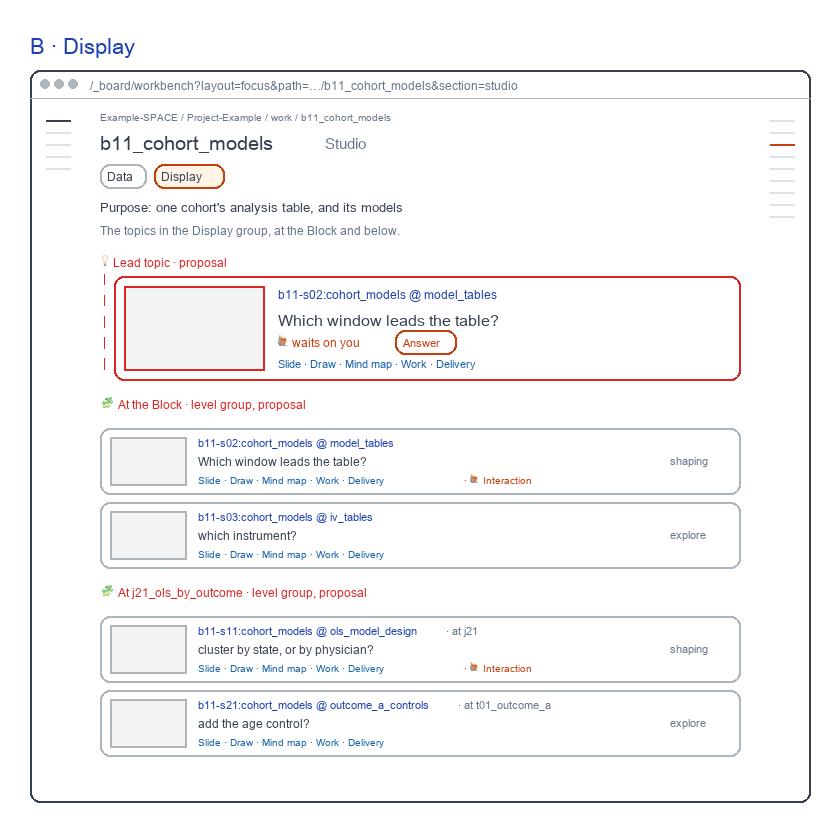

# Block Studio screens

for: b17.j03.t01-s53:theme_work.work_workbench_pages.block_page @ block_ui_studio

<!-- One card per question: ## QN · title, one short why, **the question?**, then - [x] A · my pick and
     - [ ] B · another, each with its picture, then Why A: one line. collect.py check holds the limits; collect.py build
     renders the form. The earlier question sets are in passes/p01-1031/ and passes/p02-1101/. -->

The Block's Studio: flat rows as live; two reviewed parts stay red: the lead card, the level groups. Redrawn 261106: Skills on the rail, s11's row flagged 🙋.

## Q1 · A · Data

A · Data: the rows as live, with two reviewed parts in red: the lead topic as a large card, and the rows grouped by where they sit.

**Build A · Data's red parts as drawn?**

- [x] A · Yes: the lead card and the level groups, as drawn.
  
- [ ] B · No: flat rows only, as today's page.
  

Why A: The lead topic reads first; each row says where it sits.

## Q2 · B · Display

B · Display: the rows as live; in red, the topic that waits leads as a large card with Answer, and the rows grouped by where they sit.

**Build B · Display's red parts as drawn?**

- [x] A · Yes: the waiting topic leads, then the level groups.
  
- [ ] B · No: flat rows only, as today's page.
  

Why A: The topic that waits on you leads, with Answer.
