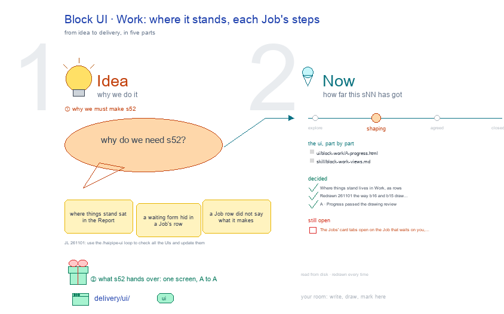

# s52 · Block UI: Work <!-- root #342409 -->

**Tags:** `Block UI`
**Stage:** shaping

- For <!-- @for #f78806 -->
  - a deck, and the work Block's Work … <!-- @for/0 #a53c8f -->
    a deck, and the work Block's Work screen on the focus page (`delivery/ui/block-work`), for the people who build the workbench
- Delivery type <!-- @delivery-type #58a44f -->
  - ui <!-- @delivery-type/0 #636117 -->
- Covers <!-- @covers #a6c44a -->
  - the Block's Work: A · Progress: 1 … <!-- @covers/0 #26bdf1 -->
    the Block's Work: A · Progress: 1 Where it stands (what waits on you, large; the close line under it), 2 Jobs (card tabs, the one that waits open: its goal, what it makes, the step each Task is on, in words), 3 Its own Runs; 🙋 Interactions at the bottom.
- Excluded <!-- @excluded #980495 -->
  - the other eight cells of the 3 … <!-- @excluded/0 #a5f0a1 -->
    the other eight cells of the 3 × 3 (j03's other sNN); what every work page shares (b17-s04).
- Topic <!-- @topic #7e13bd -->
  - The Block's Work: where it stands, each … <!-- @topic/0 #b79243 -->
    The Block's Work: where it stands, each Job and the step each Task is on; one cell of the work theme's 3 × 3, the work Block × Work (do) (JL 261031: "I think you should focus on the things like ... b16_theme_paper ... studio ...
  - UI and think about how you should … <!-- @topic/1 #bd6501 -->
    UI and think about how you should update the work_theme's workbench UI").
  - Its drawing is haipipe-studio's five parts, drawn … <!-- @topic/2 #1890ec -->
    Its drawing is haipipe-studio's five parts, drawn by `build_s52_block_ui_work.py` through j03's `work_ui_cells.py`;
  - Its Design is its section's views, lettered … <!-- @topic/3 #7111ff -->
    Its Design is its section's views, lettered A, B …, each one full screen (haipipe-ui "one view, one screen"), every review round in `review/`.
- Feeds <!-- @feeds #ffe8e9 -->
  - none: a work Block keeps no Questions … <!-- @feeds/0 #bf8e2a -->
    none: a work Block keeps no Questions (JL 261031, r01 Q5)
- Files <!-- @files #6ce6c5 -->
  - [py] [build_s52_block_ui_work.py](build_s52_block_ui_work.py) <!-- @files/0 #93cc97 -->
  - delivery/ <!-- @files/1 #404761 -->
  - result/ <!-- @files/2 #d4a42c -->
  - review/ <!-- @files/3 #7928fb -->
  - [excalidraw] [s52-block-ui-work.excalidraw](s52-block-ui-work.excalidraw) <!-- @files/4 #3a2d06 -->
  - [md] [s52-block-ui-work.md](s52-block-ui-work.md) <!-- @files/5 #d31124 -->
  - [png] [s52-block-ui-work.png](s52-block-ui-work.png) <!-- @files/6 #0307ad -->
    
- Decided <!-- @decided #55615a -->
  - s52-D01 · Where things stand lives in … <!-- @decided/0 #3c34a1 -->
    s52-D01 · Where things stand lives in Work, as rows; the Report keeps one word per delivery (JL 261031, r01_collect_report_and_delivery Q6: A, "the rows stay in Work").
  - s52-D02 · Redrawn 261101 the way b16 … <!-- @decided/1 #21f7dc -->
    s52-D02 · Redrawn 261101 the way b16 and b15 draw theirs: each view one step of the work, input → who works → output, your part, then the results (JL 261101: "the UI you have here is not that good. please check" b16's Block UI and b15's Task UI); the steps are haipipe-task's life, plan ▶ build ▶ run ▶ read ▶ close (ref/lifecycle.md). The earlier screens' rounds stay in `review/` (r01, r02).
  - s52-D03 · A · Progress passed the … <!-- @decided/2 #34ac8d -->
    s52-D03 · A · Progress passed the drawing review (stage 1), mean 8.9/10 in `review/A-s1-r04.md` (rounds: `review/A-s1-r03.md`, `review/A-s1-r04.md`); today's page scored 7.8 and failed Words 6 and One job 6. Proposed by the agent; it waits for JL's one look in `runs/r03_collect_block_work_views` (261101).
- Open <!-- @open #cf9b77 -->
  - Your one look: `../runs/r03_collect_block_work_views` shows each screen … <!-- @open/0 #52d3f1 -->
    Your one look: `../runs/r03_collect_block_work_views` shows each screen beside today's page: build it as drawn, or keep today's.
  - Still open after the redraw's reviews: <!-- @open/1 #b639b1 -->
  - The Jobs' card tabs open on the … <!-- @open/2 #4c8ccf -->
    The Jobs' card tabs open on the Job that waits on you, not the first (r04 asks); b15's tabs do the same.
  - The earlier questions, my picks now drawn … <!-- @open/3 #c396bf -->
    The earlier questions, my picks now drawn in, are in `../runs/r03_collect_block_work_views/passes/p01-1031/` and the round 2 screens' form in `passes/p02-1101/`; the full proposal is `result/views-proposal.md`.
