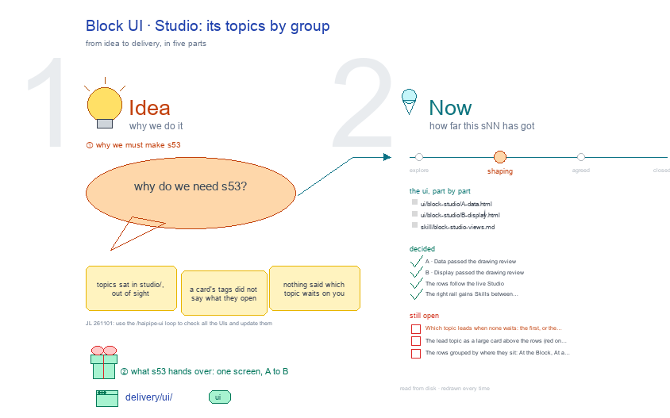

# s53 · Block UI: Studio <!-- root #b67a53 -->

**Tags:** `Block UI`
**Stage:** shaping

- For <!-- @for #f78806 -->
  - a deck, and the work Block's Studio … <!-- @for/0 #62bd27 -->
    a deck, and the work Block's Studio screen on the focus page (`delivery/ui/block-studio`), for the people who build the workbench
- Delivery type <!-- @delivery-type #58a44f -->
  - ui <!-- @delivery-type/0 #636117 -->
- Covers <!-- @covers #a6c44a -->
  - the Block's Studio: one view per group … <!-- @covers/0 #29d3d1 -->
    the Block's Studio: one view per group (A · Data, B · Display in the example), its topics as flat rows as the live page draws them (picture, name, the one line it asks, its stage word, its tags; 🙋 Interaction on a topic whose form waits).
  - Red, kept proposals: the lead topic as … <!-- @covers/1 #5753f9 -->
    Red, kept proposals: the lead topic as a large card, the rows grouped by where they sit.
- Excluded <!-- @excluded #980495 -->
  - the other eight cells of the 3 … <!-- @excluded/0 #a5f0a1 -->
    the other eight cells of the 3 × 3 (j03's other sNN); what every work page shares (b17-s04).
- Topic <!-- @topic #7e13bd -->
  - The Block's Studio: its topics by group; … <!-- @topic/0 #253e86 -->
    The Block's Studio: its topics by group; one cell of the work theme's 3 × 3, the work Block × Studio (think) (JL 261031: "I think you should focus on the things like ... b16_theme_paper ... studio ...
  - UI and think about how you should … <!-- @topic/1 #bd6501 -->
    UI and think about how you should update the work_theme's workbench UI").
  - Its drawing is haipipe-studio's five parts, drawn … <!-- @topic/2 #ad158d -->
    Its drawing is haipipe-studio's five parts, drawn by `build_s53_block_ui_studio.py` through j03's `work_ui_cells.py`;
  - Its Design is its section's views, lettered … <!-- @topic/3 #7111ff -->
    Its Design is its section's views, lettered A, B …, each one full screen (haipipe-ui "one view, one screen"), every review round in `review/`.
- Feeds <!-- @feeds #ffe8e9 -->
  - none: a work Block keeps no Questions … <!-- @feeds/0 #bf8e2a -->
    none: a work Block keeps no Questions (JL 261031, r01 Q5)
- Files <!-- @files #6ce6c5 -->
  - [py] [build_s53_block_ui_studio.py](build_s53_block_ui_studio.py) <!-- @files/0 #2aedf7 -->
  - delivery/ <!-- @files/1 #404761 -->
  - result/ <!-- @files/2 #d4a42c -->
  - review/ <!-- @files/3 #7928fb -->
  - [excalidraw] [s53-block-ui-studio.excalidraw](s53-block-ui-studio.excalidraw) <!-- @files/4 #5c2eb0 -->
  - [md] [s53-block-ui-studio.md](s53-block-ui-studio.md) <!-- @files/5 #234b6e -->
  - [png] [s53-block-ui-studio.png](s53-block-ui-studio.png) <!-- @files/6 #8fc5bd -->
    
- Decided <!-- @decided #55615a -->
  - s53-D01 · A · Data passed the … <!-- @decided/0 #ff01ca -->
    s53-D01 · A · Data passed the drawing review (haipipe-ui Design loop, stage 1) in round 2, mean 9.7/10: `review/A-s1-r02.md` (round 1: `review/A-s1-r01.md`); today's page passes too, at 8.2 (`review/today-261101.md`). Proposed by the agent; it waits for JL's one look in `runs/r04_collect_block_studio_views` (261101).
  - s53-D02 · B · Display passed the … <!-- @decided/1 #5c38af -->
    s53-D02 · B · Display passed the drawing review (haipipe-ui Design loop, stage 1) in round 2, mean 9.4/10: `review/B-s1-r02.md` (round 1: `review/B-s1-r01.md`); today's page passes too, at 8.2 (`review/today-261101.md`). Proposed by the agent; it waits for JL's one look in `runs/r04_collect_block_studio_views` (261101).
  - s53-D03 · The rows follow the live … <!-- @decided/2 #993bf0 -->
    s53-D03 · The rows follow the live Studio: one flat row per topic, its picture, name, the one line it asks, its stage word and its tags, 🙋 Interaction on a topic whose form waits (redrawn 261105). The lead-topic card and the level groups stay in red, as open proposals: no 261104 ask overruled them.
- Open <!-- @open #cf9b77 -->
  - Your one look: `../runs/r04_collect_block_studio_views` asks whether to … <!-- @open/0 #4e0b71 -->
    Your one look: `../runs/r04_collect_block_studio_views` asks whether to build the red parts (the lead card, the level groups), beside today's page.
  - Still open after the review (its reviewers' … <!-- @open/1 #27a61b -->
    Still open after the review (its reviewers' asks):
  - Which topic leads when none waits: the … <!-- @open/2 #8523df -->
    Which topic leads when none waits: the first, or the first still open (r02 fix 1).
  - The lead topic as a large card … <!-- @open/3 #db4750 -->
    The lead topic as a large card above the rows (red on the drawing).
  - The rows grouped by where they sit: … <!-- @open/4 #86c355 -->
    The rows grouped by where they sit: At the Block, At a Job (red on the drawing).
  - The earlier questions, my picks now drawn … <!-- @open/5 #2e6b41 -->
    The earlier questions, my picks now drawn in, are in `../runs/r04_collect_block_studio_views/passes/p01-1031/`; the full proposal is `result/views-proposal.md`; the 261101 screens' form is in `passes/p02-1101/`.
