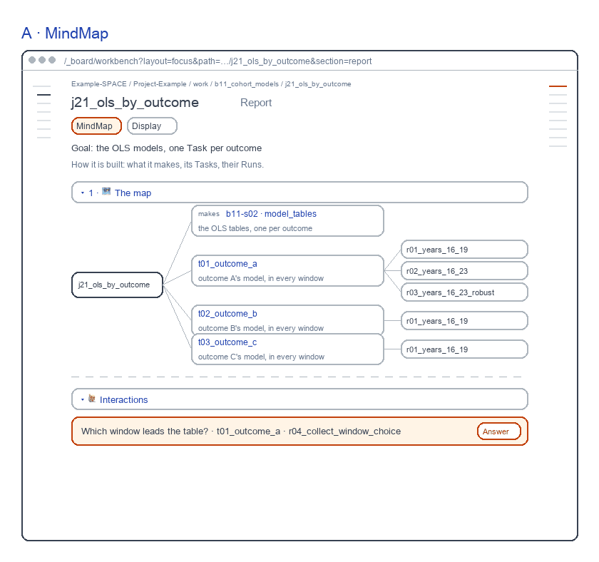
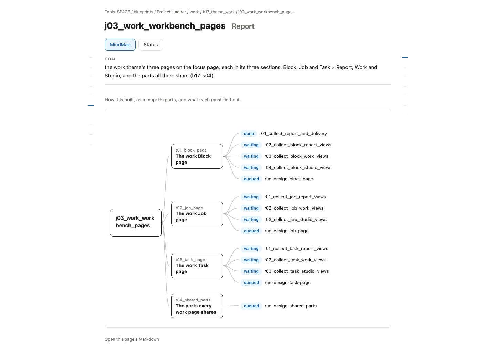
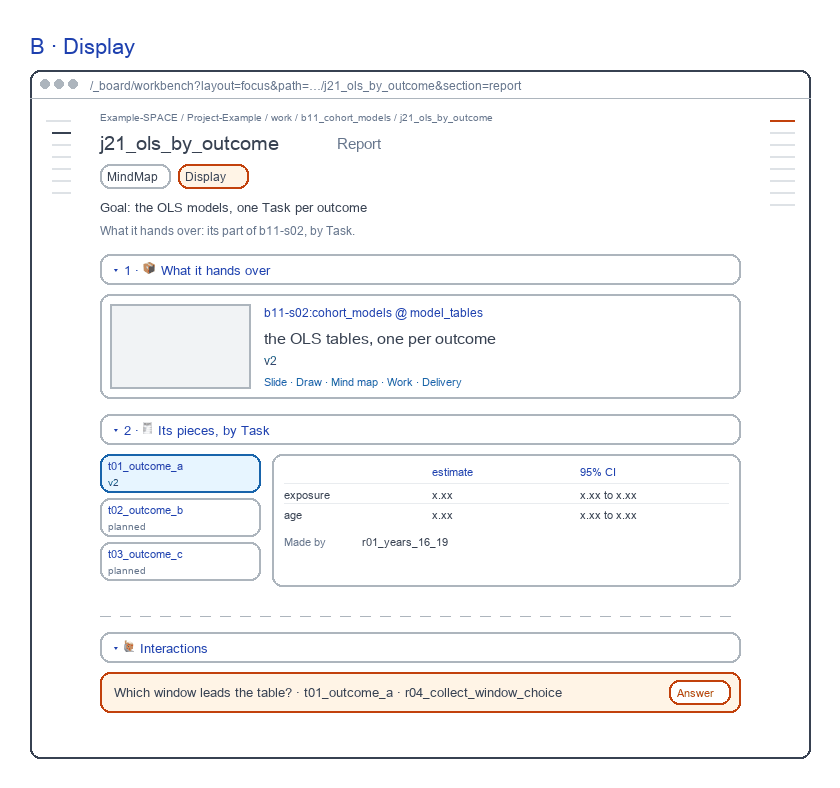

# Job Report screens

for: b17.j03.t02-s54:theme_work.work_workbench_pages.job_page @ job_ui_report

<!-- One card per question: ## QN · title, one short why, **the question?**, then - [x] A · my pick and
     - [ ] B · another, each with its picture, then Why A: one line. collect.py check holds the limits; collect.py build
     renders the form. The earlier questions (261031) are in passes/p01-1031/. -->

The Job's Report, redrawn as one screen per view on a made-up example Block. Each passed a fresh review; today's page is beside it.

## Q1 · A · MindMap

A · MindMap: what it makes, its Tasks, their Runs; no state words. A fresh reviewer passed it in round 2, 9.0 of 10; today's page scored 8.1 and failed One job 5.

**Build A · MindMap as drawn?**

- [x] A · Yes: build it as drawn.
  
- [ ] B · No: keep today's page.
  

Why A: It passed every rubric; today's page did not.

## Q2 · B · Display

B · Display: its delivery's card, then its pieces by Task as side tabs. A fresh reviewer passed it in round 2, 9.4 of 10; today's page scored 8.1 and failed One job 5.

**Build B · Display as drawn?**

- [x] A · Yes: build it as drawn.
  
- [ ] B · No: keep today's page.
  

Why A: It passed every rubric; today's page did not.
