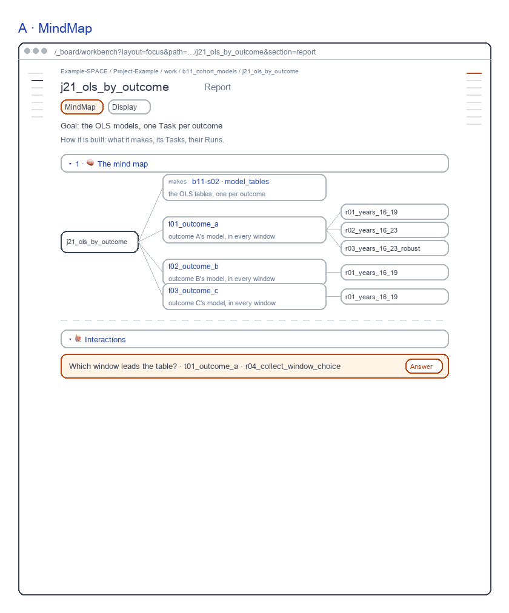
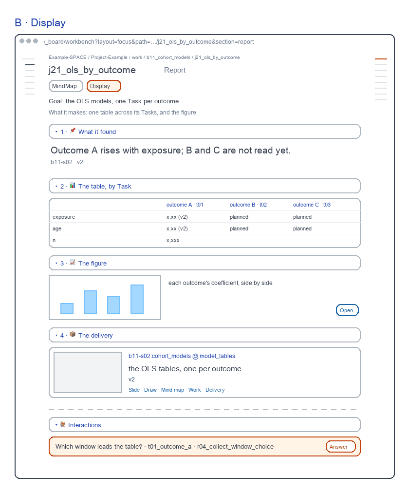
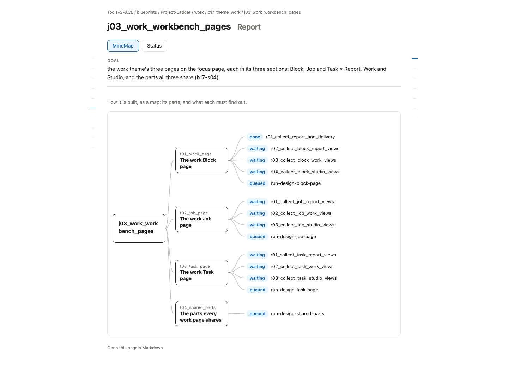

# Job Report screens

for: b17.j03.t02-s54:theme_work.work_workbench_pages.job_page @ job_ui_report

<!-- One card per question: ## QN · title, one short why, **the question?**, then - [x] A · my pick and
     - [ ] B · another, each with its picture, then Why A: one line. collect.py check holds the limits. The earlier
     question sets are in passes/p01-1031/ and passes/p02-1101/. -->

The Job's Report, redrawn the way b16 and b15 draw theirs: each view one step of the work. Each screen sits beside today's page.

## Q1 · A · MindMap

A · MindMap: what it makes, its Tasks, their Runs. A fresh reviewer passed it, 9.7 of 10; today's page scored 8.1 and failed One job 5.

**Build A · MindMap as drawn?**

- [x] A · Yes: build it as drawn.
  
- [ ] B · No: keep today's page.
  

Why A: Each view is one step of the work, as b15 draws its Task UI.

## Q2 · B · Display

B · Display: what it found, one table across its Tasks, the figure. A fresh reviewer passed it, 9.0 of 10; today's page scored 8.1 and failed One job 5.

**Build B · Display as drawn?**

- [x] A · Yes: build it as drawn.
  
- [ ] B · No: keep today's page.
  

Why A: Each view is one step of the work, as b15 draws its Task UI.
