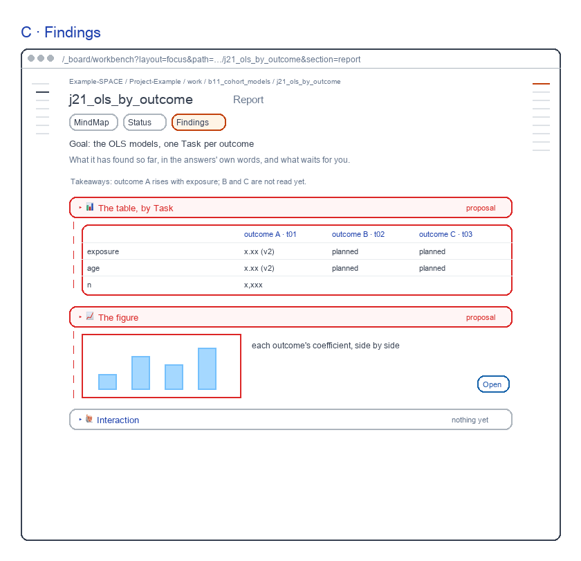
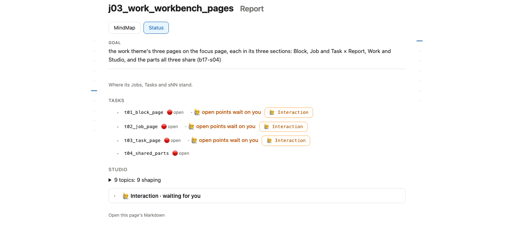

# Job Report screens

for: b17.j03.t02-s54:theme_work.work_workbench_pages.job_page @ job_ui_report

<!-- One card per question: ## QN · title, one short why, **the question?**, then - [x] A · my pick and
     - [ ] B · another, each with its picture, then Why A: one line. collect.py check holds the limits; collect.py build
     renders the form. The earlier question sets are in passes/p01-1031/ and passes/p02-1101/ and passes/p03-1101/. -->

A Job's Report as live; the table and figure stay red. Redrawn 261106: the map shows each Task's goal (Q2), each bar its word, each view its own forms.

## Q1 · C · Findings

C · Findings: the Job's takeaways as live, then two reviewed parts in red: one table across its Tasks, a column each, and the figure.

**Build the table across the Tasks and the figure?**

- [x] A · Yes: one table across the Tasks, then the figure.
  
- [ ] B · No: the takeaways only, as today's page.
  
- [ ] C · A table per Task instead, under the takeaways.

Why A: You compare the outcomes in one place.

## Q2 · A · MindMap

A · MindMap now draws each Task with what it finds out, as the live page does since 261106; Status keeps each Run's mark.

```text
A  t01 outcome A's model ── finds out: does A rise with exposure
B  t01 outcome A's model ── ✅ r01 · ⏳ r02 · ⬜ r03
```

**What does a Job's map show under each Task?**

- [x] A · Its goal ("finds out …") and its topics, as drawn.
- [ ] B · Its Runs with their marks, as drawn on 261105.

Why A: The map says what each part is for; Status already shows each Run's mark.
