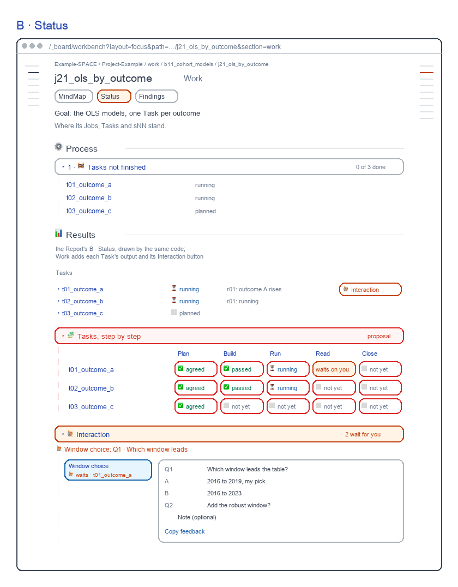
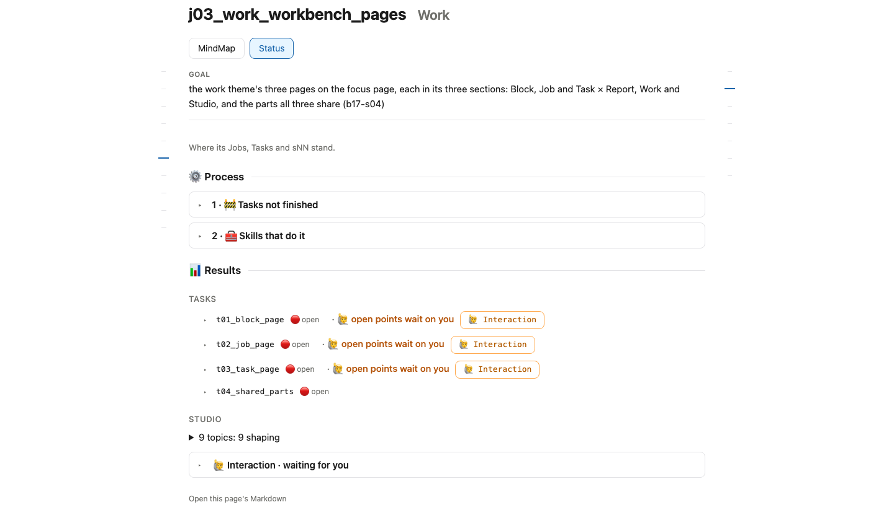

# Job Work screens

for: b17.j03.t02-s55:theme_work.work_workbench_pages.job_page @ job_ui_work

<!-- One card per question: ## QN · title, one short why, **the question?**, then - [x] A · my pick and
     - [ ] B · another, each with its picture, then Why A: one line. collect.py check holds the limits; collect.py build
     renders the form. The earlier question sets are in passes/p01-1031/ and passes/p02-1101/ and passes/p03-1101/. -->

A Job's Work: the Report's views, Process first; the step grid stays red. Redrawn 261106: skills moved to the rail, each bar its word, each view its own forms.

## Q1 · Step grid

B · Status: under its Tasks, each Task against the five steps of a Task's life, a word in every cell. It was in the reviewed 261101 Progress view.

**Keep the Tasks × steps grid under Status?**

- [x] A · Yes: keep the grid, as drawn in red.
  
- [ ] B · No: the Tasks' rows only, as today's page.
  

Why A: You see which step each Task is on, in one look.
