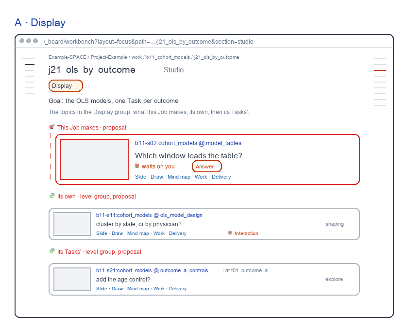
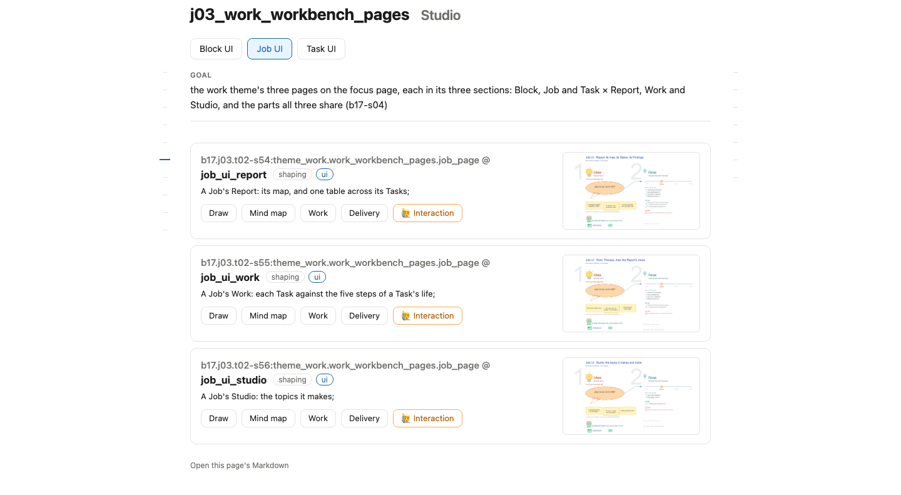

# Job Studio screens

for: b17.j03.t02-s56:theme_work.work_workbench_pages.job_page @ job_ui_studio

<!-- One card per question: ## QN · title, one short why, **the question?**, then - [x] A · my pick and
     - [ ] B · another, each with its picture, then Why A: one line. collect.py check holds the limits; collect.py build
     renders the form. The earlier question sets are in passes/p01-1031/ and passes/p02-1101/. -->

A Job's Studio: flat rows as live; two reviewed parts stay red. Redrawn 261106: Skills on the rail, s11's row flagged 🙋, its form waiting.

## Q1 · A · Display

A · Display: the rows as live, with two reviewed parts in red: This Job makes, its Block topic's card first, and the rows grouped Its own, Its Tasks'.

**Build A · Display's red parts as drawn?**

- [x] A · Yes: This Job makes first, then the grouped rows.
  
- [ ] B · No: flat rows only, as today's page.
  

Why A: The topic this Job makes is the one you answer.
