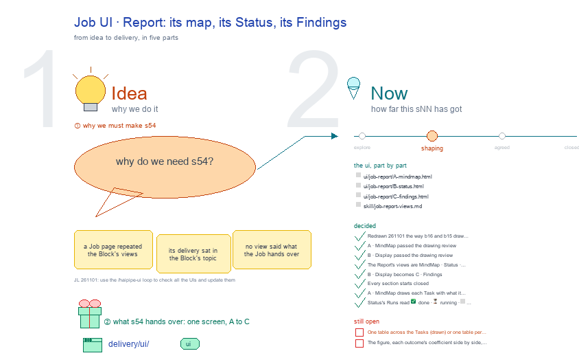

# s54 · Job UI: Report <!-- root #0114a9 -->

**Tags:** `Job UI`
**Stage:** shaping

- For <!-- @for #f78806 -->
  - a deck, and the work Job's Report … <!-- @for/0 #6bcbef -->
    a deck, and the work Job's Report screen on the focus page (`delivery/ui/job-report`), for the people who build the workbench
- Delivery type <!-- @delivery-type #58a44f -->
  - ui <!-- @delivery-type/0 #636117 -->
- Covers <!-- @covers #a6c44a -->
  - a Job's Report, as the live page … <!-- @covers/0 #13dc5a -->
    a Job's Report, as the live page draws it: A · MindMap (its topic, its Tasks, their Runs with their marks), B · Status (its Tasks, each opening to its Runs; its topics' stages), C · Findings when it has questions or takeaways (its takeaways); 🙋 Interaction each view's last section.
  - Red, kept proposals: one table across its … <!-- @covers/1 #21a16c -->
    Red, kept proposals: one table across its Tasks, the figure.
- Excluded <!-- @excluded #980495 -->
  - the other eight cells of the 3 … <!-- @excluded/0 #a5f0a1 -->
    the other eight cells of the 3 × 3 (j03's other sNN); what every work page shares (b17-s04).
- Topic <!-- @topic #7e13bd -->
  - A Job's Report: its map, its Status, … <!-- @topic/0 #983d8a -->
    A Job's Report: its map, its Status, its Findings; one cell of the work theme's 3 × 3, the work Job × Report (check) (JL 261031: "I think you should focus on the things like ... b16_theme_paper ... studio ...
  - UI and think about how you should … <!-- @topic/1 #bd6501 -->
    UI and think about how you should update the work_theme's workbench UI").
  - Its drawing is haipipe-studio's five parts, drawn … <!-- @topic/2 #6f9725 -->
    Its drawing is haipipe-studio's five parts, drawn by `build_s54_job_ui_report.py` through j03's `work_ui_cells.py`;
  - Its Design is its section's views, lettered … <!-- @topic/3 #7111ff -->
    Its Design is its section's views, lettered A, B …, each one full screen (haipipe-ui "one view, one screen"), every review round in `review/`.
- Feeds <!-- @feeds #ffe8e9 -->
  - none: a work Block keeps no Questions … <!-- @feeds/0 #bf8e2a -->
    none: a work Block keeps no Questions (JL 261031, r01 Q5)
- Files <!-- @files #6ce6c5 -->
  - [py] [build_s54_job_ui_report.py](build_s54_job_ui_report.py) <!-- @files/0 #672ece -->
  - delivery/ <!-- @files/1 #404761 -->
  - result/ <!-- @files/2 #d4a42c -->
  - review/ <!-- @files/3 #7928fb -->
  - [excalidraw] [s54-job-ui-report.excalidraw](s54-job-ui-report.excalidraw) <!-- @files/4 #e7ffe5 -->
  - [md] [s54-job-ui-report.md](s54-job-ui-report.md) <!-- @files/5 #a04945 -->
  - [png] [s54-job-ui-report.png](s54-job-ui-report.png) <!-- @files/6 #7d58ae -->
    
- Decided <!-- @decided #55615a -->
  - s54-D01 · Redrawn 261101 the way b16 … <!-- @decided/0 #a1aefc -->
    s54-D01 · Redrawn 261101 the way b16 and b15 draw theirs: each view one step of the work, input → who works → output, your part, then the results (JL 261101: "the UI you have here is not that good. please check" b16's Block UI and b15's Task UI); the steps are haipipe-task's life, plan ▶ build ▶ run ▶ read ▶ close (ref/lifecycle.md). The earlier screens' rounds stay in `review/` (r01, r02).
  - s54-D02 · A · MindMap passed the … <!-- @decided/1 #f348b5 -->
    s54-D02 · A · MindMap passed the drawing review (stage 1), mean 9.7/10 in `review/A-s1-r03.md` (rounds: `review/A-s1-r03.md`); today's page scored 8.1 and failed One job 5. Proposed by the agent; it waits for JL's one look in `runs/r01_collect_job_report_views` (261101).
  - s54-D03 · B · Display passed the … <!-- @decided/2 #f73092 -->
    s54-D03 · B · Display passed the drawing review (stage 1), mean 9.0/10 in `review/B-s1-r03.md` (rounds: `review/B-s1-r03.md`); today's page scored 8.1 and failed One job 5. Proposed by the agent; it waits for JL's one look in `runs/r01_collect_job_report_views` (261101).
  - s54-D04 · The Report's views are MindMap … <!-- @decided/3 #6bfc19 -->
    s54-D04 · The Report's views are MindMap · Status · Findings (Findings when it has questions or takeaways), drawn as the live page draws them (redrawn 261105). A · MindMap: its topic, its Tasks, their Runs with their marks; B · Status: its Tasks, each opening to its Runs; C · Findings: its takeaways.
  - s54-D05 · B · Display becomes C … <!-- @decided/4 #f09531 -->
    s54-D05 · B · Display becomes C · Findings: its delivery card leaves, since a delivery shows in the Block's Findings (asked 261104: "fold / merge the delivery to the Findings"), and What it found is the Job's takeaways. One table across the Tasks and the figure stay in red, as open proposals (261105).
  - s54-D06 · Every section starts closed (asked … <!-- @decided/5 #c3810c -->
    s54-D06 · Every section starts closed (asked 261104: "默认的话，大家都是合着的"); 🙋 Interaction is each view's last section (decided for this round, 261105).
- Open <!-- @open #cf9b77 -->
  - Your one look: `../runs/r01_collect_job_report_views` asks whether to … <!-- @open/0 #b5bacd -->
    Your one look: `../runs/r01_collect_job_report_views` asks whether to build the red table across the Tasks and the figure, beside today's page.
  - Still open after the redraw's reviews: <!-- @open/1 #b639b1 -->
  - One table across the Tasks (drawn) or … <!-- @open/2 #1fe63f -->
    One table across the Tasks (drawn) or one table per Task (r03 asks on B).
  - The figure, each outcome's coefficient side by … <!-- @open/3 #047286 -->
    The figure, each outcome's coefficient side by side, under the table (red on the drawing).
  - The earlier questions, my picks now drawn … <!-- @open/4 #1a45a1 -->
    The earlier questions, my picks now drawn in, are in `../runs/r01_collect_job_report_views/passes/p01-1031/` and the round 2 screens' form in `passes/p02-1101/`; the full proposal is `result/views-proposal.md`; the 261101 screens' form is in `passes/p03-1101/`.
